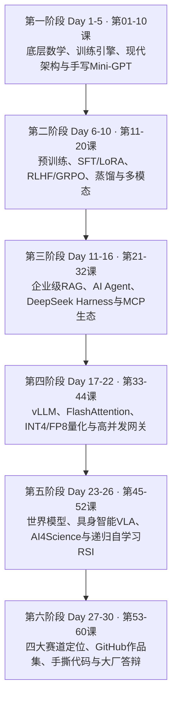

# 🚀 《30天从0转行AI：从小白到资深AI专家》全套开源知识库

> **B站主讲频道**：`Jackson的AI笔记`  
> **课程定位**：30 天 × 每天 2 节（早 07:00 + 晚 17:00）= **60 期硬核深度体系课**，每课 **25–30 分钟**。  
> **核心教学法**：**现象 👉 原理/本质 👉 通俗易懂/举例讲透 + 可运行 PyTorch 代码 + 踩坑避雷 + 大厂面试真题**。  
> **仓库用途**：全套 60 期课程共用开源仓库，持续同步每一课的**完整文字笔记、知识结构图（Mermaid）、可运行代码与面试速查卡**，欢迎 **Star ⭐ + Fork** 搭建属于你自己的 AI 知识体系！

---

## 🗺️ 30 天 60 期总知识架构图



---

## 📚 已更新课程目录（持续日更）

| 课次 | 日程 | 课程主题 | 核心知识点 | 笔记 & 结构图 | 实战代码 | B站置顶笔记 |
| :--- | :--- | :--- | :--- | :--- | :--- | :--- |
| **第 01 课** | Day 1 上 | 数学底层与神经网络本质 | 向量/余弦相似度、矩阵空间变换、`[B,T,D]` 广播与 Stride、XOR 折弯证明、Safe Softmax | [笔记与结构图](./lessons/Day01_L01_数学底层与神经网络/README.md) | [code_L01.py](./lessons/Day01_L01_数学底层与神经网络/code_L01.py) | [置顶评论](./lessons/Day01_L01_数学底层与神经网络/bilibili_pinned_comment.txt) |
| **第 02 课** | Day 1 下 | 机器学习核心引擎全解 | MSE/CE/KL/InfoNCE、高维地形与鞍点、手算链式法则、Autograd 显存账、SGD→AdamW→Muon | [笔记与结构图](./lessons/Day01_L02_损失函数与反向传播/README.md) | [code_L02.py](./lessons/Day01_L02_损失函数与反向传播/code_L02.py) | [置顶评论](./lessons/Day01_L02_损失函数与反向传播/bilibili_pinned_comment.txt) |
| **第 03 课** | Day 2 上 | 深层网络组件与 GPU 屋顶线 | Sigmoid→ReLU→GELU→SwiGLU、BN/LN/RMSNorm、ResNet→DeepSeek mHC、CNN 与 Roofline 算力账 | [笔记与结构图](./lessons/Day02_L03_激活残差卷积与GPU/README.md) | [code_L03.py](./lessons/Day02_L03_激活残差卷积与GPU/code_L03.py) | [置顶评论](./lessons/Day02_L03_激活残差卷积与GPU/bilibili_pinned_comment.txt) |
| **第 04 课** | Day 2 下 | Transformer 心脏与 KV Cache | BPE 分词、RoPE 旋转位置编码、Self-Attention 手算与 `/sqrt(d_k)`、KV Cache 显存公式、GQA/MLA | [笔记与结构图](./lessons/Day02_L04_Transformer与KVCache/README.md) | [code_L04.py](./lessons/Day02_L04_Transformer与KVCache/code_L04.py) | [置顶评论](./lessons/Day02_L04_Transformer与KVCache/bilibili_pinned_comment.txt) |
| **第 05 课** | Day 3 上 | 万亿现代架构与多卡并行 | DeepSeekMoE 细粒度路由与无辅助损失均衡、MTP 投机加速、Chinchilla 缩放律、DP/ZeRO/TP/PP/EP | [笔记与结构图](./lessons/Day03_L05_MoE缩放定律与多卡并行/README.md) | [code_L05.py](./lessons/Day03_L05_MoE缩放定律与多卡并行/code_L05.py) | [置顶评论](./lessons/Day03_L05_MoE缩放定律与多卡并行/bilibili_pinned_comment.txt) |

---

## 🛠️ 本地一键运行所有实战代码

```bash
git clone https://github.com/JJacksonchen/30-days-ai-expert.git
cd 30-days-ai-expert
pip install torch numpy
python lessons/Day01_L01_数学底层与神经网络/code_L01.py
```

---

## 📖 完整 60 期体系总课表

完整 60 期规划见 [SYLLABUS_60_LESSONS.md](./SYLLABUS_60_LESSONS.md)。

> 如果这套开源课程帮到了正在转行或进阶的你，欢迎点个 **Star ⭐** 并在 B 站视频下方打卡交流！
