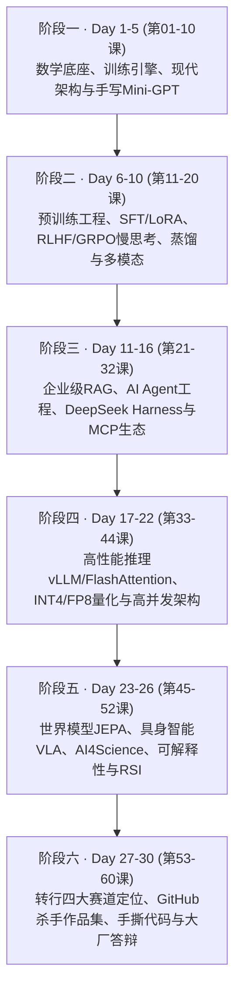

# 🚀 《从0转行AI大模型：30天60期硬核体系总课表》

> **B站主讲频道**：`Jackson的AI笔记`  
> **全套开源仓库（笔记 + 高清结构图 + 可运行代码 + 面试题库）**：https://github.com/JJacksonchen/30-days-ai-expert  
> **更新节奏**：**30 天 × 每天 2 节（早 07:00 + 晚 17:00）= 完整 60 期深度体系课**，每课 **25–30 分钟**。  
> **统一讲述逻辑**：每堂课严格遵守 **现象（痛点/奇观） 👉 原理/本质（数学公式与硬件规律） 👉 通俗易懂/举例讲透（生活类比 + 可运行代码 + 面试真题）**。

---

## 🗺️ 60 期六大进阶阶段总览

---

## 第一阶段（Day 1–5 · 第 01–10 课）：底层数学直觉、训练引擎、现代架构与手写 Mini-GPT
> **阶段目标**：彻底告别黑盒调包，能手算矩阵维度、显存与反向传播梯度，亲手从零写出可运行的 Mini-GPT。

| 课次 | 日程 | 统一 B 站标题 | 现象 👉 原理/本质 👉 举例与实战 |
| :--- | :--- | :--- | :--- |
| **第 01 课** | Day 1 上 | `从0转行AI大模型，第01课：一口气讲透向量矩阵、张量维度与神经网络本质（附PyTorch代码+开源笔记）` | 现象：调包侠一问Shape全懵 👉 原理：向量点积、矩阵空间变换、`[B,T,D]`广播与Stride、非线性折弯 👉 举例：属性体检表+揉纸团+5步代码破XOR |
| **第 02 课** | Day 1 下 | `从0转行AI大模型，第02课：手算反向传播链式法则！损失函数与SGD到AdamW、Muon优化器全解` | 现象：Loss飙NaN与显存OOM 👉 原理：MSE/CE/KL/InfoNCE、高维鞍点、链式法则与优化器数学 👉 举例：齿轮追责手算+手撕AdamW+排错三板斧 |
| **第 03 课** | Day 2 上 | `从0转行AI大模型，第03课：深度网络四大基石！SwiGLU、RMSNorm、残差mHC与GPU屋顶线算力真相` | 现象：56层训不动/H100聊天99%摸鱼 👉 原理：SwiGLU/RMSNorm/Pre-LN/mHC/CNN/Roofline脊点295 👉 举例：大厨切菜+手算4090吐字天花板+手写RMSNorm |
| **第 04 课** | Day 2 下 | `从0转行AI大模型，第04课：彻底吃透Transformer自注意力！RoPE位置编码、GQA/MLA与KV Cache显存算账` | 现象：数不清strawberry/长文并发爆卡 👉 原理：BPE/RoPE旋转内积/`/sqrt(d_k)`方差/KV显存公式/MLA 👉 举例：2048块手表+图书馆查书+40行全手撕 |
| **第 05 课** | Day 3 上 | `从0转行AI大模型，第05课：拆穿万亿大模型架构！DeepSeekMoE路由、MTP预测、缩放定律与多卡并行` | 现象：671B巨兽比70B还便宜 👉 原理：细粒度MoE+动态偏置/MTP投机/6ND缩放律/5D并行 👉 举例：医院分诊台+大律师配实习生+千人满汉全席+手撕MoE |
| **第 06 课** | Day 3 下 | `从0转行AI大模型，第06课：GPU显存外科解剖！PyTorch混合精度FP16/BF16/FP8与激活重计算实战` | 现象：14G模型训练撑爆80G卡 👉 原理：权重/梯度/优化器/激活四账单、Loss Scaling、Checkpointing 👉 举例：时间换空间账本+单卡省80%显存实战 |
| **第 07 课** | Day 4 上 | `从0转行AI大模型，第07课：数据决定大模型上限！清洗去重MinHash、数据配比与模型崩溃真相` | 现象：AI吃自己生成数据越训越傻 👉 原理：Model Collapse长尾截断、MinHash局部敏感哈希、数据配比 👉 举例：复印机反复复印失真+完整数据清洗流水线 |
| **第 08 课** | Day 4 下 | `从0转行AI大模型，第08课：告别玄学炼丹！学习率调度、Batch缩放律、正则化与Loss曲线诊断手册` | 现象：验证集突然反弹或Loss尖刺 👉 原理：WSD调度、线性/平方根缩放、Grokking顿悟与评价指标 👉 举例：10张真实Loss病历图逐张开药方 |
| **第 09 课** | Day 5 上 | `从0转行AI大模型，第09课：从RNN到扩散模型！一课讲透LSTM、VAE、Diffusion与Flow Matching去噪本质` | 现象：文生图/视频如何从纯噪点雕出大片 👉 原理：马尔可夫加噪去噪、UNet/DiT与流匹配直路运输 👉 举例：大理石雕像+手写极简去噪循环 |
| **第 10 课** | Day 5 下 | `从0转行AI大模型，第10课：【阶段实战】200行PyTorch从零手写可训练Mini-GPT！逐行精讲+上线跑通` | 现象：把前9课所有零件装进一台完整引擎 👉 原理：Tokenizer+RoPE+GQA+SwiGLU+采样生成闭环 👉 举例：从零训出能写诗/写代码的迷你大模型! |

---

## 第二阶段（Day 6–10 · 第 11–20 课）：大模型后训练（Post-Training）、对齐、慢思考与多模态
> **阶段目标**：掌握从“续写机”变成“听话且会深度推理的顶级助手”的全套工业后训练工艺。

| 课次 | 日程 | 统一 B 站标题 | 现象 👉 原理/本质 👉 举例与实战 |
| :--- | :--- | :--- | :--- |
| **第 11 课** | Day 6 上 | `从0转行AI大模型，第11课：万卡预训练工业全景！NCCL集合通信、DualPipe重叠与Loss Spike救火指南` | 现象：千卡集群掉速与午夜炸车 👉 原理：AllReduce/All-to-All拓扑、计算通信重叠、跳过毒批次 👉 举例：物流高速路网调度+真实救火日志复盘 |
| **第 12 课** | Day 6 下 | `从0转行AI大模型，第12课：微调必学！SFT指令微调与LoRA/QLoRA低秩矩阵原理（单卡微调实战）` | 现象：基座模型答非所问，全参微调买不起卡 👉 原理：对话模板Mask Loss、低秩分解`A@B`与4-bit NF4 👉 举例：给大百科贴便利贴+单张消费卡微调实战 |
| **第 13 课** | Day 7 上 | `从0转行AI大模型，第13课：让AI听懂人话！RLHF(PPO)四模型架构、奖励黑客陷阱与DPO数学化简` | 现象：AI为刷高分开始阿谀奉承废话连篇 👉 原理：Reward Hacking、PPO裁剪与KL拴狗绳、DPO隐式奖励 👉 举例：训犬防偷吃零食+20行代码实现DPO Loss |
| **第 14 课** | Day 7 下 | `从0转行AI大模型，第14课：慢思考革命！彻底讲透DeepSeek R1的GRPO算法与Test-Time Compute草稿纸` | 现象：模型突然自己说出「等等，我刚才算错了」 👉 原理：GRPO砍掉Critic组内相对优势、长度涌现与反思 👉 举例：班级模考按相对排名发奖+手写GRPO核心公式 |
| **第 15 课** | Day 8 上 | `从0转行AI大模型，第15课：模型蒸馏白盒与黑盒彻底分清！软标签温度T、KL散度与小模型越级实战` | 现象：7B小模型蒸馏后打爆70B老模型 👉 原理：白盒Logits暗知识 vs 黑盒思维链数据蒸馏、温度T平滑 👉 举例：学霸讲错题思路vs只抄ABCD答案+PyTorch实现 |
| **第 16 课** | Day 8 下 | `从0转行AI大模型，第16课：合成数据与铁面验证器！代码沙盒、单元测试与Lean 4如何锁死大模型幻觉` | 现象：互联网文本枯竭但AI还在狂涨智商 👉 原理：可验证奖励RLVR、生成器-验证器非对称性 👉 举例：出题难但验算1秒钟+自动化验证数据飞轮 |
| **第 17 课** | Day 9 上 | `从0转行AI大模型，第17课：攻克百万上下文！YaRN位置插值、Ring Attention与开源记忆救星Engram` | 现象：长文中间信息「大海捞针」失忆 👉 原理：RoPE频基外推、环状KV传递、DeepSeek Engram条件记忆 👉 举例：外挂查表字典vs脑内硬记+长文评测实战 |
| **第 18 课** | Day 9 下 | `从0转行AI大模型，第18课：大厂评测体系与刷榜防坑！数据污染检测、LLM-as-a-Judge与业务评测集搭建` | 现象：榜单第一的模型一进公司业务就翻车 👉 原理：Benchmark污染、裁判模型位置/长度偏见校准 👉 举例：防背题考试设计+搭建企业级自动化Eval流水线 |
| **第 19 课** | Day 10 上 | `从0转行AI大模型，第19课：多模态大模型底层原理！CLIP图文对齐、ViT切块与端到端统一视觉融合` | 现象：大模型如何一眼看懂复杂财报截图和手绘草图 👉 原理：ViT Patchify、InfoNCE对齐、Projector/原生多模态 👉 举例：把图片翻译成外语Token+多模态维度全追踪 |
| **第 20 课** | Day 10 下 | `从0转行AI大模型，第20课：【阶段实战】单卡LoRA+GRPO全流程复现一个领域专用慢思考推理小模型！` | 现象：从零炼出自己的「迷你R1」推理模型 👉 原理：数据构造+LoRA+可验证规则奖励+GRPO训练闭环 👉 举例：端到端完整脚本+前后能力对比评测 |

---

## 第三阶段（Day 11–16 · 第 21–32 课）：RAG、AI Agent 工程、DeepSeek Harness 与 MCP 生态
> **阶段目标**：直击当下招聘需求最旺盛的 AI 应用 / Agent 工程师核心技能树，能独立架构生产级智能体系统。

| 课次 | 日程 | 统一 B 站标题 | 现象 👉 原理/本质 👉 举例与实战 |
| :--- | :--- | :--- | :--- |
| **第 21 课** | Day 11 上 | `从0转行AI大模型，第21课：现代RAG底层原理！向量库HNSW图索引、BM25混合检索与Rerank重排` | 现象：企业知识库问答经常胡编乱造 👉 原理：跳表多层图HNSW近似检索、稀疏+稠密RRF融合、交叉编码器重排 👉 举例：先坐高铁再打车精准找书+完整Hybrid RAG代码 |
| **第 22 课** | Day 11 下 | `从0转行AI大模型，第22课：企业级RAG踩坑实录！复杂PDF表格解析、语义切块、GraphRAG与召回归因` | 现象：RAG准确率卡在70%死活上不去 👉 原理：版面恢复、父子索引切块、知识图谱跨文档跳查与错因拆解 👉 举例：医疗/法务复杂PDF实战排雷清单 |
| **第 23 课** | Day 12 上 | `从0转行AI大模型，第23课：告别玄学提示词！结构化输出约束解码、DSPy自动编译与SkillOpt技能自进化` | 现象：Prompt改一个标点线上业务全崩 👉 原理：JSON Schema有限状态机约束解码、把Prompt当代码编译优化 👉 举例：100%稳定吐JSON的底层原理+实战模板 |
| **第 24 课** | Day 12 下 | `从0转行AI大模型，第24课：AI Agent核心引擎！Function Calling协议、ReAct闭环与状态机编排` | 现象：Chatbot只会聊，Agent能自己查库发邮件 👉 原理：工具Schema注入、思考-行动-观察循环与有向图状态机 👉 举例：不调框架50行纯Python写出完整ReAct Agent |
| **第 25 课** | Day 13 上 | `从0转行AI大模型，第25课：彻底讲透Agent Harness！为什么Agent=Model+Harness？一切皆插件架构` | 现象：同样大模型，套上顶级外壳战力翻十倍 👉 原理：Harness外壳、插件隔离、`historylist`全链路追踪与Token控费 👉 举例：F1引擎配顶级底盘变速箱+DeepSeek Harness拆解 |
| **第 26 课** | Day 13 下 | `从0转行AI大模型，第26课：AI界的USB-C！MCP协议底层JSON-RPC通信、Server/Client开发与安全隔离` | 现象：每个模型接100个工具写100套胶水代码 👉 原理：M×N变M+N标准协议、stdio/SSE传输、工具资源提示词三原语 👉 举例：30行代码亲手写出一个可接入全平台的MCP Server |
| **第 27 课** | Day 14 上 | `从0转行AI大模型，第27课：安全沙箱与Computer Use！Docker/MicroVM隔离与浏览器GUI视觉操作原理` | 现象：Agent帮我执行rm -rf删库怎么办 👉 原理：容器/微虚拟机权限沙箱、DOM树+屏幕坐标点击闭环 👉 举例：给AI套防爆手套安全操作网页与终端 |
| **第 28 课** | Day 14 下 | `从0转行AI大模型，第28课：多智能体Multi-Agent协同架构！主控拆解、并行分工、交接协议与防死循环` | 现象：让5个Agent聊天结果互相夸了一小时烧光余额 👉 原理：Orchestrator-Worker拓扑、上下文隔离、最大步数与熔断仲裁 👉 举例：软件公司敏捷开发团队分工+防死锁设计 |
| **第 29 课** | Day 15 上 | `从0转行AI大模型，第29课：Coding Agent深度拆解！代码库AST索引、精准Diff编辑、自动跑测与工程边界` | 现象：AI编程助手如何一次改对十几个文件 👉 原理：树sitter语法树检索、Search/Replace补丁机制、测试驱动自愈循环 👉 举例：拆解顶级Coding Agent工作流与Vibe Coding红线 |
| **第 30 课** | Day 15 下 | `从0转行AI大模型，第30课：Agent记忆系统设计！短期上下文压缩、长期情景记忆与跨会话用户画像` | 现象：聊到第50轮Agent忘了最初目标且账单爆炸 👉 原理：滑动窗口+分层摘要、Episodic/Semantic双记忆库与遗忘机制 👉 举例：人脑工作记忆+笔记本+档案室三级记忆代码实现 |
| **第 31 课** | Day 16 上 | `从0转行AI大模型，第31课：生产级Agent稳定性！全链路Trace追踪、失败重试、成本护栏与人工审批闸门` | 现象：Demo惊艳一上线天天超时扣费客诉 👉 原理：OpenTelemetry Trace、指数退避、预算熔断与高危动作HITL审批 👉 举例：支付/删数据前强制弹窗确认的生产级架构 |
| **第 32 课** | Day 16 下 | `从0转行AI大模型，第32课：【阶段实战】从零打造带沙箱、MCP、记忆与Trace回放的企业级工程Agent！` | 现象：做出能直接写进简历的硬核Agent代表作 👉 原理：整合第21-31课全部组件端到端联调 👉 举例：完整GitHub可部署项目+架构演进复盘 |

---

## 第四阶段（Day 17–22 · 第 33–44 课）：高性能推理优化、量化部署与 AI 系统架构（AI Infra / MLOps）
> **阶段目标**：吃透大厂年薪百万最稀缺的 AI Infra 推理加速、省卡降本与高并发系统架构能力。

| 课次 | 日程 | 统一 B 站标题 | 现象 👉 原理/本质 👉 举例与实战 |
| :--- | :--- | :--- | :--- |
| **第 33 课** | Day 17 上 | `从0转行AI大模型，第33课：大模型推理性能瓶颈全解！Prefill与Decode分离、TTFT首字延迟与吞吐权衡` | 现象：首字等5秒或并发一高全员卡死 👉 原理：Compute-Bound vs Memory-Bound、Chunked Prefill、PD分离架构 👉 举例：餐厅点单配菜与上菜分两条线+指标压测解读 |
| **第 34 课** | Day 17 下 | `从0转行AI大模型，第34课：vLLM与PagedAttention封神原理！像操作系统虚拟内存一样管KV Cache` | 现象：传统推理显存浪费高达60%~80% 👉 原理：显存碎片化、非连续分页块表Block Table、Continuous Batching连续批处理 👉 举例：高铁动态补座+手写极简分页块管理器 |
| **第 35 课** | Day 18 上 | `从0转行AI大模型，第35课：FlashAttention硬件级加速！GPU SRAM分块平铺Tiling与在线Online Softmax` | 现象：不改一个数学结果，速度狂飙4倍显存省10倍 👉 原理：消灭`O(T^2)`HBM中间矩阵读写、分块动态更新最大值与分母 👉 举例：小案板分批切菜不跑大仓库+在线Softmax数学推导 |
| **第 36 课** | Day 18 下 | `从0转行AI大模型，第36课：模型量化彻底讲透！INT8/INT4/FP8、GPTQ与AWQ激活感知权重保护原理` | 现象：70B大模型压成1/4体积智商几乎零掉点 👉 原理：对称/非对称量化、离群值Outliers杀伤力、AWQ按激活缩放保核心通道 👉 举例：按重要程度保护1%关键柱子+手写INT4量化反量化 |
| **第 37 课** | Day 19 上 | `从0转行AI大模型，第37课：推理加速三大黑科技！投机采样Speculative Decoding、MTP协同与前缀缓存` | 现象：单用户吐字速度如何突破显卡显存带宽上限 👉 原理：小草稿模型+大模型并行无损拒绝采样、RadixAttention共享系统提示词 👉 举例：大律师审实习生草稿+多轮对话白嫖90% Prefill |
| **第 38 课** | Day 19 下 | `从0转行AI大模型，第38课：硬件选型与本地部署指南！4090/H100/Mac统一内存怎么挑？显存成本精确算账` | 现象：公司花一百万买错显卡血亏 👉 原理：带宽/算力/互联NVLink三维匹配、单并发vs高并发选型公式 👉 举例：3个真实企业预算场景手算最优买卡方案 |
| **第 39 课** | Day 20 上 | `从0转行AI大模型，第39课：高并发大模型网关设计！多模型智能路由、限流熔断、语义缓存与流式SSE` | 现象：简单问题全打昂贵旗舰模型每月多花几十万 👉 原理：难易分级Router、Token桶限流、向量语义缓存命中、SSE背压控制 👉 举例：大厂AI Gateway核心架构图与关键代码 |
| **第 40 课** | Day 20 下 | `从0转行AI大模型，第40课：AI应用安全攻防实战！提示词注入Prompt Injection、越狱、脱敏与合规护栏` | 现象：一句「忽略之前指令」套出系统提示词和用户隐私 👉 原理：指令与数据平面混淆、双模型安全护栏Guardrails、PII实时脱敏 👉 举例：AI界的SQL注入攻防演示+三层防线代码 |
| **第 41 课** | Day 21 上 | `从0转行AI大模型，第41课：实时语音与视频交互架构！端到端语音流、低延迟VAD与全双工打断原理` | 现象：为什么有的语音AI反应慢3秒，顶级语音能秒打断 👉 原理：级联ASR-LLM-TTS vs 原生端到端Audio Token、流式分片与声学回声消除 👉 举例：拆解500ms以内超低延迟语音管道 |
| **第 42 课** | Day 21 下 | `从0转行AI大模型，第42课：端侧AI与边缘计算！手机/PC端小模型压缩、llama.cpp/MLX与NPU加速真相` | 现象：断网手机和笔记本如何流畅跑本地私人大模型 👉 原理：GGUF格式、内存映射mmap、统一内存零拷贝与端云协同路由 👉 举例：本地隐私助理实战部署与实测对比 |
| **第 43 课** | Day 22 上 | `从0转行AI大模型，第43课：AI产品数据飞轮！线上埋点回收、坏例自动聚类、在线A/B测试与持续微调闭环` | 现象：产品上线后怎么越用越聪明甩开竞品 👉 原理：隐式反馈（修改/重试/采纳率）挖掘、难例回流SFT/DPO闭环 👉 举例：把真实线上吐槽自动炼成下一版高分训练数据 |
| **第 44 课** | Day 22 下 | `从0转行AI大模型，第44课：【阶段实战】部署一套支持千人并发的量化vLLM + 智能路由网关生产级服务！` | 现象：压测扛住千并发且单字成本暴降70% 👉 原理：vLLM AWQ + Prefix Cache + 路由网关 + Prometheus监控看板 👉 举例：完整压测报告与调优参数全公开 |

---

## 第五阶段（Day 23–26 · 第 45–52 课）：2026 前沿突破——世界模型、具身智能 VLA、科学 AI 与 RSI
> **阶段目标**：建立领先行业 1–2 年的前沿技术视野，看懂未来 5 年的超级增量机会，具备独立精读顶会论文能力。

| 课次 | 日程 | 统一 B 站标题 | 现象 👉 原理/本质 👉 举例与实战 |
| :--- | :--- | :--- | :--- |
| **第 45 课** | Day 23 上 | `从0转行AI大模型，第45课：世界模型World Models底层逻辑！视频生成物理因果与杨立昆JEPA架构全解` | 现象：纯文本大模型不懂倒水会洒、不懂重力碰撞 👉 原理：像素级预测浪费算力 vs 潜空间表征预测JEPA、反事实物理模拟 👉 举例：司机脑内预演刹车距离而非逐像素画树叶 |
| **第 46 课** | Day 23 下 | `从0转行AI大模型，第46课：具身智能与VLA视觉-语言-动作！动作Token化、Diffusion Policy与人形机器人` | 现象：机器人如何听懂「把桌上的苹果放进篮子」并流畅抓取 👉 原理：VLM底座+连续关节动作离散化/扩散动作头、快慢双系统控制 👉 举例：大脑规划(5Hz)+小脑稳手(200Hz)协同架构 |
| **第 47 课** | Day 24 上 | `从0转行AI大模型，第47课：具身导航VLN与Sim2Real！虚拟仿真器训练如何跨过真实世界物理鸿沟` | 现象：仿真器里走得飞起，放到真地板一脚踩滑摔倒 👉 原理：域随机化Domain Randomization、高保真物理引擎与真机微调 👉 举例：在1万种虚拟摩擦力/光照下魔鬼训练再上真机 |
| **第 48 课** | Day 24 下 | `从0转行AI大模型，第48课：AI for Science革命！AlphaFold蛋白质折叠原理、分子生成与自动化湿实验室` | 现象：困扰生物学50年的蛋白质三维结构被AI一夜破解 👉 原理：Evoformer多序列共进化注意力+SE(3)等变三维坐标模块 👉 举例：看进化家族笔记猜哪两个氨基酸拉着手+新药闭环 |
| **第 49 课** | Day 25 上 | `从0转行AI大模型，第49课：剖开神经网络黑盒！大模型可解释性与稀疏自编码器SAE如何找到「金门大桥神经元」` | 现象：调高一个神经元大模型就疯狂聊金门大桥 👉 原理：特征叠加假设Superposition、用超宽稀疏自编码器拆解单语义概念 👉 举例：给纠缠大脑做核磁共振精准定位与安全干预 |
| **第 50 课** | Day 25 下 | `从0转行AI大模型，第50课：递归自学习RSI前沿实证！AI改写自身源码、设计芯片与评估器天花板真相` | 现象：AI真的已经开始自己训练更强的下一代AI了吗 👉 原理：代码自优化(AIDE²)、芯片布局(AlphaChip)与外生验证器天花板 👉 举例：能自我迭代的边界与安全铁律清醒剖析 |
| **第 51 课** | Day 26 上 | `从0转行AI大模型，第51课：顶级AI论文30分钟精读法！如何快速拆透NeurIPS/DeepSeek论文并复现核心模块` | 现象：每天ArXiv发500篇论文根本看不过来 👉 原理：三遍漏斗精读法（图/公式/消融表）+ 抓核心增量Diff复现 👉 举例：现场30分钟实战解剖一篇最新顶会架构论文 |
| **第 52 课** | Day 26 下 | `从0转行AI大模型，第52课：看透AI行业商业模式与技术护城河！算力、基座、Harness与垂直应用价值分配` | 现象：为什么很多套壳AI产品半年就死，有的却狂赚十亿 👉 原理：模型商品化通缩规律、数据飞轮、工作流锁定与领域验证护城河 👉 举例：个人开发者与职场人选赛道/选公司的避坑雷达 |

---

## 第六阶段（Day 27–30 · 第 53–60 课）：资深 AI 工程师求职转行、杀手作品集与大厂面试答辩
> **阶段目标**：把前 26 天学到的全部硬核知识转化为高薪 Offer——精准定岗、打磨简历作品集、手撕代码与系统设计全通关！

| 课次 | 日程 | 统一 B 站标题 | 现象 👉 原理/本质 👉 举例与实战 |
| :--- | :--- | :--- | :--- |
| **第 53 课** | Day 27 上 | `从0转行AI大模型，第53课：转行AI四大黄金赛道定位！算法研发、Agent工程、推理Infra与数据评测怎么选` | 现象：盲目海投全挂，不知自己适合哪个AI岗 👉 原理：4大岗位能力矩阵、薪资天花板、学历门槛与传统背景迁移路径 👉 举例：后端/前端/测试/产品/非科班精准对号入座图 |
| **第 54 课** | Day 27 下 | `从0转行AI大模型，第54课：打造杀手级GitHub作品集！3个让大厂面试官眼前一亮的Senior级AI项目包装` | 现象：简历写满「调API做聊天机器人」直接初筛淘汰 👉 原理：量化评测指标+架构权衡+压测数据+踩坑复盘四件套 👉 举例：把普通RAG/微调Demo改造成大厂级硬核项目全示范 |
| **第 55 课** | Day 28 上 | `从0转行AI大模型，第55课：大厂AI面试高频手撕题（上）！Attention/GQA/RoPE/LoRA/Beam Search白板精讲` | 现象：聊原理头头是道，白板一敲代码就卡死 👉 原理：手撕题高频考点模板与边界条件防错口诀 👉 举例：6道最高频手撕题逐行白板通关演练 |
| **第 56 课** | Day 28 下 | `从0转行AI大模型，第56课：大厂AI面试高频八股深挖（下）！显存算账、Loss排查、RLHF与RAG幻觉标准框架` | 现象：面试官三连追问「为什么」瞬间被问穿 👉 原理：现象+数学公式+几何直觉+工程取舍四段式高分模板 👉 举例：20道大厂终面杀手连环追问逐题拆解 |
| **第 57 课** | Day 29 上 | `从0转行AI大模型，第57课：AI系统设计面试实战！现场架构千万日活智能客服、企业知识库与编程Agent平台` | 现象：高级岗/Senior定级全看System Design 👉 原理：需求澄清->算力/QPS估算->离线/在线架构->降级与评测全流程 👉 举例：三大真实大厂系统设计白板画图全通关 |
| **第 58 课** | Day 29 下 | `从0转行AI大模型，第58课：转行简历精修与面试反客为主！如何把非AI过往经历包装成稀缺复合优势` | 现象：跨行没直接AI头衔怎么过HR和总监关 👉 原理：STAR法则+业务ROI翻译+高并发/工程稳定性迁移叙事 👉 举例：3份真实跨行简历改造前后逐行对比 |
| **第 59 课** | Day 30 上 | `从0转行AI大模型，第59课：资深AI专家的长期进化系统！如何构建个人知识库，永不被工具迭代淘汰` | 现象：AI每周出100个新开源项目越学越焦虑 👉 原理：区分「永恒底层规律」与「短期工具壳」、搭建最小信息源雷达 👉 举例：一线大厂Staff工程师的每周学习与复盘工作流 |
| **第 60 课** | Day 30 下 | `从0转行AI大模型，第60课：【结业大考】30天全景知识大串联！从第一个向量到万亿智能体的完整认知大厦` | 现象：60期全部通关，零散知识点融会贯通成一体 👉 原理：一张超级全景图串起硬件/数学/架构/对齐/Agent/推理/前沿 👉 举例：60期终极自测通关考卷+持续进阶路线图! |
