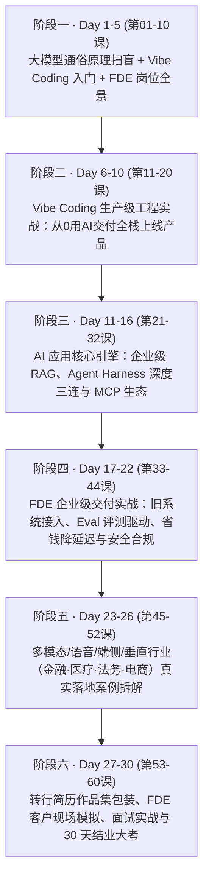

# 🚀 《从0转行AI大模型：AI应用工程师 & FDE 30天60期体系总课表》

> **B站主讲频道**：`Jackson的AI笔记`  
> **全套开源仓库（笔记 + 知识结构图 + 实战模板 + 面试题库）**：https://github.com/JJacksonchen/30-days-ai-expert  
> **课程定位**：**不面向学术算法岗，专为零基础/非科班/传统开发/产品转行「AI 应用工程师 & FDE（前置部署工程师）」量身打造！**  
> **核心讲法**：**零晦涩数学公式！严格按「现象 👉 底层本质 👉 生活中的鲜活例子讲透 + 直接拿来用的工程心法」**，30 天 × 每天 2 节 = 60 期，学完能用 Vibe Coding 独立做产品、能懂 Agent Harness / RAG / MCP、能胜任企业级 AI 落地！

---

## 🗺️ 60 期六大实战进阶阶段总览

---

## 第一阶段（Day 1–5 · 第 01–10 课）：大模型原理大白话扫盲 + Vibe Coding 破局 + FDE 认知建立
> **阶段目标**：不啃高数公式，用生活例子彻底摸清大模型脾气，上手 Vibe Coding，看懂 FDE 岗位为何年薪百万！

- **第 01 课（Day 1 上）**：`从0转行AI大模型，第01课：别再死磕算法了！AI应用工程师和FDE到底干啥？生活例子讲透大模型原理`
- **第 02 课（Day 1 下）**：`从0转行AI大模型，第02课：为什么AI有时聪明有时胡说？一课讲透幻觉、上下文腐化、温度与慢思考`
- **第 03 课（Day 2 上）**：`从0转行AI大模型，第03课：AI应用工程师怎么挑模型省90%钱？看懂MoE、KV缓存、API算账与选型策略`
- **第 04 课（Day 2 下）**：`从0转行AI大模型，第04课：彻底告别手敲代码！Vibe Coding实战心法：零基础如何用AI做出上线级产品`
- **第 05 课（Day 3 上）**：`从0转行AI大模型，第05课：年薪百万最火新岗FDE全揭秘！前置部署工程师如何把AI真正落地进企业`
- **第 06 课（Day 3 下）**：`从0转行AI大模型，第06课：提示词不是聊天是「签合同」！结构化输出JSON、系统提示词与防翻车模板`
- **第 07 课（Day 4 上）**：`从0转行AI大模型，第07课：AI应用开发零门槛环境搭建！API密钥安全、SDK调用、流式打字机与计费监控`
- **第 08 课（Day 4 下）**：`从0转行AI大模型，第08课：什么时候该用提示词、什么时候用RAG、什么时候才要微调？一图终结选型纠结`
- **第 09 课（Day 5 上）**：`从0转行AI大模型，第09课：开源模型vs闭源模型怎么选？本地Ollama/MLX离线部署与隐私红线实操`
- **第 10 课（Day 5 下）**：`从0转行AI大模型，第10课：【阶段实战】30分钟用Vibe Coding做出你的第一个能公网访问的AI应用！`

## 第二阶段（Day 6–10 · 第 11–20 课）：Vibe Coding 生产级全栈工程实战（告别玩具 Demo！）
- **第 11 课（Day 6 上）**：`从0转行AI大模型，第11课：Vibe Coding工具全家桶横评！Cursor、Claude Code、Antigravity、Windsurf怎么分工`
- **第 12 课（Day 6 下）**：`从0转行AI大模型，第12课：为什么AI写代码越改越乱？用「5步文档驱动法」彻底治好AI改错死循环`
- **第 13 课（Day 7 上）**：`从0转行AI大模型，第13课：写好.cursorrules与项目规则文件！让AI一进仓库就秒懂你的架构与代码品味`
- **第 14 课（Day 7 下）**：`从0转行AI大模型，第14课：零基础看懂前后端与数据库！用餐厅前厅后厨故事秒懂API、Supabase与鉴权`
- **第 15 课（Day 8 上）**：`从0转行AI大模型，第15课：Git是Vibe Coding的唯一后悔药！零基础3分钟学会分支、回滚与防AI改坏仓库`
- **第 16 课（Day 8 下）**：`从0转行AI大模型，第16课：测试驱动的Vibe Coding！让AI先写验收测试再写代码，自己把Bug修到全绿`
- **第 17 课（Day 9 上）**：`从0转行AI大模型，第17课：AI写的前端太丑像模板？5招视觉参考图+设计规范让AI画出大厂级高级UI`
- **第 18 课（Day 9 下）**：`从0转行AI大模型，第18课：零基础避开AI安全大坑！防密钥泄露、防SQL注入、防刷爆账单的上线前安检清单`
- **第 19 课（Day 10 上）**：`从0转行AI大模型，第19课：一键部署上线全流程！Vercel/Cloudflare/Docker让全世界打开你的AI网站`
- **第 20 课（Day 10 下）**：`从0转行AI大模型，第20课：【阶段实战】用Vibe Coding从0上线一套带登录、支付与AI能力的完整SaaS产品！`

## 第三阶段（Day 11–16 · 第 21–32 课）：AI 应用核心引擎——企业级 RAG、Agent Harness 深度三连与 MCP 生态
- **第 21 课（Day 11 上）**：`从0转行AI大模型，第21课：企业知识库RAG通俗全解！为什么直接把PDF扔给AI会瞎编？混合检索与重排原理`
- **第 22 课（Day 11 下）**：`从0转行AI大模型，第22课：企业级RAG落地踩坑实录！复杂表格PDF解析、父子切块、引用溯源与准确率翻倍`
- **第 23 课（Day 12 上）**：`从0转行AI大模型，第23课：从聊天机器人到干活数字员工！Function Calling工具调用与ReAct工作流拆解`
- **第 24 课（Day 12 下）**：`从0转行AI大模型，第24课：工作流编排(Dify/n8n) vs 代码Agent怎么选？什么时候该写死流程、什么时候交给AI自主`
- **第 25 课（Day 13 上）**：`从0转行AI大模型，第25课：Agent Harness深度精讲（上）！为什么Agent=Model+Harness？外壳哲学与一切皆插件`
- **第 26 课（Day 13 下）**：`从0转行AI大模型，第26课：Agent Harness深度精讲（中）！上下文工程、historylist全链路追踪与Token控费`
- **第 27 课（Day 14 上）**：`从0转行AI大模型，第27课：Agent Harness深度精讲（下）！铁面验证闭环、权限沙箱、Hooks护栏与评测迭代`
- **第 28 课（Day 14 下）**：`从0转行AI大模型，第28课：AI界的USB-C！MCP协议通俗全解：如何用标准化接口给AI插上任意企业系统`
- **第 29 课（Day 15 上）**：`从0转行AI大模型，第29课：手把手开发MCP Server！30分钟把公司数据库、飞书/钉钉与内部API安全接进Agent`
- **第 30 课（Day 15 下）**：`从0转行AI大模型，第30课：多智能体Multi-Agent与浏览器自动化！什么时候需要拆团队、怎么防止Agent无限烧钱死循环`
- **第 31 课（Day 16 上）**：`从0转行AI大模型，第31课：Agent记忆系统与高危审批闸门！让AI记住客户偏好，删库/付款前强制人工确认`
- **第 32 课（Day 16 下）**：`从0转行AI大模型，第32课：【阶段实战】打造一套带完整Harness、MCP、沙箱与人工审批的企业级自动化Agent！`

## 第四阶段（Day 17–22 · 第 33–44 课）：FDE（前置部署工程师）核心交付心法与企业级工程壁垒
- **第 33 课（Day 17 上）**：`从0转行AI大模型，第33课：FDE进场第一周干什么？业务现场调研、痛点拆解与避开「伪AI需求」天坑`
- **第 34 课（Day 17 下）**：`从0转行AI大模型，第34课：企业里全是烂摊子旧系统！FDE如何啃下遗留ERP/CRM、脏数据与权限隔离硬骨头`
- **第 35 课（Day 18 上）**：`从0转行AI大模型，第35课：没有评测就没有上线！FDE核心绝技Eval驱动开发：怎么用自动化考卷管住AI质量`
- **第 36 课（Day 18 下）**：`从0转行AI大模型，第36课：坏例分析Error Analysis实战！看懂Trace日志，把Agent成功率从60%一路拉到95%`
- **第 37 课（Day 19 上）**：`从0转行AI大模型，第37课：企业降本增效算账课！大小模型智能路由、前缀缓存与语义缓存让API账单直降80%`
- **第 38 课（Day 19 下）**：`从0转行AI大模型，第38课：老板嫌AI太慢怎么破？流式交互、并发拆解、乐观UI与低延迟工程优化大全`
- **第 39 课（Day 20 上）**：`从0转行AI大模型，第39课：企业级AI安全、脱敏与合规！防提示词注入、敏感数据不出内网与RBAC权限穿透`
- **第 40 课（Day 20 下）**：`从0转行AI大模型，第40课：FDE怎么跟业务老板和高管沟通？把技术指标翻译成省人头、提转化、降风险的ROI账单`
- **第 41 课（Day 21 上）**：`从0转行AI大模型，第41课：把一次定制交付沉淀成标准产品！FDE如何反哺研发团队，绝不当廉价外包驻场`
- **第 42 课（Day 21 下）**：`从0转行AI大模型，第42课：AI线上监控与数据飞轮！怎么自动回收用户点赞/修改日志，让系统越用越聪明`
- **第 43 课（Day 22 上）**：`从0转行AI大模型，第43课：私有化部署必懂常识！vLLM/量化/买卡预算估算，客户要纯内网部署怎么给方案`
- **第 44 课（Day 22 下）**：`从0转行AI大模型，第44课：【阶段实战】完整模拟一次FDE客户现场7天极限交付：从需求调研到上线验收汇报！`

## 第五阶段（Day 23–26 · 第 45–52 课）：多模态应用与四大高薪垂直行业真实落地方案拆解
- **第 45 课（Day 23 上）**：`从0转行AI大模型，第45课：多模态应用落地实战！财报截图解析、合同OCR核对与发票自动审单流水线`
- **第 46 课（Day 23 下）**：`从0转行AI大模型，第46课：实时语音AI客服与外呼系统！500毫秒超低延迟语音交互与随时打断架构拆解`
- **第 47 课（Day 24 上）**：`从0转行AI大模型，第47课：行业实战1——金融与法务AI落地：零幻觉强引用溯源、合规审计与尽调助手架构`
- **第 48 课（Day 24 下）**：`从0转行AI大模型，第48课：行业实战2——电商与营销AI落地：智能导购、爆款图文生成与售后工单全自动闭环`
- **第 49 课（Day 25 上）**：`从0转行AI大模型，第49课：行业实战3——制造与供应链AI落地：设备故障知识库、质检视觉协同与ERP自动排产`
- **第 50 课（Day 25 下）**：`从0转行AI大模型，第50课：行业实战4——研发效能与企业内部提效：代码审查Agent、BI自然语言查数(Text2SQL)`
- **第 51 课（Day 26 上）**：`从0转行AI大模型，第51课：看懂2026前沿趋势对应用层的冲击！长上下文、原生多模态与桌面Agent会淘汰哪些套壳`
- **第 52 课（Day 26 下）**：`从0转行AI大模型，第52课：个人超级个体与AI创业机会！不进大厂，怎么用Vibe Coding+Agent做高利润细分小产品`

## 第六阶段（Day 27–30 · 第 53–60 课）：从 0 转行 AI 应用工程师 / FDE 求职作品集与面试通关
- **第 53 课（Day 27 上）**：`从0转行AI大模型，第53课：转行AI应用层岗位全景图！AI应用开发、FDE、AI解决方案架构师、AI产品经理怎么选`
- **第 54 课（Day 27 下）**：`从0转行AI大模型，第54课：打造让面试官抢着发的作品集！3个能直接演示、带评测数据和在线地址的硬核项目包装`
- **第 55 课（Day 28 上）**：`从0转行AI大模型，第55课：AI应用工程师高频面试实战（上）！RAG调优、Agent循环控制、MCP与幻觉治理标准答法`
- **第 56 课（Day 28 下）**：`从0转行AI大模型，第56课：FDE现场系统设计面试实战（下）！现场拆解「如何帮传统大企业2周上线AI客服/知识库」`
- **第 57 课（Day 29 上）**：`从0转行AI大模型，第57课：跨行转AI简历精修课！后端、前端、测试、运维、产品、非科班怎么写出稀缺复合竞争力`
- **第 58 课（Day 29 下）**：`从0转行AI大模型，第58课：AI现场编程面试怎么破？带着Vibe Coding与工程架构思维，在机试与Code Review里降维打击`
- **第 59 课（Day 30 上）**：`从0转行AI大模型，第59课：AI时代永不被淘汰的进化系统！如何用最小精力跟上前沿，建立自己的复用工具库`
- **第 60 课（Day 30 下）**：`从0转行AI大模型，第60课：【结业大考】30天从0到AI应用工程师/FDE全景复盘！你的下一个高薪起点`
