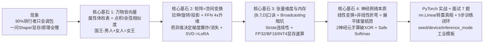

# 第 01 课（Day 1 上）：AI 数学底层、张量维度与神经网络本质

> **B站配套视频**：《30天从0转行AI｜向量、矩阵、张量维度与神经网络空间折弯本质（含PyTorch手写实战）》  
> **配套可运行源码**：[code_L01.py](./code_L01.py)

---

## 🧭 本课知识结构图（现象 👉 原理/本质 👉 举例讲透）

---

## 📌 核心公式与速查笔记

1. **点积与余弦相似度**
   - 点积：`a · b = sum(a_i * b_i) = |a| |b| cos(θ)`
   - 余弦相似度：`cos(θ) = (a · b) / (|a| * |b|)`，严格落在 `[-1, +1]`，屏蔽长短文本模长干扰。
2. **高维矩阵乘法三秒心算口诀**
   - **前面批次维度照抄，内侧两数相等消掉，外侧两数留下来**：`(B, H, T, d) @ (B, H, d, T) -> (B, H, T, T)`
3. **Broadcasting 广播两条死规则**
   - 从最右一维往左对齐：两数相等，或其中一个是 `1` 即可虚拟拉伸（零拷贝 `stride=0`）。
   - **头号暗坑**：`(N, 1) - (N,)` 会静默广播成 `(N, N)` 引发 OOM 和 Loss 算错！
4. **模型参数量与权重显存速算**
   - `Linear(in, out)` 参数量 = `in × out + out`（`bias=False` 时直接 `in × out`）。
   - 7B 模型权重显存：`FP32 = 28 GB`｜`BF16 = 14 GB`｜`INT8/FP8 = 7 GB`｜`INT4 = 3.5 GB`。
5. **Safe Softmax 防爆公式**
   - 先减最大值 `z_shift = z - z.max()`，再算 `exp(z_shift) / sum(exp(z_shift))`，彻底杜绝 `exp(90) -> inf -> NaN`！

---

## 🎯 大厂面试 7 道高频真题标准答法

1. **为什么必须加非线性激活函数？** 矩阵乘法封闭，无激活 100 层退化为单层线性；非线性激活折弯高维流形，使 XOR 等纠缠数据线性可分。
2. **点积 vs 余弦相似度？** 向量 L2 归一化后二者等价；不归一化时余弦免疫词频/文档长度干扰。
3. **`view()` vs `reshape()`？** 物理内存一维平铺靠 `stride` 跳表，`transpose` 后不连续导致 `view` 报错，`reshape` 必要时自动 copy。
4. **为何不用 Python for 循环？** 向量化消除解释器开销并打满 CPU SIMD / GPU Tensor Core，快 3000+ 倍。
5. **矩阵的秩与 LoRA 关系？** 微调增量 ΔW 天生低秩，拆成 `(D, r) @ (r, D)` 省 99%+ 参数。
6. **为何大模型训练选 BF16 而非 FP16？** BF16 保留和 FP32 一致的 8 位大指数范围，不易溢出变 NaN。
7. **Softmax 溢出怎么防？** 全员减 `max(z)`，数学等价且所有指数 `<= 0` 永不溢出。

---

## 💻 课后 10 分钟作业
1. 运行 `python code_L01.py`，观察 300 步内两层 MLP 完美攻克 1969 年 XOR 难题。
2. 手算 `nn.Linear(4096, 16384, bias=False)` 的参数量与 BF16 显存占用。
3. 故意写一次 `(1000, 1) - (1000,)` 观察静默广播生成的形状。
