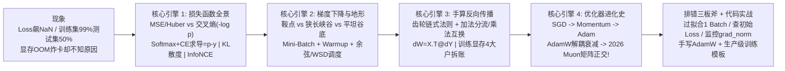

# 第 02 课（Day 1 下）：机器学习核心引擎——损失函数、反向传播与优化器进化

> **B站配套视频**：《30天从0转行AI｜损失函数选型、纯手算反向传播链式法则与SGD→AdamW→Muon优化器进化》  
> **配套可运行源码**：[code_L02.py](./code_L02.py)

---

## 🧭 本课知识结构图（现象 👉 原理/本质 👉 举例讲透）

---

## 📌 核心公式与速查笔记

1. **四大任务损失函数速查**
   - 回归：`MSE = mean((y_hat - y)^2)`（抗野点用 `Huber/SmoothL1`）
   - 分类 & 大模型预训练：`CE = -log(p_true)`，与 Softmax 合并求导极简：`dL/dz = p - y`（**千万别给 `nn.CrossEntropyLoss` 提前套 `softmax`！**）
   - 蒸馏 & RLHF/GRPO：`KL(P || Q) = H(P, Q) - H(P) >= 0`（不对称！）
   - 多模态 CLIP & RAG：`InfoNCE`（批内正样本拉近、负样本推远）
2. **矩阵反向传播黄金双公式**
   - 前向 `Y = X @ W` 👉 反向 `dL/dW = X^T @ dL/dY`，`dL/dX = dL/dY @ W^T`
3. **训练显存四大户（7B BF16 + AdamW 混合精度）**
   - 权重 `14 GB (2B)` + 梯度 `14 GB (2B)` + AdamW 状态 `84 GB (12B: FP32主权+m+v)` + 前向激活值（大头！靠 Activation Checkpointing 省 80%）
4. **优化器进化**
   - `AdamW` 把 Weight Decay 解耦到权重直乘（且对 1D Bias/Norm 豁免衰减）；
   - `Muon` 用 Newton-Schulz 正交化 2D 权重更新矩阵，2025–2026 预训练实测提效近 2x！
5. **排错三板斧**：① 只拿 1 个 Batch 关正则死磕到 Loss=0；② 检查第一步初始 Loss 是否 ≈ `-log(1/C)`；③ 监控 `grad_norm` 并开 `clip_grad_norm_(..., 1.0)`。
