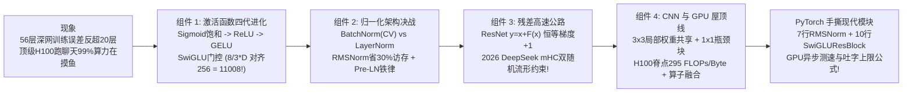

# 第 03 课（Day 2 上）：深度网络四大组件与 GPU 算力屋顶线真相

> **B站配套视频**：《30天从0转行AI｜激活函数SwiGLU、RMSNorm、ResNet到DeepSeek mHC、CNN与GPU屋顶线模型》  
> **配套可运行源码**：[code_L03.py](./code_L03.py)

---

## 🧭 本课知识结构图（现象 👉 原理/本质 👉 举例讲透）

---

## 📌 核心公式与速查笔记

1. **SwiGLU 隐藏维度对齐秘密**
   - 传统 FFN 两矩阵用 `4D`（`8D^2` 参）；SwiGLU 三矩阵（Gate/Up/Down）用 `8/3 * D`，并向上对齐 256 倍数（`D=4096 -> 11008`）吃满 GPU Tensor Core！
2. **RMSNorm 完胜 LayerNorm**
   - 去掉减均值 `μ` 和平移 `β`，只除以均方根 `sqrt(mean(x^2) + eps)`，显存访存暴省 30%+，LLaMA/Qwen/DeepSeek 全员标配。
3. **残差连接不死之谜 & DeepSeek mHC**
   - `y = x + F(x)` 求导出现 `+1` 直通项，保底梯度永不断链；2026 DeepSeek mHC 用双随机矩阵（行和=1、列和=1）稳住多车道超连接，千亿深网零爆炸！
4. **H100 屋顶线模型（Roofline Model）与吐字速度物理天花板**
   - H100 脊点：`989 TFLOPS / 3.35 TB/s ≈ 295 FLOPs/Byte`
   - **单并发大模型吐字上限** ≈ `GPU 显存带宽 / 模型权重体积`（如 4090 `1008 GB/s ÷ 14 GB ≈ 72 tok/s`）
   - Prefill 算力受限（Compute-Bound）；Decode 带宽受限（Memory-Bound）👉 破局靠大 Batching + INT4 量化 + 算子融合！
