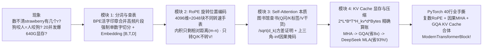

# 第 04 课（Day 2 下）：大语言模型心脏解剖——Transformer、RoPE 与 KV Cache

> **B站配套视频**：《30天从0转行AI｜彻底吃透Transformer自注意力、RoPE旋转位置编码、GQA/MLA与KV Cache显存算账》  
> **配套可运行源码**：[code_L04.py](./code_L04.py)

---

## 🧭 本课知识结构图（现象 👉 原理/本质 👉 举例讲透）

---

## 📌 核心公式与速查笔记

1. **缩放点积自注意力**
   - `Attention(Q, K, V) = Softmax( Q @ K^T / sqrt(d_k) + Mask ) @ V`
   - **为什么除以 `sqrt(d_k)`？** 点积方差随维度放大 `d_k` 倍，不缩放进 Softmax 会极端饱和梯度归零；除以 `sqrt(d_k)` 把方差拉回 `1.0`。
   - **为什么 Mask 填 `-inf` 而不是 `0`？** `exp(0) = 1` 仍分走概率，只有 `exp(-inf) = 0` 才彻底禁止偷看未来。
2. **RoPE 旋转位置编码**
   - `(R_m q) · (R_n k) = q^T R_{n-m} k`，天然编码相对距离 `m - n`，只作用在 Q 和 K，保持 V 纯净。
3. **KV Cache 显存精确公式**
   - `KV_Mem = 2 × Layers × Batch × SeqLen × (n_kv_heads × d_head) × Bytes`
   - 70B MHA 128K 单用户就要 **335 GB** 👉 GQA 降 8 倍到 **42 GB** 👉 **DeepSeek MLA 低秩潜在压缩暴省 93%+**，再配 2026 CSA+HCA 攻克 1M 百万上下文！
