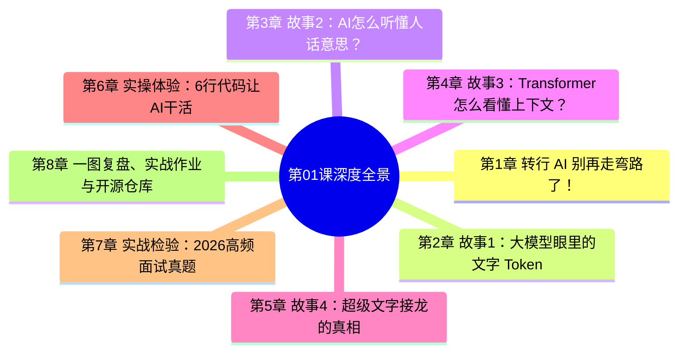

# 《从0转行AI大模型》第01课：别再死磕算法了！AI应用工程师和FDE到底干啥？生活例子讲透大模型原理

> **完整 20–30 分钟深度大课同步笔记（共 8 大章节 · 35 个核心精讲模块）**  
> 教学法：**真实业务现象 -> 底层本质 -> 生活故事步步拆解 -> 工程避坑/代码实操 -> 2026 高频面试真题**

## 一、本课知识结构图（Mermaid）



## 二、分章节精讲与实战要点

### 第 1 章：转行 AI 别再走弯路了！

#### 第 01 课：转行 AI 别再 傻傻去卷算法岗了！

欢迎来到《从零转行 AI 大模型》三十天六十期系列体系课的第一堂大课！我是 Jackson。在咱们正式翻开第一页之前，我必须先帮你省下至少半年的无效焦虑和弯路：如果你不是名校人工智能博士、没有打算去实验室手推几十页偏导数从零训练基座大模型，请立刻合上那些满篇希腊字母的传统算法教材！今天全行业最缺人、薪资涨得最猛、同时也是普通人从零转行成功率最高的两条黄金赛道，根本不是算法研究岗，而是——**AI 应用工程师**，以及 2025 到 2026 年被 OpenAI、Anthropic 和全球大厂天价疯抢的超级新岗位：**FDE（前置部署工程师）**！

- 看清大局：造发动机(算法岗)只要1%人，把发动机装进业务赚钱(应用/FDE)要99%人!
- 彻底大白话：零晦涩公式，用 4 个超好记的生活故事步步拆穿大模型思考全过程!
- 真实可上手：从 0 逐行看懂企业级合同审核调用代码，打破所有编程恐惧!
- 硬核附赠：文末带 3 道 2026 高频面试真题拆解 + 开源 GitHub 仓库完整笔记!

#### 一句话看清转行大局： 造发动机 vs 用发动机赚大钱！

咱们先用生活里最直白的一组画面，把整个 AI 行业的人才分工一次性看透：**造汽车发动机 vs 开着顶配车队跑物流赚钱！** 像 OpenAI、Anthropic、DeepSeek、阿里通义这些超级巨头，每年花几十亿美金买几万张顶级显卡，招几百位全球顶尖博士，干的是「造出马力更猛、油耗更低的发动机（底层基座大模型）」的活——这就是传统算法研究岗，门槛极高、坑位极少，全球真正核心的预训练团队加起来也就几千人！可发动机造出来摆在展厅里，全中国几百万家银行、医院、电商、制造业工厂根本没法直接拿一台裸发动机去干活！谁来给发动机配底盘、接油箱、装刹车安全护栏、连上公司老数据库、真正帮企业降本增效赚到真金白银？就是咱们这门课的主角：**AI 应用工程师**和 **FDE 前置部署工程师**！

- **底层算法研发岗（极窄独木桥）**：核心工作：在实验室从零训练新发动机（基座大模型） / 真实门槛：名校硕博、顶会一作论文、深厚数学与 CUDA 功底 / 市场现状：全球只需要极少数顶尖科学家，坑位卷上天 / 普通人硬冲：啃半年高数公式，连大厂简历筛选都过不了!
- **AI 应用工程师 & FDE（百万级蓝海！）**：核心工作：摸透大模型脾气 + 用 Vibe Coding/Agent 落地业务 / 真实门槛：不考手推微积分，看重业务拆解、工程闭环与交付结果! / 2026 薪资：海外 OpenAI/Anthropic FDE 年薪冲到 35万~100万美元! / 国内大厂与独角兽全面扩招，普通人转行最稳、天花板最高的通道!

> **核心记忆点**：记住核心定位：咱们不需要亲手造发动机，但必须像顶级 F1 赛车手一样「彻底摸透发动机的每一分脾气」！

#### 四类普通人转行 AI： 你的过往经验全是隐藏外挂！

很多同学马上会问一个特别现实的问题：「老师，我现在是做后端的、或者做前端测试的、甚至是产品运营或零基础小白，我到底能不能转成 AI 应用工程师或 FDE？我原来干的活是不是全白费了？」答案是：**非但一点没白费，反而是你降维打击纯书呆子的超级护城河！** 咱们看看 2026 年真实拿到高薪 Offer 的四大转行人群画像：后端和全栈开发自带接口、数据库、排错和部署能力，补齐大模型工程底座最快；前端和移动端最懂交互体验，做流式界面和 Vibe Coding 原型天然顺手；产品、咨询和业务专家最懂客户真正愿意掏钱的痛点，以前卡在不会写代码，现在靠 AI 编程直接自己跑出闭环；哪怕你是纯零基础，只要按这 60 期路线踏踏实实做出三个带真实业务评测数据的上线作品，照样敲开高薪大门！

- **1. 传统后端 / 测试 / 运维**：天然会接口、数据库、日志排查；不用碰高数，直接学 RAG + Harness；最快 1~2 个月无缝切入 AI 应用岗；核心升级：从写死逻辑转向编排 Agent!
- **2. 前端 / UI / 客户端**：最懂用户体验与流式交互细节；配合 Vibe Coding 一人顶完整全栈队；AI 时代交互重构极度稀缺好前端；核心升级：补齐后端 API 与上下文工程!
- **3. 产品 / 运营 / 行业顾问**：最懂真实业务痛点与老板 ROI 账本；以前提需求干等研发排期两周；现在自己用 AI 两天搭出可运行 Demo；天然最适合冲向高薪 FDE 客户交付!
- **4. 零基础 / 应届转行小白**：没有旧包袱，直接学 2026 最新范式；前 10 课就能上线人生首个公网产品；靠 3 个真实开源作品集代替空口画饼；先切中小厂 AI 落地，再冲大厂高薪!

> **核心记忆点**：2026 年 AI 招聘早已过了比谁会背论文的阶段，企业只愿意为「能用 AI 把真业务跑通」的人付高薪！

#### 30 天 60 期实战成长路线： 零基础 -> AI 应用工程师 / FDE

那这三十天、整整六十期、每期二十分钟以上的超级体系课，咱们是怎么一步一步带你从零走到能独立交付企业项目、拿到高薪 Offer 的呢？我把整张 60 期成长地图摊开给你看，分成**四大黄金阶段**：**第一阶段（第 1 到 10 课）**，用生活故事把大模型原理、四大怪脾气、选型省钱、Vibe Coding 心法和 FDE 落地全扫盲干净，并手把手带你上线第一个公网 AI 应用；**第二阶段（第 11 到 20 课）**，Vibe Coding 工业级全栈实战，做出带登录、数据库、支付和自动化测试的真实 SaaS 产品；**第三阶段（第 21 到 32 课）**，猛攻企业级 RAG、**Agent Harness 深度三连专题**和手写公司级 MCP 协议服务；**第四阶段（第 33 到 60 课）**，FDE 现场七天交付模拟、评测监控省钱、金融医疗电商制造四大高薪行业案例，以及简历作品集与模拟面试全通关！

- **L01-L10 筑基起步｜原理扫盲 + 首秀上线**：摸清脾气、省钱选型、上线第1个AI应用
- **L11-L20 氛围全栈｜Vibe Coding 工业实战**：告别手敲代码，做出带登录支付的 SaaS!
- **L21-L32 数字员工｜RAG + Harness + MCP**：打造稳定干活、可控可审计的企业 Agent!
- **L33-L60 拿高薪｜FDE 交付 + 行业求职**：评测监控 + 四大行业案例 + 面试通关!

> **核心记忆点**：每一课的图文结构图、大白话笔记、提示词模板和可运行代码，全部开源同步在置顶评论的 GitHub 仓库里！

#### 今天第一课四大生活故事： 25 分钟彻底看透大模型大脑！

好，既然咱们今天定位清清楚楚——不造发动机，而是当最懂发动机脾气的顶级赛车手——那今天第一堂课的核心任务就非常明确：**用四个一听就笑、听完一辈子忘不掉的生活故事，把「大模型脑子里到底是怎么看字、怎么懂意思、怎么读长文、怎么吐答案」这四大底层真相彻底拆穿！** 然后咱们再用短短十行大白话代码，带你亲手看懂怎么在真实公司里调用大模型干活，最后拿三道 2026 年大厂面试高频真题现场检验你的功力！系好安全带，咱们直接进入第一个故事！

- **故事 1: 成语卡片｜Token 词元真相**：为啥 AI 数不清草莓几个 r + API 怎么算钱
- **故事 2: 口味打分卡｜向量与语义地图**：AI 怎么懂「充电」和「开机」是一家子
- **故事 3: 微信大群聊｜Transformer 自注意力**：1 秒看懂上下文与长文变蠢的底层根源
- **故事 4: 超级文字接龙｜概率预测与三步成长**：写草稿智商翻倍 + 6 行代码实战调通!

> **核心记忆点**：记住学习方法：听完每个故事，问自己一句「这能帮我在做 AI 应用时避开什么坑、省下多少钱？」

### 第 2 章：故事1：大模型眼里的文字 Token

#### 故事 1：为什么顶级 AI 经常数不清 strawberry 有几个 r？

咱们从全网笑得最多、同时也最能瞬间点醒新手的一个经典**现象**切入！如果你拿一个普通非推理模型去考它：英文单词 `strawberry`（草莓）里面一共有几个字母 `r`？或者把一句中文「人工智能改变世界」让它倒着一个字一个字念出来，又或者让它数清楚下面这段合同正文精确到个位数一共有多少个汉字——哪怕是平时能写奥赛代码、能写博士论文的顶级大模型，竟然经常一本正经地给你数错！很多外行一看就嘲笑：「连一年级小朋友数数都不会，还吹什么通用人工智能呢？」其实你彻底冤枉它了！揭开**底层本质**：大模型压根不是像人类眼睛一样「一个字母一个字母、一笔一画」看文字的，它在进门第零秒，就把所有文字全切碎成了整数编号——这就是 **Token（词元）**！

- **生活例子：老外背「成语卡片编号」**：有个外国朋友学中文，根本不认识单个偏旁笔画 / 他把常见词整块印成带编号的扑克牌卡片： / 「草莓」= 88号卡，「人工智能」= 520号卡 / 你突然问他「520号卡片里共有几撇几捺」？他瞬间蒙圈!
- **大模型底层真相：万物先切 Token 编号!**：你输入的每句话，进模型前先过「切词器 (Tokenizer)」 / strawberry 在模型眼里只是 [496, 675, 15717] 三个整数! / 它压根没见过单个字母 s-t-r-a-w-b-e-r-r-y! / 让它数几个 r，相当于让它凭记忆背卡片里藏了几个字母!

> **核心记忆点**：大白话破案：AI 不是笨，而是它看世界用的「最小像素颗粒」不是单个字母，而是成块的词元卡片 Token！

#### 剥开切词器底层： 同样一段话，为啥有的省钱有的烧钱？

咱们再往深剥一层：切词器（Tokenizer）到底是怎么决定把一句话切成几张卡片的呢？生活里特别好理解——就像**「快递站给高频爆款商品提前做定制打包盒」**！词表就像快递站的货架，常见词比如「中国」「人工智能」「function」「return」，因为天天出现，直接给你印成**一张完整的整卡（1 个 Token）**，效率极高；而冷门生僻字、奇怪的火星文、或者超长乱码订单号，货架上根本没预制整盒，只能被迫拆成零碎的小零件甚至一个个字节去打包，一个字可能要吃掉 **2 到 3 个 Token**！而且最要命的是，不同大模型厂商的「预制卡片库（词表大小与语料比例）」完全不一样，这直接决定了你的真实账单！

- **英文高频词（极省）**：apple / python / server；整词直接打包成 1 张卡；大约 1 个 Token ≈ 0.75 个英文单词；1000 个英文单词 ≈ 1300 Token
- **中文高频词（看厂商!）**：DeepSeek / Qwen 中文语料极多；「人工智能」「合同」常压成 1 卡!；1000 汉字仅耗约 600~800 Token；早期偏英文模型可能暴耗 1800+ Token!
- **数字/空格/JSON（隐形刺客!）**：大堆缩进空格、重复 JSON 键名；长串随机 UUID、Base64 图片串；根本没法整块压缩，逐字符拆碎!；账单里经常 40% 钱花在无用格式符上!

> **核心记忆点**：工程实测真相：同样处理 100 万字中文合同，选中文压缩率高的国产模型光 Token 数量就能直接省下 30%~50%！

#### 看懂 API 真实计费账单： 同样 100 万字，哪些地方最烧钱？

我们直接来算一笔 2026 年真实企业项目里的 Token 账单，让你马上拥有资深 AI 应用工程师的「商业成本敏感度」！各大厂 API 定价全部采用**「输入 Token（你喂给 AI 读的字）+ 输出 Token（AI 吐出来写给你的字）」分开计费**，而且通常**输出 Token 比输入 Token 贵 3 到 5 倍**！为什么？因为你给 AI 看一万字背景材料，显卡可以一次性并行扫完（读题极快）；而 AI 往外吐字是一个字一个字逐个接龙算出来的，占着昂贵的显卡显存带宽慢慢磨，成本高得多！所以做企业应用时，既要精简输入废话，更要管住 AI 的嘴——别让它动不动给你写三千字「好的，非常感谢您的提问，接下来我将分八点为您详细阐述……」的废话文学！

- **冗长重复的系统提示词与历史对话 (52%)**：最大冤大头 -> 靠前缀缓存 + 摘要压缩立省 80%!
- **AI 爱写客套废话的超长输出 (贵3-5倍!) (28%)**：控制输出长度 + 紧凑 JSON 格式立省一半!
- **HTML 标签/乱码空格/未清洗网页脏数据 (14%)**：喂给 AI 前先用 5 行 Python 转成干净 Markdown!
- **真正有价值的业务核心问答 (6%)**：真正帮公司赚钱的有效载荷其实只占极小比例!

> **核心记忆点**：大白话省钱第一课：喂给 AI 之前先帮它洗菜（去 HTML 脏标签），输出要求直奔主题禁说客套话！

#### 懂了 Token 立刻避开 应用工程师三大价值十万的业务坑！

听透了「成语卡片（Token）」的底层，现在立刻给你总结 AI 应用开发里最值钱的三条实战避坑军规！第一条：**所有涉及精确计数、精确加减乘除、核对发票合计金额、校验 18 位身份证号或银行卡号、判断日期星期几的活，永远不要让大模型靠嘴硬猜！** 把语言理解交给大模型，把精确计算通过工具调用交给 3 行 Python 代码或者 SQL 数据库，100% 精准零翻车！第二条：**切长文档（做知识库 RAG）时，千万不要按「字符数」瞎切，最好按语义段落结合 Token 估算器来切**，避免把一个完整金额数字或专有名词硬生生腰斩成两半！第三条：**写接口代码永远要设好 `max_tokens`（最大输出上限）**，防止大模型万一抽风陷入复读机死循环，一口气给你吐几万字把账户余额全刷光！

- **[避坑警示]**：坑 1：直接让大模型心算 50 行报销单总金额、统计精确字数或校验手机号位数；坑 2：直接把满屏 <div> 标签的原始网页 HTML 塞给 AI -> 白烧 3 倍 Token 钱!；坑 3：调 API 不设 max_tokens 上限，遇到模型复读抽风一口气刷爆钱包!
- **[实战推荐]**：解 1：语言理解归大模型，精确算账/计数/日期核对一律交给工具代码 (Python/SQL)!；解 2：入模前用清洗脚本把网页转干净纯文本/Markdown，中文业务优选高压缩词表模型!；解 3：接口必配 max_tokens 硬上限 + 提示词里明确「严禁客套开场白，直接给结果」!

#### 故事 1 实战闭环： 从懂 Token 到立刻落地工程决策！

好，做个 10 秒钟小自检：现在如果产品经理跑过来问你「咱们的合同助手怎么把 10086.50 元加 2034.80 元算错了，是不是模型智商太低该换更贵的？」你就能胸有成竹地笑着用「成语卡片编号」给他讲明白：**不是模型不够贵，而是任何语言模型天生看的是词元卡片，算精确财务账必须挂载计算器工具！** 仅仅这一句话，你在团队里的专业度瞬间就拉开了跟普通玩家的代差！下面咱们进入第二个更神奇的故事！

- **看到现象｜数错字母 / 算错账单**：新手骂 AI 智障，盲目换更贵模型
- **看穿本质｜万物先切 Token 卡片**：模型眼里是整数编号，不是单个字符
- **工程解法｜语言归 AI，算账归代码**：挂 Python 计算器 + 清洗脏文本
- **直接收益｜准确率 100% + 省钱 40%**：零公式，用直觉做出顶级架构决策!

> **核心记忆点**：懂了 Token，咱们下一步解决最神奇的谜题：变成一堆数字编号后，电脑怎么知道谁和谁意思相近？

### 第 3 章：故事2：AI怎么听懂人话意思？

#### 故事 2：用「外卖口味打分卡」 一秒听懂向量 Embedding 与语义地图！

文字刚进大门变成了编号卡片：`橘猫` 是 1024 号，`金毛` 是 8872 号，`挖掘机` 是 1025 号。问题立刻来了！单看编号本身，1024 和 1025 挨得最近，难不成「橘猫」和「挖掘机」是亲戚，而和 8872 号「金毛」毫不相干吗？当然不是！那电脑只认识数字，它到底是怎么听懂「橘猫和金毛都是毛茸茸的宠物，挖掘机是工地铁家伙」的？靠的就是整个 AI 应用开发——尤其是企业知识库检索（RAG）里绝对的灵魂概念：**向量（Embedding）**！扔掉线性代数书，用生活里天天见的一个画面一秒钟吃透：**向量就是给每个词、每句话填的一张「外卖口味打分卡」**！

- **生活例子：外卖 App 比你妈还懂你**：外卖系统悄悄给每个人和每道菜填一张打分卡： / 你 = [爱吃辣9分, 爱吃甜2分, 爱夜宵8分, 爱重油7分] / 重庆毛血旺 = [辣9, 甜1, 夜宵9, 重油8] -> 天生绝配! / 草莓大福 = [辣0, 甜10, 夜宵3, 重油1] -> 毫无瓜葛!
- **大模型眼里的「高维语义大地图」**：大模型把每句话变成一张「1536 项属性的超级打分卡」! / 属性包含：是不是动物、有没温度、偏正式还是口语、金融还是医疗... / 意思相近的两句话，填完卡后在地图上紧紧挨在一起! / 你问「电脑充不进电」，说明书写「笔记本电源故障」-> 1秒精准匹配!

> **核心记忆点**：大白话记死：Token 是给文字发「身份证号」，向量 Embedding 是给文字发「灵魂性格体检表」！

#### 语义地图的三个 神级直觉（面试直接照着讲！）

顺着这张「口味打分卡」，你顺手就能把面试官最爱考、老教程写满一堆希腊字母的**「余弦相似度（Cosine Similarity）」**用十秒钟彻底秒杀！想象两位美食博主都在夸同一家火锅店特别正宗：博主 A 发了一条 6 个字的短评「巨辣巨香超好吃」，博主 B 写了 3000 字长篇大论从锅底夸到毛肚。如果只比字数多少（数学里叫向量长度/嗓门大小），他俩差了五百倍；但如果我们只看两人打分卡上**「指南针指向的方向」**——都是「极度喜爱 + 极度嗜辣」同一个朝向，夹角几乎是 `0` 度！大模型判断两段话像不像，就是看这张语义地图上两个指南针指得是不是同一个方向：**方向重合打 1 分（绝配），方向垂直打 0 分（毫不相干），方向相反打负 1 分（完全唱反调）！**

- **1. 只看方向不看嗓门**：短评和 3000 字长文聊同一主题；在地图上指南针方向完全重合!；行业黑话就叫「余弦相似度」；所以用 1 句短问题能精准搜出长文档!
- **2. 概念能沿路线加减推理**：国王 - 男人 + 女人 ≈ 女王；北京 - 中国 + 日本 ≈ 东京；AI 不是死背词典，而是记住了；词与词在地图上的「相对空间路线」!
- **3. 跨语言天生打通!**：中文「年假怎么请」和英文；Annual leave policy 落点紧挨着!；现代多语种向量模型自动对齐；中文提问直接搜出公司全英文 SOP!

> **核心记忆点**：没有一个公式，你已经把大学机器学习课讲两周的 Embedding + 余弦相似度彻底悟穿了！

#### 一秒悟通企业 RAG 命门： 为什么长文档绝不能整本建 1 张卡？

现在马上把这张「打分卡直觉」拉进真实企业项目！很多新手学完向量，兴冲冲把公司一本 **500 页的员工手册 PDF** 一整本塞进向量模型，压成「1 张打分卡」存进向量数据库。结果一上线老板骂翻了：不管员工问报销、问年假、还是问加班餐补，系统啥也搜不准！为什么？你想想「口味打分卡」就瞬间笑了：**如果你把川菜、粤菜、东北炖菜、法式甜品一百道菜全倒进一口大铁锅搅成一锅糊糊，最后填出来的打分卡每一项全是「5分不咸不淡不甜不辣」，谁跟它都不像！** 这就是企业级知识库（RAG）第一条生死线：**长文档必须按语义章节「切小块（Chunking）」，而且相邻两块要留 10% 到 20% 的「重叠边（Overlap）」，防止关键句子刚好被一刀劈在正中间！**

- **整本 500 页压成 1 张卡（一锅大杂烩）**：里面同时有报销、请假、电脑维修、食堂菜谱 / 所有语义特征互相平均抵消 -> 变成一张「平庸废卡」! / 员工搜「出差高铁票怎么报销」-> 相似度全低于 0.3! / 哪怕真搜出来了，500 页全塞给 AI 账单当场炸锅!
- **按章节切小块 + 留重叠边（图书馆索引卡!）**：每 300~500 字独立逻辑段落建 1 张高纯度打分卡! / 「差旅报销卡」「年假规则卡」各自特征锋利无比! / 每块首尾重叠 50~80 字，绝不把关键金额条款一刀劈断! / 提问时只把最准的 Top 3~5 张小卡片递给大模型作答!

> **核心记忆点**：看！你根本还没写一行 RAG 代码，就已经凭生活直觉悟透了「文档切块 + 滑动重叠窗口」的核心原理！

#### 企业知识库搜索避坑： 为什么不能只靠纯向量搜索？

再送你一个在 2026 年做企业知识库搜索时、能直接把召回率从 65% 拉升到 92% 的真·资深工程师秘籍：**千万别迷信「纯向量语义搜索」包打天下！** 向量搜索有个天然死穴：它太懂模糊意思，反而不擅长精确找「生僻编号、型号、人名、错误码」！比如公司售后工程师搜「`ERR_5092_B` 故障怎么修」，或者采购员搜「型号 `XJ-980K` 阀门报价」，向量模型压根没见过这种冷门型号，可能会自作聪明给你搜出 `XJ-980A` 或 `ERR_5091` 的文档，害死一线员工！真正大厂生产级标准答案叫做**「混合检索（Hybrid Search = 传统关键词精确匹配 BM25 + 向量语义搜索 + 精排模型 Rerank）」**——相当于同时雇了「死认字眼的图书管理员」和「听懂弦外之音的语义专家」，两人各交一批候选，最后让总裁判打分挑出前 5 名！

- **[避坑警示]**：只上纯向量搜索 -> 搜精确产品型号 XJ-980K、错误码 ERR_5092 经常张冠李戴!；只上老式关键词搜索 (Ctrl+F) -> 用户搜「笔记本没电」，文档写「电源故障」直接查无此项!；把搜出来的前 20 条粗排结果不做筛选全扔给大模型 -> 上下文塞满噪声!
- **[实战推荐]**：1. 关键词精确检索 (BM25)：死锁型号、人名、发票号、专有代码，100% 精准!；2. 向量语义检索 (Embedding)：专治口语提问、同义词替换、跨语言模糊查找!；3. 双路合并 + 精排模型 (Reranker)：从 30 条候选里精挑最准 Top 5 喂给 AI!

#### 故事 2 全链路通关： 一张打分卡串联 4 大企业级检索核心！

做到这一步你是不是已经开始爽起来了？你看，短短五分钟，靠一张「外卖口味打分卡」，咱们一路打通了**向量 Embedding -> 余弦相似度 -> 知识库切块 Overlap -> 生产级混合检索 + 精排**四层真功夫！后面第 21 到 24 课咱们会手把手用代码把这套企业级混合 RAG 亲手跑起来！现在带着这份底气，咱们直奔整个现代 AI 皇冠上的超级明珠——第三个故事！

- **1. 语义打分卡｜Embedding 向量化**：把文字变成高维特征坐标
- **2. 指南针比方向｜余弦相似度计算**：不怕篇幅长短，意思近就得分高
- **3. 切小块留重叠｜Chunking + Overlap**：防止 500 页糊成一锅平庸大杂烩
- **4. 混合检索精排｜BM25 + 向量 + Rerank**：既懂人话又死锁型号，企业落地标配!

> **核心记忆点**：问题升级：单个词有了静态打分卡，可同一个词在不同句子里意思完全不同，AI 怎么瞬间变身？

### 第 4 章：故事3：Transformer怎么看懂上下文？

#### 故事 3：旧时代 AI vs Transformer 30 秒彻底看懂自注意力机制！

来到今天第三个最核心的故事，揭开 2017 年谷歌发表、直接点燃整个 ChatGPT 和现代大模型时代的超级架构——**Transformer 与自注意力机制（Self-Attention）**！依然先看一个天天见的生活**现象**：请读下面这两句话——第一句「我刚啃了一口又脆又甜的红**苹果**」，第二句「我刚在门店买了一台最新款**苹果**手机」。注意啦！这两句话里的「苹果」两个字，刚进大模型大门时，拿到的「初始打分卡（静态向量）」是**百分之百一模一样**的！可大模型看一眼上下文，立刻就知道第一句里的苹果是水果、第二句里的苹果是科技公司！它脑子里到底施了什么魔术？

- **旧时代 AI（2017 前 RNN）：近视眼排队读**：像一个记性很差的近视眼，从左往右一个字一个字挪着看 / 读到第 500 个字时，前面第 1 个字早忘得干干净净! / 而且必须排队一个个算，后面字干等着前面，没法用显卡并行! / 结果：模型根本做不大，写到第三段就开始胡言乱语!
- **Transformer 革命：全员拉进微信大群聊!**：把整句话里所有词同时拉进同一个微信群，瞬间并发沟通! / 不用排队！显卡几千个核心一起开干，速度暴涨百倍! / 句子里哪怕相隔 10000 字的两个词，也能 1 秒直接私聊核对! / 靠群里互相借信息，每个词瞬间融进整句话的真实语境!

> **核心记忆点**：一句话讲穿 Transformer 为什么统治世界：既让所有词自由隔空互相核对语境，又完美解放了 GPU 并行算力！

#### 「去图书馆查资料」秒懂 Q / K / V： 苹果怎么 1 秒变身成手机？

那每个词进群之后，到底是怎么互相私聊借信息的呢？很多教程一上来就甩出 `Q`、`K`、`V` 三个大矩阵相乘把人吓跑，咱们用**「去图书馆找资料」**三秒钟演完！群里每个词同时扮演三个超直观的身份：**第一，`Q`（Query，提问条）**——「苹果」举起一张纸条大喊：「各位邻居，谁能告诉我我今天到底是水果还是手机？」**第二，`K`（Key，目录标签）**——周围每个词亮出自己的名牌：「脆甜」举牌写着「形容食物口感」，「手机」举牌写着「数码电子产品」，「的」「了」举牌写着「纯虚词没干货」；**第三，`V`（Value，核心干货内容）**——「苹果」拿自己的提问条跟所有人的名牌一碰，发现第二句里跟「手机」匹配度高达 95%，于是猛抄 95% 来自「手机」的数码干货，顺手抄 5% 来自「买」的消费干货——抄完这一轮，「苹果」这张打分卡就彻底华丽变身成了「苹果科技公司手机」！

- **1. 亮提问条 (Q)｜「苹果」发问**：我在这句话里到底是谁？谁跟我有关？
- **2. 碰目录签 (K)｜全场亮名牌**：「手机」=数码95分，「的」=虚词1分!
- **3. 抄真干货 (V)｜按权重借信息**：抄 95%「手机」属性 + 5%「购买」属性
- **4. 融合升级｜语境彻底清晰!**：「苹果」瞬间更新为「科技品牌手机」!

> **核心记忆点**：你看！传说中吓哭无数人的 Attention(Q,K,V)，拆开就是「发问找标签 -> 匹配度高就多抄它的干货」！

#### 为什么大模型能听懂「弦外之音」？ 多头专家组 + 几十层深度研讨！

而且真实大模型可不只做「1 次」群聊！它还有两个听名字很唬人、其实极其接地气的神操作：第一叫**「多头注意力（Multi-Head Attention）」**——好比你写完一篇年终总结，同时请了 **32 位不同视角的审稿专家**并行给你看：1 号专家专门盯着「主谓宾语法谁修饰谁」，2 号专家专门盯着「代词『它』到底指前面哪个人」，3 号专家专门感受「语气是在夸人还是阴阳怪气」，4 号专家专门抓「逻辑因果关系」！第二叫**「叠几十层深度（比如 60 到 96 层）」**——每一层都在上一层聊完的基础上再开一轮更深度的研讨会：前几层看懂字面词组，中间层看懂隐喻逻辑和代码结构，最顶层直接推理出深层战略意图！

- **多头注意力 = 多视角审稿**：不是 1 个人孤零零看句子；同时派几十个「头」分头盯不同线索；有的抓指代、有的抓情感、有的抓代码括号；拼在一起，细微反讽阴阳怪气全看穿!
- **叠几十层 = 逐级升维理解**：浅层（1~10层）：认清词组与基础语法；中层（20~50层）：理解因果、人物关系；深层（60+层）：推理复杂逻辑与架构设计；每过一层，对句子的理解就深一个次元!
- **位置编码 = 给座位发编号**：全员进群聊天有个小Bug：容易乱序!；「猫追狗」和「狗追猫」字一样意思相反；所以进群先发座位号 (如 RoPE 旋转位置)；AI 立刻知道谁在前、谁在后、隔了几排!

> **核心记忆点**：顺手连「多头注意力」和「位置编码 (RoPE)」也用两句大白话听懂了，以后看技术文章再也不发怵！

#### 微信群人数翻倍的代价： 为什么不要把垃圾全塞进上下文？

现在最关键的一步来了：**懂了「全员进微信群两两互相私聊」的画面，怎么直接转化为你在公司里的工程判断力？** 立刻回答一个价值十万的工程真相：**为什么你给大模型扔几百字指令它反应极快、极其听话，可一旦把十万字聊天记录、报错日志、旧代码全塞进同一个对话窗口，它不仅变慢、账单暴涨，而且智商断崖式下跌、连你最开头立的死规矩都忘得精光？** 拿微信群一算就明白了：10 个人的小群，两两互相核对只需聊 `10 × 10 = 100` 次，清清楚楚；可拉进 **10 万人的超级大群**，两两互相核对工作量暴涨到 **100 亿次**！更要命的是，每条真正有用的指令，全被 9 万 9 千条无关废话的刷屏彻底淹没稀释——这就是 2026 年 AI 应用圈头号大敌：**上下文腐化（Context Rot）**！

- **1,000 字精简指令 (4%)**：极快极准 · 注意力 100% 聚焦在核心任务上!
- **16,000 字干净参考资料 (28%)**：需配合前缀缓存省钱 + 重点放开头和结尾
- **100,000 字未经清洗大杂烩 (100%)**：废话刷屏严重稀释注意力 -> 关键指令被无视!

> **核心记忆点**：这就是 2026 最火的高薪技能「上下文工程 (Context Engineering)」：给 AI 喂最干净精准的信息，绝不倒垃圾！

#### 看穿「百万上下文」宣传： 2026 应用工程师的清醒操作！

顺便分享一个 2026 年最前沿的行业新动向（咱们课程所有信息都保持最新真实！）：为了让大模型读超长代码库和超长合同时不再算力爆炸，像 DeepSeek V3.2 和最新一代架构引入了**稀疏注意力（DSA）**、**多头潜在注意力压缩（MLA）**等黑科技——大白话讲就是「10 万人大群里不再傻傻地每个人跟所有人私聊，而是先派索引员快速挑出最相关的 200 人拉个VIP小群深聊」！虽然底层模型越来越能抗长文，但记住咱们应用工程师的铁律：**永远不要靠「赌模型能扛长文」来偷懒，主动做好上下文清理、按需检索和阶段摘要，你的系统永远比别人快三倍、便宜五倍、准一倍！**

- **[避坑警示]**：迷信宣传「支持100万字」，把公司所有文档每次全塞进 Prompt；跟 AI 聊完任务 A 不开新窗口，接着在同一个窗口聊任务 B、C、D；报错信息一粘贴就是 2000 行重复堆栈日志，把真正报错原因淹死!
- **[实战推荐]**：换新任务立刻开干净新会话，或者把前 20 轮总结成 5 行干净摘要!；长文档优先用 RAG 按需只抽最相关的 3~5 段，别整本硬塞!；贴报错日志时只贴核心 30 行报错 + 相关 2 个文件，AI 1 秒定位 Bug!

### 第 5 章：故事4：超级文字接龙的真相

#### 大模型唯一的底层动作： 一个字一个字地「超级概率接龙」

好，来到今天第四个、也是能让你**一通百通、彻底解释大模型一切神迹和一切怪癖**的终极故事！请你死死记住这句话：**不管今天的大模型看起来多像一个无所不知的超级博士、金牌程序员或心理咨询师，它从诞生到回答你最后一个字，干的唯一动作只有一个——「根据前面出现的所有字，预测下一个最可能出现的字（超级概率文字接龙）」！** 比如前面写了「床前明月」，整张神经网络算完后，给全词表十几万张卡片各自打一个概率分：「光」99.8%、「亮」0.1%、「挖掘机」0.00001%；它把「光」抽出来吐到屏幕上，立刻拼回上文变成「床前明月光」，再重新算下一个最可能的字「，」，就像一台超级打字机，一个字一个字循环接下去，直到吐出隐藏的「收笔结束符（EOS）」停手！

- **1. 读懂全部上文｜「床前明月」**：Transformer 群聊提取完整语境
- **2. 给词表打概率｜光99.8% / 亮0.1%**：给十几万张卡片算出下个字概率
- **3. 抽签吐出 1 字｜屏幕上蹦出「光」!**：立刻拼回上文变成「床前明月光」
- **4. 循环往复接龙｜接着猜下 1 个字**：一直吐到「结束符 EOS」才停笔!

> **核心记忆点**：别小看「猜下一个字」！为了把人类几十万亿字里的下个字都猜准，AI 被迫吃透了语法、逻辑、代码甚至物理常识！

#### 一秒悟透神级工程提分招： 为什么「先打草稿」能让 AI 智商翻倍？

神奇的事情来了！你只要真正吃透了「大模型是逐字接龙，且**必须先把字吐在纸上，下一步才能回头看见它**」，AI 应用工程里最神的一个实战绝招你当场自己就能发明出来！问你个问题：**为什么你让大模型直接报出一道复杂推理题或合同审核的最终结论「合规 / 违规」，它经常猜错；可只要你要求它「先分条写出思考分析过程，最后再给结论」，准确率立刻飙升 15% 到 30%？** 秘密极其简单！因为你逼它「只许直接说结论」时，它必须在吐第一个字那零点一秒内把整道难题一口气硬猜完；而你让它先写分析过程时，**它每写出一行中间分析，都立刻拼进了后面的上文里——相当于你给一位心算吃力的考生，发了一沓厚厚的草稿纸！**

- **逼它直接交卷（不许打草稿）**：指令：「判断这份合同合不合规，只许回复 是 或 否!」 / AI 只有吐出第 1 个字的瞬间，把整份合同风险硬算完 / 大脑根本来不及拆解条款冲突 -> 极易凭感觉盲猜翻车! / 哪怕返回 JSON 把 result 放第一行，也是逼它盲猜!
- **给它发草稿纸（先分析再下结论！）**：指令：JSON 里把 analysis(分析理由) 放在 verdict(结论) 前面! / AI 先逐条写出第 3 条押金隐患、第 7 条违约金风险 / 写到最后一行 verdict 时，前面草稿全摊在眼前 -> 1 秒判准! / OpenAI o3、DeepSeek R1 的「慢思考」就是把这招练成肌肉记忆!

> **核心记忆点**：价值十万的工程小技巧：做结构化 JSON 分类/审核时，永远把 reason 字段排在 result 字段前面！

#### 大模型三步成长记： 从「野孩子续写机」到「超级推理学霸」！

接着用三十秒讲透另一个新手老搞混的大问题：**只会傻傻续写文章的「野孩子接龙机」，是怎么一步步练成今天这么懂礼貌、会写代码、还会自我反思的超级学霸的？** 记住三个超好记的「成长上学阶段」！**第一步，通读全人类图书馆（预训练 Pre-training）**：花大钱让它把全网书籍、百科、代码全读几遍，只干一件事——练猜下一个字！毕业后它肚子装满学问，但完全不懂礼貌，你问「北京首都是哪？」它可能顺着给你续写「上海首都是哪？广州首都是哪？」！**第二步，名师礼仪示范课（监督微调 SFT）**：人类老师精选几万份高质量「好问好答」示范本给它模仿，它瞬间开窍：「哦！原来别人提问我是要当贴心助手回答的！」**第三步，赏罚分明刷真题（强化学习对齐 RLHF & RLVR）**：答得好发小红花、胡说八道扣重分，尤其是 2025 到 2026 年爆发的「可验证强化学习（RLVR）」——给它配自动数学验算器和代码编译器，做对给奖、报错重来，它自己竟然悟出了「等等，我刚才算错了，让我换个思路再验一遍」，**慢思考推理大模型就此横空出世！**

- **1. 通读图书馆 (预训练)**：啃完几十万亿字书籍与代码；唯一训练目标：猜下一个字；成果：学富五车、懂世界规律；缺点：不懂对话礼貌，只会瞎续写
- **2. 礼仪示范课 (微调 SFT)**：人类专家写几万份优质问答范本；教它按助手身份、按格式认真作答；成果：听话懂事、能写代码做总结；这就是大家熟悉的对话大模型!
- **3. 赏罚刷真题 (强化对齐)**：好答案发奖励，胡编违规扣重分；数学/代码题配自动编译器验真假；模型自己悟出「反思回溯打草稿」；DeepSeek R1 / o3 慢思考时代降临!

> **核心记忆点**：看！整本厚厚的大模型训练教材，三个上学成长故事全部讲透，完全够 AI 应用工程师受用终身！

#### 帮老板立省 50 万的核心认知： 什么时候用 RAG，什么时候才该微调？

学完「三步成长记」，你马上能帮公司老板省下几十万冤枉钱！几乎每个刚接触 AI 的传统企业老板，见面的第一句话都是：「小王啊，咱们把公司过去十年的财报和最新产品价格表拿去**微调（Fine-tuning）**一个咱们公司专属的大模型吧！」千万拦住他！用咱们刚讲的「上学故事」一秒讲清：**微调（SFT）好比给员工报「礼仪话术培训班」**，它是用来教模型「怎么按你们公司的语气说话、怎么输出固定工单格式」的，**极其不适合用来背每天都在变的最新产品价格表！** 一方面价格下周变了你还得重新花钱重训，另一方面闭卷背书依然极易瞎编幻觉！正确方案是什么？**把最新资料放进外挂知识库（RAG），让大模型「开卷翻书作答」——95% 的企业项目，靠「提示词工程 + 上下文工程 + RAG」根本不需要微调，一周就能跑出惊艳效果！**

- **外挂知识库 RAG（开卷翻书考试 · 95% 场景！）**：适合：产品价格表、制度文档、每天更新的实时新闻与客户数据 / 改资料只需 1 秒更新文档，不用重新花钱训练模型! / 每句回答都能精准标注出处页码，大幅压低瞎编幻觉! / 成本极低，1 个工程师三天就能搭出可用版本!
- **模型微调 Fine-tuning（报礼仪话术特训班 · 5% 场景）**：适合：固定行业黑话风格、极苛刻输出格式、把大模型能力蒸馏给小模型降本 / 痛点：准备高质量标注数据极贵、训完知识就凝固过时! / 黄金铁律：先用最强模型 + RAG + 提示词把业务跑通! / 真遇到超高并发要省算力钱时，最后再考虑微调小模型!

> **核心记忆点**：记住 2026 FDE 黄金决策树：补知识用 RAG，改风格/压成本/定格式才考虑微调，永远别一上来就盲目炼丹！

#### 四大底层拼图全部集齐！ 立刻切入真实公司级代码实战！

太爽了！到这一刻，你已经彻底拿下了 AI 应用工程师最核心的四块底层拼图：**成语卡片（Token）、口味打分卡（向量）、全员微信群（Transformer 自注意力）、超级文字接龙与三步成长（Next-Token + SFT/RL）**！是不是发现原来大模型一点都不神秘、甚至处处都有迹可循？接下来咱们立刻从「听故事」无缝切换到「实战动手」——打破你对写代码的最后一丝恐惧，亲眼看看 AI 应用工程师是怎么用短短几行代码指挥顶级大模型替公司干活的！

- **Token 词元｜看懂切词与计费**：算账交代码，清洗省一半钱
- **向量 Embedding｜看懂语义检索**：切块重叠 + 混合检索精排
- **Transformer｜看懂群聊上下文**：拒绝塞垃圾，严防上下文腐化
- **超级接龙｜看懂草稿与对齐**：先分析再结论，先 RAG 再微调!

> **核心记忆点**：接下来 5 分钟：手把手带你逐行拆解「企业级合同风险审核助手」的真实调用全过程！

### 第 6 章：实操体验：6行代码让AI干活

#### 破除编程恐惧： AI 应用工程师调用大模型只需 6 行！

很多零基础转行同学一听到「调 API 写代码」手心就开始冒汗，觉得那是黑客才懂的天书。今天咱们彻底祛魅！首先告诉你一个天大的好消息：**到了 2026 年，全行业不管是 OpenAI、DeepSeek、阿里通义千问、字节豆包还是本地开源模型，早就统一采用了同一套「点外卖下单格式（OpenAI 兼容 SDK）」！** 你只需要学会这一套 6 行代码，以后想换 DeepSeek 还是换 Qwen，只需要改一下 `base_url` 地址和 `model` 名字，一秒切换全宇宙大模型！下面咱们一行一行像读菜单一样把这 6 行代码彻底看穿！

```python
from openai import OpenAI
# 1. 填好外卖平台地址(base_url)和你的付款钥匙(api_key)
client = OpenAI(api_key='你的专属密钥', base_url='https://api.deepseek.com')
# 2. 下单：选好厨师(model) + 定好角色身份 + 抛出具体任务
resp = client.chat.completions.create(model='deepseek-chat', temperature=0.1, messages=[
    {'role': 'system', 'content': '你是资深租房合同顾问，先列风险条款再给最终建议'},
    {'role': 'user',   'content': '请审核这条：提前退租押金不退且需另付3个月违约金'}])
print(resp.choices[0].message.content)  # 拿到 AI 的专业回复!
```

> **核心记忆点**：看到没？后面第 04 课学了 Vibe Coding，连这 6 行都不用你手背，但你必须一眼看懂每一行在干嘛！

#### 看懂 messages 三大角色： 为什么多轮对话越聊越贵？

注意看刚刚代码里最核心的 `messages` 列表——里面藏着大模型对话世界里最重要的**「三种演员角色」**！第一个是 **`system`（导演兼岗位说明书）**：它站在最顶部，决定 AI 今天的身份、说话语气、绝对不能踩的红线和输出格式（比如「严禁编造法律条文，资料里没有就直说不知道」）；第二个是 **`user`（顾客或业务方）**：放每一次用户发来的新问题或待审核文档；第三个是 **`assistant`（AI 自己上一轮说的话）**：用来记录对话历史！这里有一个 **90% 新手第一天必踩的惊天真相**：**大模型 API 天生是「金鱼记忆（完全无状态 Stateless）」的！** 它压根不会在云端替你记住上一秒聊过啥！

- **1. system (岗位红线)**：放在 messages 最顶部第一条；定死角色、规则、格式与禁止事项；尽量保持固定不变 -> 吃满前缀缓存!；权重最高，相当于员工入职手册
- **2. user (用户新需求)**：每次放用户的真实提问或文档；严禁把用户输入直接拼进 system!；防止恶意用户搞「提示词注入越狱」；重要输出要求可在末尾再强调一次
- **3. assistant (历史记忆)**：API 本身是 7 秒记忆金鱼，不存历史!；想实现多轮聊天，必须由你的代码；把过去所有 user+assistant 全打包重发!；所以聊到第 50 轮，每次都要把前 49 轮重发一遍!

> **核心记忆点**：瞬间打通任督二脉！原来微信/ChatGPT 能记住你刚才说的话，是后台程序每次帮你把历史聊天全重新打包发给 AI！

#### 3 步升级成「公司生产级」： 环境变量 + 流式打字机 + 预算保险丝！

好，再往前迈一小步，看看**「玩具 Demo 代码」**和**「真正能放进公司里给客户用的生产级代码」**到底差哪三行！你看下面这份升级版代码：第一，**绝不能把 `api_key` 明文硬编码写死在代码里**，万一顺手传上 GitHub，十秒钟就被黑客脚本扫走刷爆信用卡！必须放进本地 `.env` 环境变量里！第二，**加上 `stream=True`（流式打字机输出）**，让用户 0.5 秒就看到第一个字蹦出来，而不是盯着转圈圈白屏傻等 15 秒！第三，**加上 `max_tokens` 预算保险丝和 `try/except` 异常兜底**，遇到网络抖动自动友好提示或重试，绝不让整个网站白屏崩溃！

```python
import os
from openai import OpenAI
# 1. 安全第一：从环境变量读取钥匙，绝不把密钥明文传上 GitHub!
client = OpenAI(api_key=os.getenv('DEEPSEEK_API_KEY'), base_url='https://api.deepseek.com')
# 2. 开启 stream=True 边算边吐 + max_tokens 预算保险丝 + 低温稳健输出
stream = client.chat.completions.create(model='deepseek-chat', temperature=0.1,
    max_tokens=800, stream=True, messages=[{'role':'system','content':'先列风险再给结论'},
    {'role':'user','content':'审核这份租房合同...'}])
for chunk in stream: print(chunk.choices[0].delta.content or '', end='', flush=True)
```

> **核心记忆点**：从第一天就养成「密钥放环境变量 + 开流式 + 设预算上限」三个好习惯，面试官看一眼你的 GitHub 就知道你是行家！

#### 全景串联：一个真实 AI 产品 后台到底是怎么跑起来的？

顺便再带你直观感受一下，当我们把「第一课刚学的全部原理」串进这个小小的租房合同助手后，完整的数据流在后台是怎么跑的！用户上传一份租房合同 PDF -> 先用清洗脚本剥掉页眉页脚（**省 Token**） -> 切成每条独立的条款卡片并建索引（**向量 + 混合检索**） -> 只把涉及「押金、违约金、维修责任」的最相关 4 条塞进干净的提示词窗口（**防上下文腐化**） -> 用 `temperature=0.1` 要求 AI 先逐条写出法律风险分析、最后再输出 JSON 评级（**草稿纸原理**） -> 金额计算交给 Python 核对（**工具调用防幻觉**） -> 流式推送到手机网页！你看，**全天下所有价值千万的企业级 AI 应用，剥掉华丽外衣，底层骨架全都是这一模一样的流水线！**

- **1. 清洗切块｜去杂质 + 按条款切卡**：省 40% Token，防止大杂烩
- **2. 精准检索｜混合检索挑 Top 4 条款**：开卷考试，桌面干净不腐化
- **3. 稳健推理｜低温 0.1 + 先分析再结论**：发草稿纸，准确率飙升!
- **4. 代码兜底｜Python 算账 + 流式展示**：零算术幻觉，0.5 秒丝滑呈现!

> **核心记忆点**：今天第一课还没结束，你脑子里已经长出了完整、清晰、可落地的「企业级 AI 应用全链路架构图」！

#### 零基础入门心态避坑： 先建全局地图，绝不卡死在第一天！

如果你电脑上今天还没装过 Python、完全不知道终端黑框框怎么打开，一丁点都别慌！咱们已经把 Mac 和 Windows 傻瓜式一键安装清单放进了置顶评论的开源 GitHub 仓库里，而且第 07 课我会专门手把手录屏带你十分钟把环境一次配通！今天第一课最宝贵的，是先让你的大脑彻底建立起**「正确、清晰、不迷信黑话的 AI 应用工程世界观」**！

- **[避坑警示]**：第一天就跑去死背 Python 几百个语法、或者去啃 PyTorch 底层源码；看到环境报错就怀疑自己没天赋，直接劝退放弃转行；只会收藏吃灰不建知识库，学完第 5 课忘了第 1 课!
- **[实战推荐]**：先花 5 天吃透 AI 应用全局地图、脾气、选型、Vibe Coding 与 FDE!；把置顶评论的开源 GitHub 仓库 Star 下来，每课配 1 张高清结构图!；碰到报错直接把报错截图/文本扔给 AI 助手，它就是你 24 小时免费私教!

### 第 7 章：实战检验：2026高频面试真题

#### 2026 面试真题 1（高频必考）： 怎么给老板讲清 AI 为啥数错字还爱瞎编？

既然咱们的终极目标是帮你成功转行拿高薪 Offer，从第一课开始，每一课结尾咱们都加入一个超级硬核的环节——**「2026 真实大厂 AI 应用 / FDE 面试灵魂三问」**！咱们现场检验一下，学完今天这 20 分钟，你已经能吊打多少半吊子候选人！**面试第 1 题（超高频！）**：面试官问：「请不用公式，用两分钟给咱们公司的非技术业务总裁讲明白，大模型为什么有时会数错字符、有时又会一本正经胡说八道，我们在业务里怎么防？」听听高分回答框架：**先用「成语卡片 Token」解释模型不看单字符所以数错；再用「概率接龙」解释它不是查数据库而是按顺口猜词所以会瞎编；最后立刻落回工程方案——算账计数挂工具代码、业务知识走 RAG 开卷考试并强迫标出处！** 业务听得懂、技术站得住，这一题直接满分！

- **普通候选人回答（听完面试官直摇头）**：「因为 BPE 分词算法导致子词切分粒度问题...」 / 「再加上自回归解码的采样方差引起分布偏移...」 / 全是教科书黑话，老板听得云里雾里! / 最致命：只讲原因，没给任何可落地的工程防线!
- **高薪 AI 应用 / FDE 满分回答（3 步法！）**：1. 讲人话：Token 像成语卡片看不到单字，接龙像考场怕交白卷所以顺口编! / 2. 给防线：精确计算/计数一律交给工具代码，知识问答一律走 RAG 开卷考试! / 3. 给底线：强迫输出标出处页码 + 允许 AI 直说「资料未提及」! / 面试官评价：懂底层、会沟通、能落地，妥妥 FDE 好苗子!

> **核心记忆点**：面试黄金公式：大白话比喻点破本质 (30秒) + 业务真实风险 (20秒) + 可落地工程解法 (60秒)！

#### 2026 面试真题 2： 2000 份每周更新文档，微调 vs 长窗口 vs RAG？

再看**面试第 2 题**：面试官抛出一个真实项目陷阱：「咱们现在要做公司内部客服知识库，文档有 2000 份，而且每周都在改价格政策。团队里有人建议直接把这些文档拿去微调（Fine-tuning）一个开源大模型，有人建议全部塞进 100 万字长上下文窗口，你怎么选？」用今天刚学的知识直接秒杀！**第一，果断否决盲目微调**：微调是报礼仪培训班改语气格式的，价格每周都变，微调成本高、更新慢还容易背错瞎编；**第二，果断否决无脑全塞百万上下文**：微信大群效应会导致算力暴涨、账单爆表且严重上下文腐化；**第三，亮出生产级王炸方案**：文档按语义切块留重叠边 -> 上**混合检索（BM25 关键词锁死型号价格 + 向量懂口语意图 + Rerank 精排）** -> 只喂最准的 5 段开卷作答！面试官当场眼神发光！

- **方案 A：拿去微调 [x]**：每周更新都要重新标数据重训；成本极高、上线周期太长；闭卷背价格表极易产生幻觉；结论：微调只改风格格式，不背实时数据!
- **方案 B：全塞百万窗口 [x]**：每次提问重读百万字，慢且极贵；引发严重上下文腐化 (大海丢针)；价格条款埋在中间极易看漏；结论：绝不拿长窗口当垃圾桶!
- **方案 C：混合 RAG [√ 满分]**：按段落切块 + 15% 重叠防断句；关键词锁型号 + 向量懂口语 + 精排；价格变了 1 秒更新索引，零重训!；回答强制附出处链接，省钱又精准!

> **核心记忆点**：记住：面试官最爱出这种「三选一工程权衡题」，拼的不是背公式，而是成本、准确率和维护性的综合判断！

#### 2026 面试真题 3（一招封神！）： 把两个 JSON 字段换个顺序，准确率暴涨 15%！

最后看**面试第 3 题（细节见真章！）**：面试官问：「我们上线了一个合同风险分类接口，让 AI 输出 JSON 字段 `{"is_risky": true, "reason": "..."}`，结果准确率只有 76%，换了更贵的模型也只涨到 79%，不换模型你有什么一分钟见效的优化绝招？」听完今天第四个故事的你，嘴角肯定已经微微上扬了！**答案一招封神**：把 JSON 里的字段顺序倒过来——改成 **`{"reason": "先逐条分析风险...", "is_risky": true}`**！因为大模型是逐字接龙的，把 `is_risky` 放前面等于逼它在吐第一个字时没打草稿硬蒙答案；把 `reason` 放前面等于强制它先把推理草稿写完、再看着草稿下结论！再配合把 `temperature` 降到 `0.1`、把核心判断红线放在 Prompt 开头和结尾，零成本准确率立刻冲上 90% 以上！

```python
// [x] 错误写法：逼 AI 没打草稿在第 1 个字硬蒙 true/false，错完后面理由还替错误硬圆!
{
  "is_risky": false,
  "reason": "因为前面已经猜了 false，AI 只能硬着头皮把风险条款洗白..."
}
// [√] 资深工程师写法：先强迫 AI 把分析草稿写出来，看着草稿再判 true/false!
{
  "reason": "第3条约定提前退租没收全部押金且另赔3个月租金，显失公平...",
  "is_risky": true
}
```

> **核心记忆点**：这就是「懂底层原理」的恐怖威力——别人加钱换模型涨 3%，你换两行字段顺序零成本暴涨 15%！

### 第 8 章：一图复盘、实战作业与开源仓库

#### 第 01 课 · 终生难忘的 8 句大白话记忆卡 & 课后任务！

恭喜你坚持看完了足足二十多分钟、全程干货零废话的第一堂体系大课！回想一下这二十多分钟，你没背哪怕一个令人头大的微积分公式，却已经彻底打通了**职业定位、Token 计费、向量与混合检索、Transformer 群聊与上下文工程、超级接龙草稿纸原理、生产级 6 行代码，以及 3 道大厂面试杀手锏**！我帮你把全课浓缩成下面这 8 句一辈子忘不掉的大白话记忆卡，并且给你布置一个只需要 **15 分钟就能完成的课后实战小任务**：第一，点开置顶评论里的全系列共用开源 GitHub 仓库一键 Star，下载第一课的高清思维结构图；第二，找任意一个大模型，分别测试把 JSON 的 `reason` 放在结论前和结论后审核同一段霸王条款，亲眼见证一次「草稿纸效应」；第三，在评论区打卡写下你的过往背景和转行目标，让我认识你！

- **四大原理 + 工程铁律**：1. 转行定位：不卷造发动机，直奔 AI 应用 & FDE!；2. Token=成语卡片：算账交代码，中文选高压缩模型!；3. 向量=口味打分卡：长文必切块重叠 + 混合检索精排!；4. 群聊+接龙：防上下文腐化，JSON 永远先写 reason 再写结论!
- **今天立刻去做的 15 分钟行动**：5. 补实时知识用 RAG，改风格定格式才考虑微调!；6. 调 API 密钥放环境变量 + 开流式 + 设 max_tokens!；7. Star 置顶开源 GitHub 仓库领全套笔记与结构图!；8. 评论区打卡你的背景 + 目标，咱们 60 期一路同行!

> **核心记忆点**：全套 60 期开源笔记结构图 + 代码：github.com/JJacksonchen/30-days-ai-expert（置顶评论直达！）

#### 下节预告：第 02 课 彻底治服 AI 四大怪脾气！

今天下午十七点的**第 02 课**，咱们继续保持同样的高密度、超细致、全大白话生活故事风格，用二十分钟以上彻底拆穿大模型身上最让开发者抓狂的**四大怪脾气与企业级治本方案**——为什么 AI 宁可瞎编假法条也不说不知道？怎么治好「无脑顺着你夸的马屁精倾向」？百万上下文里怎么靠「U 形记忆规律」防失忆？Temperature 酒精浓度旋钮怎么精准调校？以及 2026 年最关键的「快思考 vs 慢思考提示词新老反转」！千万别忘了点赞、投币、收藏加关注 UP 主，打开置顶评论一键收藏咱们的开源知识仓库，咱们第 02 课不见不散！

- 治幻觉与马屁精：律师用 AI 编假判例翻车案 + 4 记企业防幻觉铁拳 + 红军审稿架构!
- 治上下文腐化：巨型杂乱办公桌效应 + U 形记忆红线摆放法 + 多轮摘要压缩实战!
- 控温度与随机性：酒精浓度旋钮 (Temperature / Top-P / Seed) 生产配置全表!
- 快思考 vs 慢思考革命：2026 提示词新老反转 + 3 道高频面试真题现场通关!
