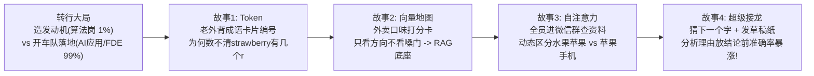

# 第 01 课：别再死磕算法了！AI 应用工程师与 FDE 定位 + 生活例子讲透大模型原理

## 🧭 本课知识结构图（现象 👉 底层本质 👉 生活举例）



## 💻 6 行代码让大模型干活（DeepSeek / OpenAI / Qwen 全通用）

```python
from openai import OpenAI

client = OpenAI(api_key="你的API_KEY", base_url="https://api.deepseek.com")
resp = client.chat.completions.create(
    model="deepseek-chat",
    messages=[
        {"role": "system", "content": "你是资深合同审核顾问，请先分条分析风险，再给出最终建议"},
        {"role": "user", "content": "请帮我检查这段租房合同有没有押金霸王条款..."},
    ],
)
print(resp.choices[0].message.content)
```
