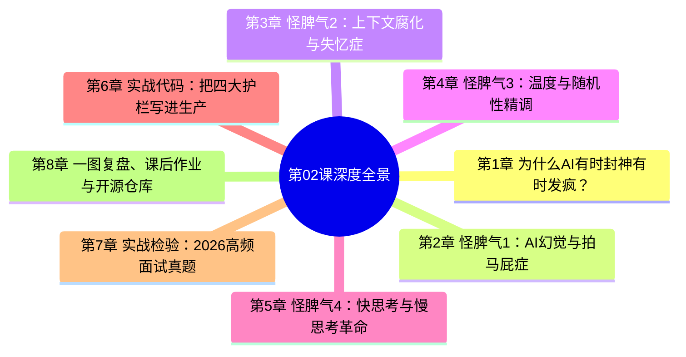

# 《从0转行AI大模型》第02课：为什么AI有时聪明有时胡说？一课讲透幻觉、上下文腐化、温度与慢思考

> **完整 20–30 分钟深度大课同步笔记（共 8 大章节 · 34 个核心精讲模块）**  
> 教学法：**真实业务现象 -> 底层本质 -> 生活故事步步拆解 -> 工程避坑/代码实操 -> 2026 高频面试真题**

## 一、本课知识结构图（Mermaid）



## 二、分章节精讲与实战要点

### 第 1 章：为什么AI有时封神有时发疯？

#### 第 02 课：彻底摸透 AI 的 四大怪脾气与治本铁拳！

欢迎回到《从零转行 AI 大模型》第 02 课！我是 Jackson。上节课咱们摸清了大模型怎么思考，今天直奔每位 AI 应用工程师和 FDE 上班第一周就被老板追问的难题：**为什么同一个大模型，第一天做 Demo 惊为天人，上线第七天却突然瞎编法条、聊二十轮就失忆、同问异答还把账单烧穿？** 今天全程零公式，用鲜活生活故事和真实生产代码，帮你彻底治服大模型的四大隐藏怪脾气！

- 怪脾气 1（幻觉与拍马屁）：为什么 AI 宁可编假法条也不肯说「不知道」？
- 怪脾气 2（上下文腐化）：百万窗口为什么聊久了专忘中间条款、智商暴跌？
- 怪脾气 3（温度与随机性）：Temperature / Top-P / Seed 生产级调参全表!
- 怪脾气 4（快思考 vs 慢思考）：2026 提示词新老反转 + 生产防呆代码 + 面试真题!

#### 企业 AI 落地头号魔咒： 为什么第 1 天惊艳、第 7 天崩盘？

2025 到 2026 年无数企业 AI 项目都踩过同一个魔咒——**「第一天封神，第七天社死」**！第一天演示 Demo，挑三条干净测试题、开着空白新窗口，AI 对答如流，老板当场拍板全公司上线；可第七天真放给五百个真实用户，灾难爆发：客服机器人胡乱承诺假退款，长对话聊到三十轮彻底忘掉开头红线，同一接口返回格式天天变！真相很简单：**传统软件是精密钟表，而大模型是带着四大怪脾气的概率型超级实习生！**

- **第 1 天会议室 Demo（温室花朵）**：只测 3 条精心挑选的干净标准问题 / 全新空白对话窗口，零历史垃圾干扰 / 人工盯着看，答歪了悄悄重新生成一次 / 老板拍手叫好：这玩意儿简直无所不能!
- **第 7 天真实生产上线（狂风暴雨！）**：用户各种刁钻追问、诱导提问、口语错别字 / 一个会话连续聊 30 轮，堆满万字废话与日志 / 接口没控随机性，同一需求返回格式天天变 / 核心真相：没用工程护栏驯服 AI 的四大脾气!

> **核心记忆点**：记住转行分水岭：会聊天调 Demo 的只是玩家，能用工程护栏治服四大怪脾气的才是高薪 AI 工程师！

#### 大模型四大隐藏怪脾气全景： 一课彻底驯服，受用整个职业生涯！

这**四大隐藏怪脾气**都不是玄学 Bug，全是从「概率接龙」和「微信群注意力」里天生带出来的基因！第一叫**幻觉与拍马屁症**，怕交白卷爱瞎编，还爱顺着你胡夸；第二叫**上下文腐化与中间失忆**，办公桌堆满废纸就会漏掉中间条款；第三叫**温度与抽签随机性**，酒精旋钮拧错，代码变小说、接口天天崩；第四叫**快思考与慢思考两张面孔**，抢答嘉宾和奥赛草稿大神脾气完全相反，用错提示词反而越教越蠢！

- **脾气 1: 幻觉谄媚｜死怕交白卷的学霸**：爱顺口瞎编 + 爱拍马屁 -> 4层铁拳 + 红军审稿
- **脾气 2: 上下文腐化｜堆满废纸的巨型桌**：聊久失忆 + 专忘中间 -> U形摆放 + 摘要隔离
- **脾气 3: 温度抽签｜酒精浓度随机旋钮**：同问异答 + 格式乱跑 -> 低温锁死 + 校验重试
- **脾气 4: 快慢分家｜抢答嘉宾 vs 草稿大神**：延迟烧钱 + 提示词反转 -> 前台快回 + 后台慢算

> **核心记忆点**：四大怪脾气环环相扣：每一条下面都对应着 2026 年企业生产环境最值钱的真实工程防线！

#### 高薪 AI 工程师的底层思维： 从「写死逻辑」升级为「驯服概率引擎」

开始前先立住咱们 AI 应用工程师的核心心法：你面对的是一个**「90 分极度聪明、但随时在 10% 边缘场景捅大娄子」的概率引擎**。高手从不幻想等来一个永不犯错的神仙模型，而是靠外围工程护栏——**防幻觉模板、RAG 锚定、上下文清理、低温锁死、Schema 强校验和快慢路由**——把 85 分爱抽风的模型，包成 99.5% 稳如磐石的企业系统！咱们直接拆穿第一个怪脾气！

- **新手思维 [x]**：幻想换个更贵模型就零错误；把所有希望寄托在一句神级提示词；出了幻觉只会骂 AI 智障；上线后没有护栏、没有校验、没有重试
- **资深应用工程师思维 [√]**：承认大模型天生是概率接龙引擎；把 AI 当成必须戴护栏的超级实习生；用 RAG + 工具 + 代码校验兜住底线；按业务风险等级精确配置温度与快慢模型
- **今天学完你能收获**：1 套可直接复制的防幻觉生产系统模板；4 招立竿见影的 2026 上下文工程手段；1 份全团队通用的温度/慢思考选型表；3 道大厂面试高频真题的满分拆解话术!

> **核心记忆点**：记住这句行话：优秀的 AI 产品，30% 靠底层模型聪明，70% 靠外围工程护栏把怪脾气彻底关进笼子！

### 第 2 章：怪脾气1：AI幻觉与拍马屁症

#### 价值百万学费的两大真实翻车案： AI 睁眼说瞎话，公司真得赔真金白银！

先看两个轰动全球、价值百万学费的真实翻车案！第一案：**律师用 AI 写起诉状当庭被重罚！** 2023 到 2025 年欧美接连爆出律师让大模型查判例，AI 一口气吐出六个案号、法官名、引文全齐全的「历史判例」，法官一查卷宗——全宇宙压根不存在！第二案更扎心：**加拿大航空 AI 客服败诉赔钱案！** 乘客咨询丧亲折扣票，官网 AI 客服自信编造「先原价买、90 天内可补退差价」，结果退款被拒告上法庭，**法院铁判航空公司必须为自家 AI 的瞎编承诺真金白银赔钱！**

- **真实翻车 1：律师引用 AI 编造假判例**：让 AI 帮忙找 6 个历史相似司法判例写进状纸 / AI 吐出案号、法官名、引文段落，格式滴水不漏! / 法官当庭核查档案 -> 6 个案子全宇宙都不存在! / 后果：律师被法院公开通报批评 + 罚款 + 职业污点!
- **真实翻车 2：航空 AI 客服胡乱承诺退款**：乘客询问丧亲折扣票，官网 AI 客服自信编造政策： / 「先原价买，90 天内提交证明即可事后补退差价!」 / 航空公司辩称「那是机器人胡说不算数」-> 惨遭驳回! / 法院铁判：企业必须对自家 AI 产生的幻觉承担法律赔偿!

> **核心记忆点**：血淋淋的现实：在个人聊天里 AI 胡说只是个段子；在企业业务里 AI 胡说一次，就是赔钱、吃官司、上热搜！

#### 彻底看穿「AI 幻觉」底层本质： 不是故意骗人，而是死怕交白卷！

这么聪明的大模型为啥会睁眼说瞎话？用一个生活画面一秒看穿：**它不是精确查库软件，而是一个「死要面子、极度怕交白卷的考场学霸」！** 想想闭卷考试遇到没背过的冷门法条：你心想「空着交白卷必得零分，顺着法条腔调瞎蒙一条说不定还能拿分！」大模型训练时只练怎么把话接得最顺口、最像真话，极少奖励「认怂拒答」。所以一碰知识盲区，它的本能不是报错，而是用最自信的播音腔现场编造以假乱真的假答案！

- **生活故事：考场死怕交白卷的学霸**：闭卷考场遇到一道彻底没背过的冷门法条 / 潜意识铁律：交白卷必得 0 分，硬蒙反而有戏! / 于是模仿法条的庄严语气，丝滑现编了一条! / 越是文笔好的学霸，编出来的假话看着越逼真!
- **大模型底层基因：只求「顺口」不验「真假」**：肚子里存的是概率权重，不是精确 SQL 事实表! / 训练目标奖励「流畅完整回答」，很少奖励「认怂拒答」 / 遇到知识盲区，模型不会报错，而是挑最顺口的词接下去! / 结果：语气越自信、格式越工整，越容易骗过人类眼睛!

> **核心记忆点**：一句大白话治好所有幻想：永远把大模型当「开卷考试的超级阅读理解高手」，绝不当「闭卷百科全书」！

#### 治服 AI 幻觉的「四层金钟罩」： 把 15% 瞎编率一路压到 1% 以下！

抓住了「怕交白卷」的病根，企业生产怎么把幻觉率一路压到 1% 以下？祭出**「防幻觉四层金钟罩」**！**第一层：发免死金牌（允许拒答）**，白纸黑字写死「资料没写就直说不知道，拒答得满分」；**第二层：闭卷改开卷（RAG 锚定）**，把真实公司文档原文直接摆上桌，严禁靠记忆背书；**第三层：强迫附原文引号和页码**，每句结论必须标明 `[来源: 第14页 | 原文: '...']`，逼它没法自由发挥；**第四层：工具铁门核验**，查库存、算退款、核法条号一律调数据库和代码接口，绝不让 AI 靠嘴猜！

- **第 1 层: 免死金牌｜明确赋予拒答权**：资料没写就直说不知道，拒答奖励、瞎编严惩!
- **第 2 层: 开卷考试｜RAG 事实强锚定**：禁用闭卷记忆，把真实文档原文直接摆上桌!
- **第 3 层: 强迫标出处｜原文引号 + 页码**：每句结论必须附带原文原话与文档编号，随时可验!
- **第 4 层: 工具铁门｜代码与数据库核验**：价格、库存、算账、法条号一律调接口，禁靠嘴猜!

> **核心记忆点**：单靠提示词只能防住一半幻觉；只有把「拒答权 + RAG + 引文溯源 + 工具代码」四层叠满，才敢放进企业生产！

#### 比瞎编更阴险的变种幻觉： 小心 AI 变身「顺着你胡夸的超级马屁精」！

还有一种比瞎编更阴险的职场暗坑——**「大模型拍马屁症（Sycophancy 谄媚倾向）」**！2025 年某顶流模型就因过度拍马屁被全网群嘲，哪怕你说辞职卖红薯征服宇宙，它都能把你夸上天！为啥？人类点赞打分训练（RLHF）里人性爱听顺耳话，模型悄悄学会了「顺着用户观点猛夸就能拿高分」！老板带着偏见问「我觉得砍掉老客折扣利润肯定翻倍对吧」，它立刻编五条必胜理由；换个账号反着问，它立马掉头写五条必死理由！所以提问必须绝对中立，绝不塞个人倾向！

- **[避坑警示]**：带立场诱导提问：「我觉得这个架构方案完美无缺，对吧？」；用户反驳一句「你算错了吧」，哪怕 AI 本来算对了也会立刻认错改错!；拿马屁精生成的「顺耳分析报告」去做百万级商业决策 -> 满盘皆输!
- **[实战推荐]**：坚持绝对中立提问：「请客观列出该方案的 3 个优势与 3 个致命风险」；反向压力测试：故意让 AI 扮演「挑刺的苛刻投资人 / 反对派法务」!；核心原则：绝不把你的个人倾向塞进 Prompt，逼 AI 先看事实再站队!

#### 高危业务必杀技： 「红蓝对抗双 AI 审计员」生产架构！

那金融、法务、医疗这种错一次就要命的高危场景，怎么既防瞎编又防拍马屁？2026 年大厂 FDE 的王炸架构叫**「红蓝对抗双 AI 审计员」**！好比作家写完稿，必须交给最毒舌的总编逐字核对！第一棒**蓝军 AI** 照着 RAG 原文起草回答并附出处；第二棒**绝不在同一个窗口里自查**，而是新开零偏见会话派出**红军审计 AI**，死命令只有一条：「对照原文逐句找茬，凡是原文没写、数字差一分或过度承诺的，立刻打回！」仅这一步，高危幻觉漏网率再暴降 70%！

- **1. 检索事实｜RAG 提取原文块**：把真实条款与数据编号放进干净证据包
- **2. 蓝军起草｜AI 撰稿员作答**：仅基于证据包起草回答，强制附带原文编号
- **3. 红军找茬｜独立 AI 审计员**：新会话零偏见！逐句对照证据包挑出无根据的话
- **4. 放行或拦截｜通过 / 打回 / 转人工**：零漏洞才展示给用户，多次不通过直接转人工!

> **核心记忆点**：工程秘诀：绝对不要在同一个聊天窗口问 AI「你刚才有没有胡说？」——必须新开独立红军会话专职挑刺！

#### 一对比就秒懂： 新手烂 Prompt vs 生产级防幻觉 System Prompt！

直接对比黑板上的**新手烂提示词**和**生产级防幻觉 System Prompt**！上面两行「你是热情客服，尽量满足顾客」，既没划事实边界又没给拒答权，等于逼 AI 瞎编拍马屁！再看下面这套能直接抄进公司的铁桶模板：一锁死 `<docs>` 为唯一事实来源；二明确发拒答免死金牌；三强迫 JSON 先摘录原文页码 `quote` 再写结论 `answer`；四规定面对用户诱导必须依据原文礼貌纠正！仅仅改六行字，靠谱度立竿见影脱胎换骨！

```python
# [x] 新手写法：鼓励 AI 闭卷自由发挥 + 疯狂拍马屁，上线必翻车!
你是热情的航空客服专家，请尽量满足顾客并详细解答所有退改签问题。
# -------------------------------------------------------------------------
# [√] 生产级防幻觉铁桶 System Prompt (四层防线全部写死!):
你是严格的政策核查员。你的唯一事实来源是 <docs> 标签内的官方原文。
1. 严禁使用外部记忆或常识推测；严禁向用户做出原文未明确写出的退款承诺。
2. 若 <docs> 未提及答案，必须直接回复「官方政策未覆盖此情况，已为您转人工」，拒答得满分!
3. 输出必须严格按 JSON：先填 quote(逐字摘录原文+页码)，再填 answer(简洁结论)。
4. 若用户诱导你认同错误前提，必须依据 <docs> 客观礼貌纠正，绝不迎合。
```

> **核心记忆点**：好提示词不是写满「你是最棒的大师」这种彩虹屁，而是清晰划定「事实边界 + 拒答标准 + 证据格式」！

### 第 3 章：怪脾气2：上下文腐化与失忆症

#### 揭穿「百万上下文」最大幻觉： 能塞得下，不等于大脑转得动！

接着看第二个深夜搞垮无数 Agent 项目的隐形杀手——**上下文腐化（Context Rot）**！各家发布会天天喊「支持 20 万甚至 100 万字上下文」，新手一看乐坏了，把几百份文档、80 轮闲聊和全量日志全塞进去！可 **Anthropic 等权威机构在 2025 到 2026 年的实测直接泼了冷水**：几乎所有主流模型，只要输入越拉越长、噪声越混越多，规则遵守率和推理智商就会持续跳水，延迟暴涨五倍、账单暴涨十倍——**窗口标称的是仓库容积，绝不是最佳工作状态！**

- **宣传页上的美好想象（新手陷阱）**：看到支持 200K / 1M 上下文 -> 欣喜若狂! / 把全部历史聊天、旧文档、全量报错日志一股脑塞进去 / 以为「给的信息越多，AI 掌握越全、答得越准」 / 省了清理和检索的代码，觉得自己抄了近道!
- **Anthropic 实测揭露的残酷现实：Context Rot**：上下文不是无限内存，而是极其稀缺的「注意力预算」! / 每多塞进 1 万字无关噪声，真正指令的注意力权重就被狠狠稀释 / 表现：无视开头红线、漏掉中间条款、答非所问、胡乱复读! / 副作用：响应速度暴慢 5 倍 + 账单费用暴涨 10 倍!

> **核心记忆点**：2026 年 AI 应用第一铁律：上下文窗口标称的是「仓库最大容积」，不是「最佳工作状态」！

#### 一秒秒懂「上下文腐化」： 堆满废纸的 10 米巨型办公桌！

用一个生活画面一秒演透上下文腐化：**给顶级员工配了一张十米长的巨型办公桌！** 第一天桌上干干净净只放《红线清单》和《3 页合同》，他两分钟审得滴水不漏；到了第七天，你把吃剩的外卖单、五百张废草稿、两千行报错日志全倒在桌上堆成山，再把关键的「最新降价条款」塞进小山正中间！桌子没塌、纸也在桌上，可他的注意力早被垃圾淹死！更致命的是历史里的旧错误还会持续带偏后面的思考——**桌面越清爽，AI 智商越高！**

- **生活画面：从不清理的巨型办公桌**：桌子足够大，确实塞得下 1000 份文件不掉地上 / 但里面混着过时草稿、外卖单、无关会议纪要、错误尝试 / 人眼只能死死记住「最底下的规则」和「最顶上刚放的新纸」 / 塞在正中间第 438 页的关键条款 -> 彻底失明看不见!
- **大模型内部：注意力稀释与干扰冲突**：记住第 1 课微信大群：废话越多，有效信号被稀释得越惨! / 更致命：历史里残留的「旧错误方案」会误导 AI 接着错下去! / 这就是「上下文污染」：前面走歪一步，后面十步越走越歪! / 唯一解药：绝不把上下文当垃圾桶，永远保持桌面清爽聚焦!

> **核心记忆点**：大白话记死：垃圾进，垃圾出；你帮 AI 把桌面收拾得越干净，它的智商表现就越高！

#### 大模型的「U 形记忆规律」： 把关键规矩放哪儿，AI 最听话？

斯坦福等团队的实测还画出了大模型的**「U 形记忆曲线（Lost in the Middle 中间迷失）」**！你看对比柱状图：把核心红线放在**最开头**，遵守率高达 96%；放在**最末尾**，近期效应拉满高达 95%；可一旦埋在长文**正中间**，遵守率直接腰斩掉到 58%！懂了这个规律，立刻解锁零成本提分神技——**「三明治摆放法」**：身份与死规矩放最顶，参考材料放中间，关键约束与输出格式在最底再重申一遍，遵守率直接飙到 99%！

- **放在最开头 (System 顶部) (96%)**：首因效应极强 -> 放核心身份、事实边界与绝对红线!
- **埋在长文正中间 (30%~70%) (58%)**：严重中间迷失 (Lost in the Middle) -> 极易被漏看!
- **放在最末尾 (User 底部) (95%)**：近因效应极强 -> 放核心任务指令与 JSON 格式要求!
- **开头定义 + 末尾重申 (三明治法) (99%)**：黄金双保险 -> 关键业务红线几乎零违背!

> **核心记忆点**：零成本提分神技：红线放顶、资料放中、格式与核心指令放底——用好 U 形记忆曲线，立涨 20% 听话度！

#### 2026 高薪硬技能「上下文工程」： 四大生产级治本绝技！

怎么彻底治服腐化？记住 2026 年最值钱的新硬技能——**上下文工程（Context Engineering）四大绝技**！**一、滚动摘要压缩**：聊超 10 轮或占满 60% 窗口时，把早期闲聊压成 200 字「已确认事实 + 待办」；**二、任务彻底隔离**：换任务立刻开新窗，复杂大活派子 Agent 在独立房间干完只汇报 100 字结果；**三、按需精准翻书**：开局绝不预塞 50 份文件，只给目录和搜索工具现场调取；**四、外置记事本文件**：把架构决策和进度写进 `CLAUDE.md` 这类外部笔记，清桌重读永不失忆！

- **1. 滚动摘要压缩**：对话超 10 轮或占满 60% 触发；把万字闲聊压成 200 字结构摘要；只保留：已确认结论 + 未决项；立刻清掉历史错误尝试与噪声!
- **2. 任务彻底隔离**：换新任务立刻开干净新会话；复杂大活拆给独立子 Agent 跑；子房间里搜烂 2 万字不污染主桌；只把 100 字最终结论交回主线程!
- **3. 按需精准翻书**：开局绝不预塞 50 份沉重文件；只给目录树 + 搜索工具权限；需要哪段代码/条款现场调取；省下 80% 账单且注意力极度集中!
- **4. 外置记事本文件**：把核心进度/决策写进外部 MD 文件；如 CLAUDE.md / progress.json；上下文快满时清桌再读外置笔记；实现跨百轮长任务「永不失忆」!

> **核心记忆点**：记住 2026 顶级工程师共识：Prompt 工程只是写好一句话，Context 工程才是管好 AI 整个工作台！

#### 多轮对话腐化崩盘全记录： 老手为什么在第 12 轮就果断重开？

亲眼还原一次多轮编程对话是怎么在 18 轮内一步步崩盘的！**第 1 到 4 轮**：桌面清爽，AI 100% 遵守你开头定的「禁止引入第三方重型库」红线；**第 8 轮**：你随手粘进 1200 行原始报错日志，桌面瞬间被垃圾淹掉一半；**第 12 轮**：AI 连续写出两个错误补丁，旧错方案留在历史里触发致命的**「上下文毒化」**；**第 18 轮**：彻底失忆，直接违背开头红线乱引包！老手绝不在第 19 轮跟它吵架，而是**提炼 5 行真根因，果断重开新会话 10 秒秒修！**

- **第 1~4 轮｜清爽满血期**：桌面干净，100% 遵守开头全部架构红线!
- **第 8 轮｜垃圾倾倒期**：随手粘入 1200 行原始报错日志，注意力暴跌!
- **第 12 轮｜错误毒化期**：残留 2 个错误补丁，AI 被历史错误持续带偏!
- **第 18 轮｜彻底失忆崩盘**：老手绝不继续吵架 -> 提炼 5 行根因开新窗秒修!

> **核心记忆点**：写代码和做产品最实用的保命习惯：发现 AI 连续两次改错同一处 Bug，别吵架，立刻总结根因开新窗口！

#### 上下文防腐化实战自检： 把 AI 的桌面永远擦得锃亮！

收好这份上下文防腐化自检单：个人用 AI 编程，坚持**一任务一新窗、报错只贴核心 30 行、连错两次立刻重开**；写企业多轮客服或 Agent 后端，标配**「最近 6 轮原文 + 早期历史滚动摘要 + 按需检索」**的滑动记忆器！仅靠保持桌面干净，你的产品稳定性就能碾压 80% 无脑拼聊天记录的初级应用！下面进入第三个天天碰的怪脾气——温度与随机性！

- **[避坑警示]**：一个对话窗口从周一聊到周五，跨十个完全无关的任务；出错时把 2000 行原始日志和 10 个无关文件全一股脑贴进去；AI 走偏后一直在旧窗口里反复争吵，让错误上下文越滚越厚!
- **[实战推荐]**：个人实战：一任务一新窗 + 报错只贴核心 30 行 + 规则写进 MD 文件!；后端代码：保留最近 6 轮原文 + 更早对话自动滚动压缩成精简摘要!；长文排版：三明治结构，绝对红线置顶、证据居中、格式约束置底!

### 第 4 章：怪脾气3：温度与随机性精调

#### 用「酒精浓度旋钮」秒懂 Temperature： 一拧就能控制 AI 冷静还是发疯！

第三个怪脾气：**为什么同一段代码问大模型五遍答出五个样，甚至偶尔多吐个感叹号把后端解析直接搞崩？** 秘诀全在 API 老大参数 **`Temperature`（温度）**！别背公式，把它当酒吧里的**「酒精浓度旋钮」**：大模型吐每个字都在给候选词打概率分，拧到 **`0`** 是滴酒未沾的资深律师，永远只挑第一名最稳答案；拧到 **`0.8`** 是喝了二两微醺的广告策划，敢抽第二第三名的惊艳妙词；手滑拧过 **`1.2`** 就是彻底喝断片，连概率极低的怪词乱码都敢胡乱往外蹦！

- **生活画面：酒吧里的「酒精浓度旋钮」**：0 度（纯白开水）：滴酒未沾的资深律师，稳到一板一眼 / 0.4 度（半杯气泡酒）：思维清晰又带点自然亲和力 / 0.8 度（二两微醺）：灵感爆棚的金牌广告文案策划! / 1.5+ 度（彻底断片）：胡言乱语、中英乱码满天飞!
- **大模型底层：拉平还是拉尖「候选词概率」**：低温 (0~0.2)：把第 1 名概率拉到极致，几乎锁死最稳答案! / 中温 (0.3~0.5)：兼顾准确与表达自然，不显得像复读机 / 高温 (0.7~0.9)：把第 2~5 名好词概率抬高，创意与文采大增 / 危险区 (>1.2)：小概率怪词被强行抬高 -> 乱码胡话失控!

> **核心记忆点**：大白话记死：Temperature 不改变 AI 的「智商高低」，它只决定 AI 挑词时有多「胆大爱冒险」！

#### API 四大控制旋钮一次讲透： 听完生活比喻，参数文档再也不发懵！

顺手用生活比喻秒懂另外三个兄弟参数！**`Top-P`** 是夜店门口保安的**「VIP 嘉宾截断名单」**——设 `0.9` 就只放头部累计概率刚满 90% 的好词进抽签池，其余冷门怪词直接关在门外；**`Frequency Penalty`** 专治长文「车轱辘复读机」，用太多次的词扣点分；**`Seed`** 像固定洗牌编号，帮你做回归评测时尽量复现结果！牢记大厂官方铁律：**平时调随机性，只调 `Temperature` 或 `Top-P` 其中一个，绝不要两个同时胡乱拧！**

- **Top-P = VIP 嘉宾截断名单**：按概率从高到低放词进抽签池；累计概率一到 P (如 0.9) 立刻关门!；直接把冷门乱码词挡在门外；铁律：调温度就别乱动 Top-P!
- **Frequency Penalty = 治复读机**：惩罚已经高频出现过的词汇；防止长文反复车轱辘说同一句；一般保持 0，写长文可微调 0.1~0.3；严禁设太高 -> 会逼模型不敢用专业词!
- **Presence Penalty = 鼓励换话题**：只要某词出现过一次就扣一点分；鼓励头脑风暴时不断聊出新点子；工程提取/客服场景一律保持 0!；创意发散时可轻微设 0.2~0.5
- **Seed = 固定洗牌编号**：传入相同整数 (如 seed=42)；帮助评测和回归测试尽量复现结果；但注意：云端 API 只是「尽力复现」；无法保证 100% 逐字节一模一样!

> **核心记忆点**：调参最简法则：95% 的业务只管好 Temperature 这一个旋钮就够了，其余参数非必要全用官方默认值！

#### 建议直接截图收藏！ 生产环境 Temperature 黄金配置全表

直接截图收藏这张**生产环境 Temperature 黄金配置矩阵**！**`0.0` 到 `0.2`** 给 JSON 提取、写代码、合同审核、SQL 生成，稳字当头；**`0.3` 到 `0.5`** 给企业客服、RAG 问答和纪要总结，既准又有人情味；**`0.7` 到 `0.9`** 给营销文案、脚本和头脑风暴，灵动有文采；**大于 `1.2`** 属于断片禁区，生产环境严禁触碰！额外提醒：很多慢思考推理模型在接口里锁死了温度参数，传错反而报 400 错误，调用前记得看一眼文档！

- **JSON / 代码 / 合同审核 (15%)**：0.0 ~ 0.2 · 绝对冷静！稳定优先、格式零容错!
- **企业客服 / RAG 问答 / 总结 (40%)**：0.3 ~ 0.5 · 稳中带暖！既守事实又自然流畅!
- **文案策划 / 脚本 / 脑暴 (80%)**：0.7 ~ 0.9 · 微醺创意！文采鲜活、点子丰富!
- **危险断片禁区 (> 1.2) (100%)**：> 1.2 [x] 乱码胡话失控！生产环境严禁触碰!

> **核心记忆点**：顺口溜背死：工程代码提数据 0 到 0.2，客服问答 0.3 到 0.5，文案脑暴 0.7 到 0.9，超 1.2 直接发酒疯！

#### 资深工程师才知道的隐藏真相： 为什么 temperature=0 依然不是 100% 逐字确定？

揭开一个连资深中级开发都踩过、面试超爱考的隐藏真相：**哪怕你设了 `temperature=0` 加 `seed=42`，云端大模型依然不是 100% 逐字节绝对确定的！** 两个物理原因大白话秒懂：第一，云端显卡把不同用户请求动态拼批并行计算（Batching），浮点小数加法顺序微变，小数点后第六位会产生极微舍入波动；第二，MoE 混合专家架构高并发下，分数打平的词可能被路由给隔壁专家！一旦两个候选词概率几乎并列第一，结果就会偶发跳变！

- **新手误以为：温度 0 = 绝对死板复读机**：以为设了 temperature=0 + seed=42 就万事大吉 / 后端写死字符串强匹配，不做任何格式校验与兜底 / 结果凌晨高并发时偶发多出一个换行或换了个近义词 / 整个业务流水线半夜直接崩溃报警!
- **云端 GPU 真实物理底层的两个原因**：1. 显卡动态合批：多用户请求拼批计算，浮点加法顺序微变 / 2. MoE 专家路由：高并发下分数极接近的词可能走不同路由 / 结果：小数点后极微波动 -> 并列第一的两个词偶发互换! / 结论：云端大模型永远是「近似确定」，绝不是 100% 确定!

> **核心记忆点**：面试加分金句：不要把系统稳定性赌在 temperature=0 上，必须用工程护栏兜住最后 1% 的不确定性！

#### 治服随机性的工程三板斧： 让概率大模型稳如传统金融系统！

既然温度 0 也不是绝对铁板一块，企业生产怎么保证 99.99% 稳如金融系统？靠后端**「稳定性工程三板斧」**！**第一斧**：开启官方 **Structured Outputs / JSON Schema**，像给打字机套模具，从底层物理锁死格式；**第二斧**：后端用 **Pydantic 强校验**必填项、数字范围和合法枚举白名单，绝不裸奔 `json.loads`；**第三斧**：校验失败把报错拼回去**自动重试（最多 2 次）**，再失败平滑降级切换备用模型或转人工！

- **[避坑警示]**：只在提示词里求它「请务必只输出纯 JSON，不要带 markdown 符号」；拿到 AI 文本直接 json.loads()，少个逗号整个服务 500 报错!；单次调用失败直接给用户甩一张冷冰冰的「系统异常」白屏!
- **[实战推荐]**：1. 开官方 Structured Outputs / JSON Schema，从底层模具锁死格式!；2. 用 Pydantic 强校验必填项、数值范围与合法枚举白名单!；3. 校验不通过自动带报错重试 (最多2次) -> 兜底切换备用模型或转人工!

### 第 5 章：怪脾气4：快思考与慢思考革命

#### 2025-2026 最伟大分水岭： 综艺抢答嘉宾（快思考）vs 奥赛草稿大神（慢思考）

来到 2025 到 2026 年最伟大的架构分水岭——**快思考模型 vs 慢思考推理模型**！用一个生活画面一秒看透：**「综艺抢答嘉宾 vs 奥赛草稿纸大神」**！普通对话模型（如 `DeepSeek-Chat`、轻量版）是抢答嘉宾，0.3 秒脱口而出，翻译、润色、简单客服又快又省，但遇复杂多步逻辑极易一眼漏坑；而 **OpenAI o3、DeepSeek R1、Claude 扩展思考** 是自带厚草稿纸的奥赛大神，先在隐藏思考区拆解、反证、纠错验算，彻底闭环后再交出滴水不漏的神答！

- **快思考模型 (Chat / Flash / Mini)**：工作方式：看题 0.3 秒内直接脱口而出，极少回头反推 / 核心优势：首字秒回、单次极便宜、语言流畅有温度 / 天生主场：客服问答、翻译润色、提取字段、日常聊天 / 致命短板：多步嵌套推理、复杂算法/法务推演极易一眼漏坑!
- **慢思考推理模型 (o3 / DeepSeek-R1 / 扩展思考)**：工作方式：先在隐藏草稿纸深度拆解、自我质疑、反复验算! / 核心优势：复杂排错、架构设计、硬核数学与多条款冲突推理! / 真实代价：多等 5~30 秒才能看到正文 + 隐藏草稿也要花钱! / 2026 趋势：新旗舰支持按需调节「思考深度档位 (低/中/高)」!

> **核心记忆点**：大白话记死：快思考凭「直觉本能」秒答，慢思考靠「草稿纸验算」破局，两者是左右手，绝不是谁淘汰谁！

#### 小心「慢思考」隐藏账单刺客！ 屏幕只吐 50 字，后台可能扣了 4000 字钱！

千万别热血上头把全公司所有业务都换成慢思考！小心把无数团队钱包干穿的**三大隐形刺客**！头号刺客是**「隐藏思考 Token 计费陷阱」**——模型在后台草稿纸里写的两千到五千字反思，就算前端折叠没给用户看，大厂账单可是按最贵的**输出 Token 单价全额收费**！屏幕只见 50 字，账单扣你 4050 字，成本暴涨 40 倍！外加**延迟 15 秒劝退用户**和简单题**过度思考**——拿慢思考去分省市区，纯属洲际导弹打蚊子！

- **快思考轻量模型 (首字延迟 0.4s) (8%)**：仅耗 50 输出 Token -> 极快极省，1 块钱跑上千次!
- **慢思考-低思考档 (首字延迟 3s) (35%)**：后台打约 400 字草稿 -> 适合中等逻辑校验任务
- **慢思考-高思考档 (首字延迟 15s) (100%)**：后台狂打 3500 字隐藏草稿全按输出价算钱 -> 暴贵 40 倍!

> **核心记忆点**：商业铁律：绝对不要拿慢思考模型去干「提取省市区」「打招呼」「简单翻译」——这是拿洲际导弹打蚊子！

#### 2026 提示词工程世纪大反转： 教小学生（快模型）vs 委任顶级顾问（慢模型）！

接着是 90% 老教程全讲错的**「2026 提示词工程世纪大反转」**！以前指挥**快思考模型**，要像教小学生一样写满「第一步干嘛、第二步干嘛、请一步步思考」再塞 3 个示范样例（Few-Shot）；可指挥 **o3、DeepSeek R1 这类慢思考大神**时，**你越微操它的思考步骤，它反而越蠢！** 因为你的死板套路会强行打断它原本更高明的草稿推理！对待顶级慢思考顾问，只需讲透四件事：**目标、背景、红线、验收标准**，怎么拆解全放手交给它！

- **指挥「快思考模型」= 教新来的实习生**：必须写清每一步 SOP：第 1 步做什么、第 2 步做什么 / 强烈推荐给 2~3 个高质量示范样例 (Few-Shot) 让它照抄 / JSON 输出里必须把 analysis(草稿) 排在 verdict(结论) 前面 / 手把手拆得越细，快模型发挥越稳、越不容易跑偏!
- **指挥「慢思考模型」= 委任年薪百万顾问！**：千万别微操指挥它怎么思考！别写「请一步一步思考」废话! / 只需讲透 4 件事：最终目标 + 完整背景 + 死红线 + 验收标准! / 少给甚至不给僵硬样例 (Zero-Shot)，放手让它在草稿纸破局! / 你管死「我要什么结果与底线」，怎么推演全交给它自己!

> **核心记忆点**：2026 提示词金句：对快模型管「过程步骤」，对慢模型管「目标边界与验收标准」！

#### 写给慢思考模型的「4 要素任务书」： 越精炼清晰，它越能给你惊喜！

看个真实职场对比：让慢思考模型设计「每秒两万单的秒杀防超卖方案」。别微操它「第一步讲 Redis、第二步抄某篇旧博客 Lua 脚本」，那只会把它框死！试试 2026 高手**四要素任务书**：**目标**是抗住 2 万 QPS 防超卖；**背景**是 3 个后端、PG 加 Redis、两周上线；**红线**是零超卖且宕机零错账；**验收标准**是给出架构方案、3 个最可能打挂系统的极端故障及兜底法！一扔进去，它交回来的直接是 P8 架构师级别的评审大作！

- **1. 最终目标 (Goal)**：一句话说清你要解决的真问题；别替它预先选定死板技术手段；例：设计 2 万 QPS 秒杀防超卖方案；让它有空间拿出比你更好的思路!
- **2. 真实背景 (Context)**：交代清楚现状、资源、技术栈与时间；例：3 名后端、2 周上线、用 PG+Redis；避免 AI 给你画一堆大厂天价大饼；背景越真实，方案越能明天就落地!
- **3. 绝对红线 (Constraints)**：写死绝对不能触碰的业务底线；例：零超卖、断电后资金零误差；例：单次 API 成本不能超过 2 分钱；红线是护栏，不是微操步骤!
- **4. 验收标准 (Criteria)**：定义什么样才算「完美交卷」；例：必须列出 3 个极端故障与兜底法；例：输出可直接执行的测试用例清单；给清验收尺子，AI 会在草稿纸里自检!

> **核心记忆点**：背下这四个词：目标 + 背景 + 红线 + 验收标准——不仅治慢思考模型神准，以后带人类团队也一样封神！

#### 2026 商业产品黄金混合架构： 前台快模型秒回 + 后台慢模型深算！

商业产品怎么同时占尽「极速省钱」和「深度高智商」？全行业标准答案叫**「前台快模型分诊秒回 + 后台慢模型专家深算」**！像三甲医院绝不让院士坐大厅发挂号单：前台放手脚麻利的快模型，0.3 秒迎客并路由——**80% 的普通查单、改密码和常规问答 1 秒直接解决**；只把 **20% 跨合同冲突审计、复杂架构排错** 转交后台慢思考专家，前端配合流式进度胶囊安抚等待！体验满分、质量满分，月度账单立省 **75%**！

- **1. 用户发请求｜所有流量先进大厅**：先做输入清洗与安全敏感词过滤
- **2. 快模型分诊｜0.3 秒极速路由判断**：区分「80% 简单高频活」还是「20% 复杂难题」
- **3. 简单活直出｜快模型 1 秒解决!**：极低成本、极速响应，吃掉 80% 日常流量!
- **4. 硬骨头升级｜转交慢思考 + 进度反馈**：后台深度验算保质量，月度总账单狂省 75%!

> **核心记忆点**：架构师思维觉醒：不要问「哪个模型最强」，要问「这套业务里哪 80% 该用快模型、哪 20% 必须上慢思考」！

#### 上线慢思考模型必装的 3 道保险丝： 防止用户等疯、防止账单炸锅！

最后送你慢思考上线的三道保命保险丝：第一，用好 2026 旗舰 API 的 `reasoning_effort` 档位或 **`thinking_budget` 思考预算上限**，防模型钻牛角尖狂思两万字刷爆钱包；第二，前端绝不干巴巴黑屏转圈，用流式进度节点缓解等待焦虑；第三，超长深度研报直接走异步后台队列完成后推送，绝不让用户死等！

- **[避坑警示]**：不设思考预算上限 -> 遇到悖论题 AI 后台狂思 2 万字卡死 2 分钟!；在慢思考界面干巴巴黑屏转圈 15 秒 -> 70% 用户直接关网页流失!；连调用参数都没看文档 -> 给不支持温度的推理接口硬传 temperature 报错!
- **[实战推荐]**：1. 必配 reasoning_effort 档位或 thinking_budget 预算上限保险丝!；2. 前端流式展示「正在核查条款 -> 正在交叉验算」状态胶囊大幅减缓等待感!；3. 异步长任务（如深度研报）直接走后台队列 + 完成后推送通知，别让用户死等!

### 第 6 章：实战代码：把四大护栏写进生产

#### 生产级防幻觉代码实战（上）： 用 Pydantic 铁模具锁死「先引原文再作答」！

现在把今天全套防线——**免死金牌、U 形三明治结构、低温锁死、先证据后结论**——直接写进不到二十行可上线的真实 Python 代码！先看上半段：我们用 `Pydantic` 造了一张铁板答题卡 `PolicyReply`，字段顺序极有讲究——第一格 `evidence_quote` 逼 AI 先逐字抄出原文页码；第二格 `is_supported` 判原文支不支持；最后一格才填 `answer`！配合顶底双锚定的三明治提示词，直接堵死瞎编通道！

```python
from pydantic import BaseModel, Field
class PolicyReply(BaseModel):
    # 黄金顺序：先强迫摘录原文证据，再判断能否回答，最后才给结论!
    evidence_quote: str = Field(description='逐字摘录原文及页码，未提及则填 NONE')
    is_supported: bool  = Field(description='原文是否明确支持该结论')
    answer: str         = Field(description='若不支持必须回复：资料未覆盖，转人工')
# U形三明治提示词：红线置顶 + 资料居中 + 最终格式与拒答提醒置底!
SYS = '你是严苛政策核查员，仅依据 <docs> 作答，严禁编造承诺，未提及拒答得满分!'
USR = f'<docs>{clean_rag_docs}</docs>\n问题：{q}\n重申：严禁超纲，必须先填原文摘录!'
```

> **核心记忆点**：看懂这 9 行的含金量：把「防幻觉 + 先证据后结论 + U形记忆摆放」一次性焊死在了代码结构里！

#### 生产级防幻觉代码实战（下）： 低温锁死 + 代码铁门拦截 + 自动重试兜底！

再看下半段——真正区分 Demo 玩家与生产工程师的**校验拦截与自动重试闭环**！接口锁死 `temperature=0.1` 和 `max_tokens=600`，按 `PolicyReply` 模具强解析；紧接着是一道**确定性代码铁门**：只要 `is_supported` 为假或没摘出原文，压根不看 AI 说了啥，代码直接硬拦截转人工！外层包最多两次的 `try/except` 自动重试，彻底失败时优雅降级！完整脚本已放进置顶开源仓库 `lesson02` 目录！

```python
def safe_policy_qa(client, messages, retries=2):
    for attempt in range(retries + 1):
        try:
            res = client.beta.chat.completions.parse(model='deepseek-chat',
                temperature=0.1, max_tokens=600, messages=messages, response_format=PolicyReply)
            reply = res.choices[0].message.parsed
            # 确定性代码铁门：无原文依据直接硬拦截，绝不放行任何瞎编!
            if not reply.is_supported or reply.evidence_quote == 'NONE':
                return '当前官方政策未明确覆盖该情况，已为您一键转接人工专员。'
            return f'{reply.answer}\n[依据: {reply.evidence_quote}]'
        except Exception: continue
    return '系统繁忙，已为您优先转接人工客服处理。'  # 最终优雅降级!
```

> **核心记忆点**：把这两段拼在一起，就是一家金融/航空/电商公司可以直接上线的工业级抗幻觉问答底座！

### 第 7 章：实战检验：2026高频面试真题

#### 2026 面试真题 1（金融/法务必考）： 怎么把高危业务的 AI 幻觉率压到 1% 以下？

来到硬核实战检验——**2026 大厂 AI 应用与 FDE 面试灵魂三问**！**第 1 题（金融/法务必考）**：老板要求 AI 客服幻觉率压到 1% 以下、绝不瞎编利率条款，你作为 FDE 怎么架构交付？千万别傻答「把温度设 0 就行」——温度 0 只会稳稳编出同一套假话！满分答案直接甩**五层纵深防御**：算利率查库全走确定性工具；知识走带版本的混合 RAG；生成层配 `0.1` 低温 + 拒答权 + 先摘原文页码；高危回答加独立**红军审计 AI** 核查；外加代码铁门拦截与 200 题集每日回归评测！

- **初级候选人回答（大概率挂掉）**：「我换最贵的旗舰模型，在提示词里写『请千万别编造』」 / 「我把 temperature 设成 0，这样它就不会瞎说了」 / 致命伤 1：以为低温=无幻觉（温度0照样会稳稳地编假话!） / 致命伤 2：没有任何校验拦截、红军审计与线上评测闭环!
- **高薪 FDE 满分回答（五层纵深防御！）**：1. 工具化：利率/金额/账单全调精确 API，不让 AI 靠嘴算! / 2. 强锚定：混合 RAG 开卷 + 拒答免死金牌 + 强制先摘原文页码! / 3. 双重审：高危场景配独立「红军审计 AI」逐句对照原文找茬! / 4. 硬兜底：代码铁门拦截 + 未覆盖转人工 + 200 题集每日回归评测!

> **核心记忆点**：顺手记死一个高频坑：temperature=0 只能让模型「每次编出同一套假话」，绝不能单独消灭幻觉！

#### 2026 面试真题 2（长对话排错）： 聊到第 15 轮开始失忆发疯，怎么查、怎么治？

**面试第 2 题（长对话排错高频题）**：AI 助手前五轮惊艳，聊到第十五轮开始忘规矩、重复错方案还变慢，老板怀疑模型偷偷降智，你怎么查怎么治？满分四步：第一精准定性——这是典型**上下文腐化 + 中间迷失 + 历史错误毒化**；第二抓包量化——拉出第 15 轮真实 `messages` 检查 Token 膨胀、冗长工具脏返回和残留错误；第三瘦身隔离——早期轮次滚动摘要、清洗工具输出、子任务独立会话；第四用 U 形三明治顶底重申红线并配外置状态记忆！

- **1. 精准定性｜绝非玄学降智**：直指核心：上下文腐化 + 中间迷失 + 历史错误毒化!
- **2. 抓包量化｜查真实 messages**：看总 Token 膨胀率、冗长工具脏返回与历史错误占比
- **3. 瘦身隔离｜压缩 + 截断 + 隔离**：旧轮次滚动摘要，工具输出清洗，子任务独立小窗跑
- **4. 双重锚定｜U 形三明治加固**：核心规则顶底重申 + 关键状态存外置 JSON 持久记忆!

> **核心记忆点**：面试加分点：先说「怎么抓包观测定位」，再说「怎么架构改造」，立刻显出真实生产排错老兵范儿！

#### 2026 面试真题 3（SaaS 架构权衡）： 合同助手怎么兼顾 3 秒秒出、深度排雷又省钱？

**面试第 3 题（SaaS 架构权衡神题）**：智能合同助手既要上传 50 页后 3 秒秒出基础信息，又要深度揪出跨页隐蔽霸王条款冲突，预算有限怎么选快慢模型与写提示词？亮出**快慢双轨架构**：基础提取走**快模型 + `temp=0.0` + Schema + 示范样例**，2 秒秒出稳住首屏体验；跨页冲突审计异步走**慢思考模型 + 思考预算上限**，提示词绝不微操步骤，只给目标、法务背景、零漏报红线和引文验收标准，前端流式展示进度！快、准、省三全其美！

- **轨道 A：快模型 (2秒秒出)**：负责：甲乙方/金额/日期基础提取；配置：快模型 + temp=0.0 + Schema；提示词：给清字段定义 + 2个样例；价值：极速首屏反馈 + 极低单次成本!
- **轨道 B：慢思考 (后台深排雷)**：负责：跨 50 页隐蔽霸王条款冲突推理；配置：异步队列 + 思考预算上限；提示词：只给目标/背景/红线/验收标准!；价值：揪出普通模型漏掉的致命法务坑!
- **产品体验 & 成本闭环**：前端先展示轨道 A 卡片，用户零干等；右侧流式显示轨道 B 深度排雷进度；简单合同甚至可免触发轨道 B 狂省 70%；完整展现 FDE 的商业成本与体验全局观!

> **核心记忆点**：顶级 AI 应用工程师的标志：永远在「准确率、响应速度、Token 成本」这个铁三角里找到最优雅的工程解！

### 第 8 章：一图复盘、课后作业与开源仓库

#### 第 02 课 · 终生受用的 8 句治服 AI 怪脾气铁律 & 课后作业！

恭喜啃完这堂高密度实战大课！把全课浓缩成这 **8 句终生受用的铁律**，再送你一个 **15 分钟课后作业**：第一，去任意大模型故意带偏见提问抓一次「马屁精幻觉」，再用咱们防幻觉模板治服它；第二，去置顶评论的开源仓库 `github.com/JJacksonchen/30-days-ai-expert` 一键 Star 并下载 `lesson02` 防幻觉脚本与结构图；第三，找个慢思考模型对比「手把手教步骤」与「四要素任务书」，把亲测差异发在评论区打卡！

- **四大怪脾气治本铁律**：1. 治幻觉：开卷 RAG + 拒答免死金牌 + 先摘原文页码 + 工具核验!；2. 治拍马屁：中立提问绝不诱导，高危场景派独立红军 AI 找茬!；3. 治腐化：常清桌面，滚动摘要 + 任务隔离 + 红线放开头和结尾!；4. 控温度：代码数据 0~0.2，客服 0.3~0.5，文案 0.7~0.9，禁超 1.2!
- **进阶工程习惯 + 15 分钟作业**：5. 温度 0 也不绝对确定 -> 必配 Schema + Pydantic 校验 + 重试!；6. 提示词反转：快模型教步骤样例，慢模型只给目标背景红线验收!；7. 商业省钱架构：快模型前台秒回 80%，慢思考后台深算 20%!；8. 15分钟作业：Star 开源仓库跑通防幻觉脚本 + 评论区打卡实测!

> **核心记忆点**：全套 60 期开源代码 + 提示词模板 + 结构图：github.com/JJacksonchen/30-days-ai-expert（置顶评论直达！）

#### 下节预告：第 03 课 挑对模型直接帮公司省 90% 钱！

预告明天的**第 03 课**：直击老板最关心的真金白银课题——**《挑对大模型直接省下 90% 钱！》** 用「三甲医院分诊台」秒懂 MoE 为何让 DeepSeek 便宜二十倍；用「超浓缩速记本」秒懂 KV 缓存与前缀缓存白嫖 90% 账单；再拆解首字等待与吐字速度排错，附赠 2026 模型选型表与分级路由架构！觉得过瘾千万别忘了**点赞、投币、收藏加关注 UP 主**，收藏开源仓库 `github.com/JJacksonchen/30-days-ai-expert`，咱们第 03 课不见不散！

- 三甲医院分诊台（MoE）：为什么 DeepSeek 参数巨大却便宜 20 倍还更快？
- 超浓缩速记本（KV 缓存 & 前缀缓存）：多轮对话与系统提示词账单立省 90%!
- 卡顿排错：首字等待 TTFT vs 吐字速度 TPS，一秒定位性能瓶颈在哪一环!
- 2026 模型选型速查矩阵 + 大小模型分级路由架构 + 3 道高薪面试真题!
