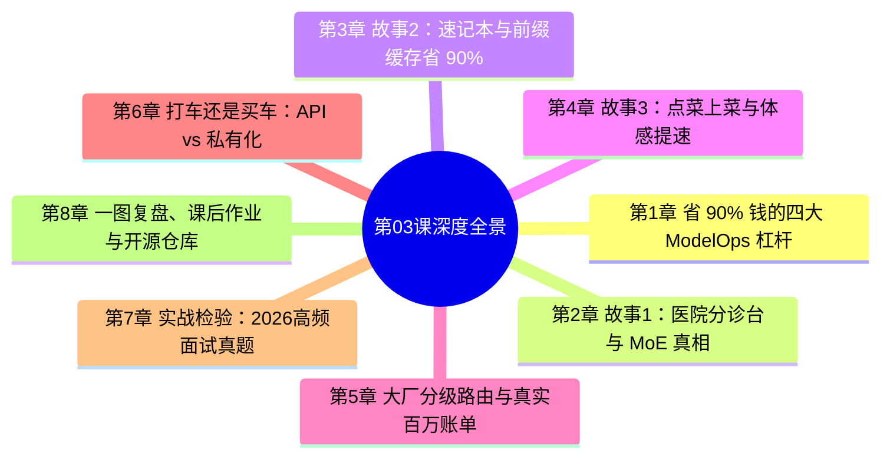

# 《从0转行AI大模型》第03课：AI应用工程师怎么挑模型省90%钱？看懂MoE、KV缓存、API算账与选型策略

> **完整 20–30 分钟深度大课同步笔记（共 8 大章节 · 34 个核心精讲模块）**  
> 教学法：**真实业务现象 -> 底层本质 -> 生活故事步步拆解 -> 工程避坑/代码实操 -> 2026 高频面试真题**

## 一、本课知识结构图（Mermaid）



## 二、分章节精讲与实战要点

### 第 1 章：省 90% 钱的四大 ModelOps 杠杆

#### 第 03 课：AI 工程师怎么挑模型 直接帮公司省下 90% 钱？

欢迎来到《从零转行 AI 大模型》第 03 课！我是 Jackson。前两课咱们摸清了大模型原理和四大怪脾气，今天教你一项在公司里**一出手就让老板刮目相看**的真本事——**AI 模型选型、速度诊断与省钱 90% 算账兵法！** 2026 年市面上模型版本有几十个，新手团队全靠「哪个最贵用哪个」，月底 API 账单烧掉十几万直接被财务约谈；而顶级 AI 应用工程师，准确率做得更高、速度更快，账单却只花别人十分之一！

- 医院分诊台 (MoE)：揭秘 671B 大模型凭啥便宜 20 倍，以及本地部署的显存陷阱!
- 浓缩速记本 (KV & 前缀缓存)：一个写错行多烧 5 倍钱的百万级生产坑与黄金排布!
- 餐厅点菜与上菜 (TTFT & 吐字)：30 秒定位 AI 卡顿根源 + 4 招体感提速 5 倍!
- 分级路由与私有化算账：日均百万请求月省 33 万实测 + 3 道 2026 面试真题!

#### 同样做企业 AI 客服助手： 新手烧光预算 vs 高手降本 90%！

先看一个无数公司踩过的扎心画面：**「请诺贝尔奖得主去前台贴快递单！」** 很多新手团队挑模型，直接去榜单选最贵的顶配旗舰，不管用户只是问「几点下班」、从短信里抽个手机号，还是做跨文件架构设计，统统无脑往同一个旗舰接口硬塞！结果每百万字账单贵出天际，旗舰动辄思考七八秒才蹦第一个字，用户嫌慢全跑光了！真正高薪的 AI 应用工程师和 FDE，干的是**「ModelOps 成本架构师」**的活——让每一分预算都精准花在刀刃上！

- **新手盲目选型（请诺奖大师贴快递单）**：全业务一刀切：所有请求无脑调最贵顶配旗舰模型 / 每次提问把 1 万字手册和动态时间全塞在最开头 / 用户问 1 万遍「怎么开发票」，AI 傻傻算 1 万遍! / 月底结果：账单月烧 10 万+，用户还吐槽反应慢!
- **资深 AI 工程师（ModelOps 精准算账！）**：按任务难度分诊：80% 简单活小模型 0.3 秒几分钱搞定 / 死守前缀缓存黄金排布：固定规则置顶，云端白嫖 1 折! / 高频重复问答走语义缓存，0.05 秒零成本秒回! / 月底结果：准确率不降反升，账单直接打掉 90%!

> **核心记忆点**：记住核心职场真相：老板招 AI 工程师不是来帮你烧 API 费的，而是来帮你把 AI 变成赚钱印钞机的！

#### 解剖一张月烧 10 万的 API 账单： 92% 的钱其实都花冤枉了！

掀开一家公司「月烧 10 万元 API 账单」的真实体检报告，钱到底漏在了哪？**第一黑洞（42%）**：拿最贵旗舰干情绪分类、字段提取这些几毛钱小模型就能满分搞定的杂活；**第二黑洞（31%）**：系统规则和长文档写法不对，彻底浪费云端 80% 到 90% 的前缀缓存折扣；**第三黑洞（19%）**：AI 输出满屏客套废话，外加高频重复问题反复硬算；算下来，**真正必须由顶配旗舰出手的核心复杂推理，往往只占整张账单的 8%！**

- **大材小用：旗舰干简单杂活 (42%)**：42% -> 上大小模型分级路由直接砍掉一大半!
- **缓存失效：长前缀全价重算 (31%)**：31% -> 调好提示词顺序命中前缀缓存立打 1~2 折!
- **废话输出 + 重复 FAQ 硬算 (19%)**：19% -> 控输出格式 + 语义缓存秒省近九成!
- **真正刚需的旗舰深度推理 (8%)**：8% -> 这才是真正帮公司赚钱、值得花钱的刀刃!

> **核心记忆点**：看懂这张账单体检图你就瞬间开窍：省钱根本不是靠「偷工减料降智商」，而是堵死四大无意义漏水口！

#### 今天 25 分钟四大省钱提速杠杆： 从底层直觉到公司实战一步到位！

今天我把整套企业级 ModelOps 选型与省钱体系，浓缩成**「四大黄金杠杆」**：**第一根看架构**，用「三甲医院分诊台」讲透 MoE 为何既便宜又聪明；**第二根看缓存**，用「浓缩速记本」吃满云端 90% 前缀缓存折扣；**第三根看速度**，用「餐厅点菜上菜」秒懂延迟指标并四招治好卡顿；**第四根看路由与部署**，亲手算清日均百万请求怎么把月账单砍掉 90%，再定夺调 API 还是本地私有化！系好安全带，直奔第一个故事！

- **杠杆 1: 选对架构｜医院分诊台 MoE**：懂 671B 为啥便宜 20 倍与显存真相
- **杠杆 2: 吃满缓存｜速记本与前缀缓存**：黄金排布顺序，立省 80%~90% 输入费
- **杠杆 3: 治好卡顿｜点菜与上菜速度学**：拆分 TTFT/吐字，4 招让体感快 5 倍
- **杠杆 4: 路由与部署｜分级派单 + 算总账**：手写路由代码 + 打车 vs 买车决策树!

> **核心记忆点**：系好安全带！每个杠杆都用生活故事 30 秒讲透底层，再直接给你能写进简历和面试的真实工程数字！

### 第 2 章：故事1：医院分诊台与 MoE 真相

#### 故事 1：去三甲医院看感冒 一秒听懂 Dense 稠密 vs MoE 混合专家！

先看一个震惊全球的真实**现象**：DeepSeek V3 和 R1 总参数量高达 **6710 亿（671B）**，比很多老牌模型大了十倍！按常理应该贵十倍、慢十倍吧？结果恰恰相反，它的 API 价格便宜到老牌闭源巨头的十分之一到二十分之一，吐字还飞快！背后的核武器就是 **MoE（混合专家架构）**！扔掉论文公式，拿**「三甲医院看感冒」**一秒讲穿：传统稠密模型是看个感冒非叫全院 256 个科室主任全员会诊；而 MoE 在大门口加了个聪明分诊台，只唤醒最对口的少数专家出手！

- **传统稠密模型 Dense（全院会诊看感冒）**：你去大医院只是挂个普通感冒发烧号 / 院长非把全院 256 个科室的脑外科、牙科、产科、骨科主任 / 全员锁进诊室，每个字都逼 100% 专家轮流把脉算一遍! / 结果：电费工资烧上天 -> API 收费贵得离谱、速度极慢!
- **MoE 混合专家（大门口配聪明分诊台!）**：医院总规模依然是 6710 亿参数的顶级全科三甲大院! / 但每个词进门先过智能分诊台：写代码叫架构师、写合同叫法务! / 每次只唤醒极少数最对口的专科医生出手干活，其余全休息! / 结果：只付 5.5% 专家出场费，享受 6710 亿满级大脑智商!

> **核心记忆点**：大白话破案：传统稠密模型是「全员加班」，MoE 是「全院待命、按需点将」，算力成本瞬间砍掉十几倍！

#### 解剖 DeepSeek 671B MoE： 单个字进门怎么只花 5.5% 算力？

把镜头拉近，看一个 Token 走进 DeepSeek 671B 大医院经历的四步分诊！第一步，进门先过极轻巧的**「分诊路由器」**，瞬间给院里 **256 位专科医生**打匹配分；第二步，永远先派 **1 位「共享全科医生」**保底处理通用语言常识；第三步，再精准点将唤醒得分最高的 **前 8 位对口专科**联合会诊；第四步，汇总诊断意见交卷——整趟只激活了 **370 亿参数（仅占 6710 亿总量的 5.5%）**！花 5.5% 的推理算力，打出 671B 的满级大脑！

- **1. 进门过分诊｜轻量路由器打分**：瞬间评估 256 位专科医生谁最对口
- **2. 全科先保底｜1 位常驻共享专家**：永远在线处理通用语法与基础常识
- **3. 精准点 8 将｜激活 Top-8 专科**：写 Python 叫代码组，算账叫逻辑组
- **4. 汇总出高分｜仅激活 37B / 671B**：5.5% 的推理成本，打出 671B 的脑容量!

> **核心记忆点**：以后看到模型名字带「A37B」「A22B」就秒懂：总参数代表「医院总知识库」，A 后面的激活参数代表「每次看病花的真算力」！

#### 2025-2026 全面 MoE 浪潮： 为什么 API 价格两年暴跌 90%？

而且 2025 到 2026 年，全球大模型已经全面进入**「全民 MoE 稀疏激活浪潮」**！除了 DeepSeek V3/R1，阿里的 **Qwen3 家族**推出 `Qwen3-235B-A22B` 旗舰和个人开发者狂爱的 `Qwen3-30B-A3B`（300 亿总脑容量，每次竟只激活 **30 亿**参数，跑得飞快！）；Meta 的 **Llama 4**（Scout / Maverick）也全面拥抱 MoE；头部闭源旗舰更是早就在云端跑稀疏集群！正是 MoE 革命，把每百万字推理价格从几百块打到了几块甚至几毛钱！

- **DeepSeek V3 / R1 / V3.2**：671B 总参数 / 仅 37B 激活；首创超细粒度共享+路由专家；直接击穿全球顶级模型定价地板；中文与代码推理性价比极高!
- **阿里 Qwen3 MoE 家族**：235B-A22B 旗舰对标一线闭源；30B-A3B 仅激活 3B 却有 30B 智商；单张消费级显卡就能跑出飞快速度；国内企业私有化极受欢迎主力!
- **Llama 4 & 全球闭源旗舰**：Meta Llama 4 全面转向 MoE 架构；原生支持超长上下文与多模态理解；闭源巨头云端也普遍采用稀疏集群；结论：MoE 已成现代大模型绝对主流!

> **核心记忆点**：选型大局观：以后挑企业日常主力模型，优先看「高性价比 MoE 架构」，花小模型的钱买旗舰级的脑子！

#### MoE 最大隐藏工程陷阱： 推理计算极省，但本地加载极吃显存！

但是注意！这里藏着一个 **90% 新手和老板必踩的私有化大雷**！很多人听说「671B 只激活 37B」，就以为花两万买两张家用 24G 显卡就能本地部署满血 DeepSeek！**大错特错！** 回到医院故事秒懂：**虽然每次看病只叫 8 位医生，但事前谁知道下个病人是牙疼还是骨折？所以全部 256 个科室和 6710 亿参数必须 100% 提前塞进昂贵的 GPU 显存大楼待命！** FP8 精度下满血 671B 依然吃掉 **700GB 以上显存**，必须多卡高端服务器集群才装得下！

- **[避坑警示]**：误区 1：以为 671B 只激活 37B，买一两张 24G 家用显卡就能跑满血版!；误区 2：老板听信「开源免费」，买台 10 万小服务器想私有化满血旗舰 -> 显存直接爆红!；误区 3：硬把模型切到普通内存硬盘跑 -> 每秒吐 0.5 个字，慢到怀疑人生!
- **[实战推荐]**：真相 1：算力成本看「激活参数(37B)」，买卡显存占用看「总参数(671B)」!；真相 2：满血 671B (FP8) 需约 700GB+ 显存，需多卡高端集群，小公司优先调云 API!；真相 3：单机小显存想本地跑，应选 Qwen3-30B-A3B 或 32B 量化小钢炮，又快又稳!

#### 故事 1 实战落地三原则： 把 MoE 认知直接变成选型直觉！

顺手你就悟透了云端大厂的商业真相：机房里几万个并发请求同时涌进来，有人问代码、有人问财务，256 个科室全员满负荷运转，把昂贵显存大楼的租金摊薄到每次只要几厘钱！记住故事 1 三条选型原则：**调云 API 优先挑高性价比大 MoE；本地买卡必按总参数算显存；遇到外包吹嘘「三万块本地部署满血 671B」，一眼识破那是偷偷换成了 32B 蒸馏版！** 下面直奔帮你再打一折的第二个故事！

- **1. 云端 API 优先挑大 MoE**：大厂高并发把 256 个科室摊到白菜价；享受 671B/235B 顶级知识覆盖面；按实际 Token 付钱，无需操心显存大楼!
- **2. 本地部署紧盯总显存**：FP8 约 1 字节/参数，INT4 约 0.5 字节；额外预留 20%~30% 显存给对话缓存；选型公式：总参数显存 <= 机房可用显存!
- **3. 警惕「伪满血」套壳坑**：小厂商宣称本地部署满血 R1 仅需几万；大概率偷偷换成了 7B/32B 蒸馏小模型；面试/采购一眼识破：问清总参数与精度!

> **核心记忆点**：懂了「医院分诊台」，下一章带你揭秘连很多工作两年的程序员都白白丢掉的「90% 现金折扣大礼包」！

### 第 3 章：故事2：速记本与前缀缓存省 90%

#### 故事 2：写长篇小说的「读书速记本」 一秒听懂大模型最核心的 KV Cache！

进入第二个价值连城的真实**现象**：做企业客服或编程 Agent，每次发给大模型的「系统规则 + 工具列表 + 产品手册」就长达 **8000 Token**！如果每吐一个字、或每来一位顾客都要从头重读重算，电费当场爆炸！用**「写长篇小说的读书速记本」**一秒听懂 **KV 缓存**：不用缓存时，写第 5001 字前要把前 5000 字全重读一遍；用了 KV 缓存，模型把前文每个词的 K 标签和 V 干货抄进速记本，写新字直接翻笔记，速度暴涨几十倍！

- **没有 KV 缓存（失忆作家每字重读全书）**：你正在写一本长篇小说，已经写到第 5000 个字了 / 要写第 5001 个字前，你非把第 1 到 5000 字全重读一遍! / 要写第 5002 个字前，又把第 1 到 5001 字全重读一遍! / 结果：99% 时间全浪费在重复读旧字，显卡算力瞬间榨干!
- **用上 KV 缓存（把前文重点记在速记本!）**：还记得第 1 课 Transformer 群聊里每个词的 K(标签) 和 V(干货) 吗? / 模型第一次读完前 5000 字，直接把它们的 K 和 V 抄进「速记本」! / 写第 5001 个字时，只需翻一眼速记本，完全不用重算前 5000 字! / 代价换收益：多占一点显卡显存桌面，换来吐字速度暴涨几十倍!

> **核心记忆点**：大白话记死：KV Cache 根本不是什么天书，就是大模型用来「记住读过的旧字、避免每写一字就重读全文」的速记本！

#### 拆穿 API 报价单的底层秘密： 为什么输出 Token 比输入贵 3~5 倍？

顺着速记本，彻底揭开第 1 课悬念：**为什么所有 API 报价单里，输出 Token 永远比输入贵 3 到 5 倍？** 因为模型干活分两段：**第一段 Prefill（读题）**——你喂进去 8000 字，显卡几千核心并行扫完抄好初始速记本，效率极高、单字极便宜；**第二段 Decode（吐字）**——只能逐字接龙，每蹦 1 个新字都要把整本速记本和几百亿参数从显存搬一遍，卡死在显存带宽上，耗电贵 **3 到 5 倍**！所以不仅要精简输入，更要管住 AI 别吐客套废话！

- **1. Prefill 读题｜千军万马并行扫全文**：一次性算出初始 KV 速记本，极快极省!
- **2. 算出第 1 字｜TTFT 首字延迟结束**：屏幕蹦出第一个字，进入逐字接龙阶段
- **3. Decode 吐字｜逐字搬运整本速记本**：每吐 1 字都要狂读显存 -> 卡在内存带宽!
- **4. 反映在账单｜输出价 = 输入价 3~5倍**：工程铁律：精简输入，更要死死管住 AI 的嘴!

> **核心记忆点**：看懂 Prefill vs Decode：以后写提示词绝不让 AI 写废话开场白，少吐 200 字客套话，等于直接省下读 1000 字的钱！

#### 30 秒秒懂 DeepSeek 独门绝招： MLA 浓缩闪卡凭啥把显存压掉 93%？

顺手用 30 秒听懂 DeepSeek 另一项震撼全球的黑科技——**MLA（多头潜在注意力压缩）**！传统大模型一聊长文，每个用户的 KV 速记本厚得像大辞海，很快把显卡显存桌面塞满，并发人数根本上不去！DeepSeek 造了台「高保真浓缩压片机」，存进显存前把厚辞海压成巴掌大的**「超浓缩精华闪卡」**，**KV 显存暴省 93%** 却几乎不损精度！同样一张卡，别人摆 10 本辞海服务 10 人，用了 MLA 能摆 100 张闪卡服务 100 人，价格直接腰斩再腰斩！

- **传统大辞海速记本（MHA / GQA）**：几十个注意力头各自抄一份完整 K 和 V 笔记 / 10 万字长对话光 1 位用户的速记本就吃掉几十 GB 显存! / 显卡桌面瞬间被占满 -> 并发人数上不去，单人分摊极贵! / 就像餐厅每张桌子摆满 50 个大盘子，根本翻不了台!
- **DeepSeek MLA 超浓缩精华闪卡!**：存入显存前先联合低秩压缩，只存一张极小的「潜在精华卡」 / 真要算注意力时，再在显卡高速缓存里瞬间解压还原使用! / KV 缓存显存体积暴减 93% -> 同样显卡并发能力暴涨数倍! / 普通人无需懂矩阵分解，记住结果：长文并发极便宜极快!

> **核心记忆点**：把 MoE (算力省 94%) + MLA (显存省 93%) 两张王牌叠在一起，你彻底看穿了 2026 国产大模型性价比屠榜的真相！

#### 白嫖云端 80%~90% 现金折扣： 命中「前缀缓存」前后真实输入单价对比！

现在轮到**你自己动手白嫖 80% 到 90% 现金折扣的超级王炸——前缀缓存（Prompt / Prefix Caching）**！云端算完你开头那 8000 字固定规则和手册的 KV 速记本后，下一秒新用户发来的开头一模一样，机房直接一键复用旧速记本，只算末尾 50 字新提问！省下的算力大厂直接返利：**DeepSeek 和 Claude 命中缓存直接打 1 折（立省 90%）！OpenAI、Gemini 和通义千问也普遍给到 50% 到 80% 折扣**，同时首字等待暴降一半以上！

- **未命中缓存（每次全价重算） (100%)**：100% 全价收费 + 每次苦等完整读题延迟!
- **OpenAI / Qwen 自动前缀缓存 (25%)**：约 20%~50% 价格 -> 什么都不用改，排好顺序自动享折扣!
- **DeepSeek / Claude 命中缓存 (10%)**：直打 1 折 (立省 90%!!) -> 10 万账单瞬间变 1 万!

> **核心记忆点**：这是 AI 应用工程师性价比最高的 5 分钟优化：不换模型、不降精度，光是把缓存命中率拉高就能立省一半以上月账单！

#### 价值百万的真实生产坑： 这 3 个手贱操作会让前缀缓存命中率归零！

重磅警告！下面这个**「价值一百万的生产级大坑」**你一定要死死记住！前缀缓存的匹配极其死板：**从第 1 个字节开始逐字严苛比对，只要开头改了 1 个字符，后面几万字缓存当场全部作废！** 可 80% 的新手程序员，偏偏喜欢在系统提示词第一行写：`当前时间：2026-11-27 10:05:32，用户ID：U88291`！每一秒都在变、每个用户都不同，等于你拿大锤每秒把后面 1 万字缓存砸成碎片，缓存命中率归零，白烧 **5 到 10 倍**冤枉钱！

- **[避坑警示]**：坑 1：在 System Prompt 第 1 行放「当前时间精确到秒」或「用户ID / 随机请求号」!；坑 2：每次请求把 tools 工具列表按无序字典乱序拼接 -> 工具顺序一变缓存全废!；坑 3：在多轮对话中间偷偷删改历史消息里的旧字 -> 改动点之后全部被迫重算!
- **[实战推荐]**：解 1：把当前时间(按天或放末尾)、用户画像、订单号统统移到最末尾的 User 消息里!；解 2：固定系统提示词 + 按字母排序锁死 Tools 清单 + 固定参考资料全放最顶部!；解 3：每次日志打印 response.usage 里的 cached_tokens，低于 70% 立刻拉警报排查!

#### 前缀缓存黄金排布实战代码： 铁打静态置顶，流水动态垫底！

立刻把大厂的**「前缀缓存黄金排布顺序」**刻进 DNA，就八个字：**「铁打静态置顶、流水动态垫底」**！看这 9 行代码：最顶部放 100% 静态的系统规则、按字母排好序的工具清单和固定产品手册；中间放只增不改的历史对话；最后一条 `user` 消息的末尾，才塞入动态时间戳、用户 ID 和本次新提问！调完接口立刻打印 `usage` 里的 `prompt_cache_hit_tokens`，亲眼看到命中率飙到 **85% 以上**才算验收过关！

```python
# [√] 黄金排布：最顶部 100% 静态不变 -> 所有用户共享同一份 KV 缓存!
STATIC_SYSTEM = '你是资深售后专家，严格按以下5000字《退换货与保修手册》回答...' + MANUAL_TEXT
messages = [
    {'role': 'system', 'content': STATIC_SYSTEM},   # 第1层: 铁打不动(命中90%折扣!)
    *chat_history,                                   # 第2层: 只追加、绝不中途修改!
    {'role': 'user', 'content': f'[时间:{now_str}][用户:{uid}] 问题: {user_query}'}  # 第3层: 动态放最尾!
]
resp = client.chat.completions.create(model='deepseek-chat', messages=messages)
# 必做验收：打印缓存命中 Token 数，验证有没有白花冤枉钱!
print('命中缓存:', getattr(resp.usage, 'prompt_cache_hit_tokens', 0), '/', resp.usage.prompt_tokens)
```

> **核心记忆点**：仅仅把时间戳和用户 ID 从 system 第 1 行挪到 user 最后一行，你上线第一天就能帮公司立省一半 API 账单！

### 第 4 章：故事3：点菜上菜与体感提速

#### 故事 3：去餐厅点菜与上菜 一眼把「AI 感觉卡」拆成三大核心指标！

省完钱，马上治好职场头号体验痛点：老板问「咱们的 AI 怎么感觉卡卡的？」新手只会盲目换模型，高手拿**「餐厅点菜与上菜」**一秒拆成三大速度指标：**第一，TTFT（首字延迟）**——点完单干等多久端上第一道菜（Prefill 读题与排队），黄金红线压在 **1.5 秒以内**；**第二，TPOT / 吐字速度（Tokens/s）**——后面每盘菜接力快不快，超过 **20 字/秒**人眼就极丝滑；**第三，端到端总耗时（E2E）**——整桌菜吃完全程多久！

- **餐厅吃饭的真实体感**：干等第一道凉菜端上桌的时间 -> 超过 5 分钟顾客就想拍桌子走人! / 开吃之后，后续每道热菜接力上桌的速度 -> 边吃边上极其丝滑! / 整桌 10 道菜全部上齐的总时间 -> 决定这一顿饭总共耗多久! / 最糟体验：厨师非要把 10 道菜全炒完闷在厨房 30 分钟才一起端出!
- **大模型体验三大黄金速度指标**：TTFT (首字延迟)：从发请求到蹦出第 1 个字 -> 黄金红线 <= 1.5 秒! / 吐字速度 (Tokens/s)：打字机每秒蹦几个字 -> 超过 20 字/秒就超顺滑! / E2E 总延迟：含检索 RAG + 多次工具调用 + 完整生成的总耗时! / 核心心理真相：人眼阅读速度约每秒 8~12 字，首字快比总耗时更重要!

> **核心记忆点**：医生看病先验血，AI 工程师调优先拆指标：不区分 TTFT 还是吐字慢，所有提速全都是蒙眼抓瞎！

#### AI 卡顿 1 分钟精准问诊表： 对症下药，绝不瞎换模型！

拿这三把手术刀，一分钟诊断职场四种经典「用户喊卡」：**情况 A，干等 8 秒白屏后唰唰吐完**——这是 TTFT 过高，九成是 Prompt 太长没命中前缀缓存、或者前置 RAG 查库慢；**情况 B，0.5 秒出首字但每秒只蹦 4 个字**——解码带宽堵死，该换高速 MoE 或低负载渠道；**情况 C，慢思考模型在暗处写草稿 15 秒不吱声**——前端没把思考进度推出来；**情况 D，总耗时 18 秒**——后台写了串行 `for` 循环，5 个步骤傻傻排队死等！

- **首字极慢 (TTFT>5s)｜前期读题/查库卡住**：查前缀缓存命中 + 精简 Prompt + 优化 RAG
- **吐字挤牙膏 (<10t/s)｜解码带宽严重拥堵**：换 MoE 轻量高速模型或切换低负载节点
- **思考黑屏 (推理模型)｜模型在暗处写长草稿**：界面实时流式展示「正在分析第2步...」!
- **总耗时暴涨 (E2E>15s)｜多步串行排队死等**：把独立子任务改成并发执行，耗时直接腰斩!

> **核心记忆点**：资深工程师上线第一件事：在后台日志里把「RAG耗时 / 首字TTFT / 吐字速度 / 总耗时」四个数字分开打点监控！

#### 体感提速前两大神技： 流式输出 + 并发扇出（立省 75% 等待！）

立刻亮出体感提速 5 倍的前两大神技！**神技 1：全链路流式输出（Streaming SSE）**——绝不憋完 1000 字才丢给前端，开 `stream=True` 边算边吐，用户 0.8 秒就读上第一行，工具调用时同步显示「正在核对库存」，体感等待暴降 80%！**神技 2：独立子任务并发扇出（Parallel Fan-Out）**——审合同要同时查违约金、付款、保密、知识产权四个维度，别串行循环等 **12 秒**，用 `asyncio.gather` **4 路并发同时发出**，只要最慢那路的 **3 秒**，又快又不易漏项！

- **神技 1: 流式输出 (SSE)**：接口必开 stream=True 边算边推；首字 0.8 秒上屏，人眼立刻开读；工具调用阶段同步推「正在查库存...」；哪怕总耗时没变，用户体感快 5 倍!
- **神技 2: 并发扇出 (Parallel)**：把大任务拆成互不依赖的小子任务；串行调 4 次：3s + 3s + 3s + 3s = 12s；并发调 4 次：asyncio.gather 仅需 3s!；多文档摘要、多规则质检必用神招!
- **神技 2 附加福利: 质量更高!**：1 次让 AI 同时查 10 条规则易漏项；拆成 4 个专注小任务并发核查；速度暴涨 3~4 倍的同时，漏检率暴降!；真正实现「又快、又准、还好维护」!

> **核心记忆点**：记住工程直觉：凡是彼此不依赖的多次大模型调用或工具查询，一律并发发出去，绝不排大队！

#### 体感提速后两大神技： 极速小前哨 + 0.05 秒语义缓存！

再看既能狂飙速度又能白省钱的**后两大神技**！**神技 3：轻量快模型前哨 + 推测解码（Speculative Decoding）**——搜索补全、UI 快捷提示直接派百字每秒级小模型；底层引擎还用「小徒弟先草拟 5 个字、大师父一眼并行验货打勾」的推测解码，零损精度提速 2 到 3 倍！**神技 4：语义缓存（Semantic Caching）**——客服里 40% 都在变着花样问「怎么开发票 / 发票在哪开」，拿向量相似度一碰超过 **0.95**，直接 **0.05 秒瞬发标准答案——零延迟、零幻觉、零费用！**

- **神技 3：轻量小前哨 & 推测解码**：搜索补全、UI 快捷建议、工单分类 -> 用百字/秒级轻量小模型 / 推测解码原理：小徒弟 1 秒草写 5 个字，大师父一眼并行批改打勾! / 画质精度 100% 与大师父一致，但出字速度直接翻 2~3 倍! / 2026 主流云端推理集群与 Cursor 自动补全都在狂用这招!
- **神技 4：语义缓存 (高频 FAQ 终极外挂!)**：用户问「发票在哪开」vs 缓存库「怎么申请电子发票」 / 虽然字面不同，但向量语义地图指南针方向几乎重合 (>=0.95)! / 直接跳过大模型，0.05 秒毫秒级返回经审核的标准答案! / 效果：客服高峰期 35% 流量零成本消化，速度比大模型快 40 倍!

> **核心记忆点**：最快、最便宜、最不会产生幻觉的一次大模型调用——就是「靠语义缓存压根不需要调用大模型的那一次」！

#### 提速优化三大红线避坑： 千万别为了快搞出线上大事故！

给提速优化补上生死攸关的**三大生产红线**！曾有公司无脑给全站套语义缓存，A 用户问「查我年假剩几天」，两分钟后 B 用户问同一句，相似度 1.00 直接把 A 的隐私年假吐给了 B！死守铁律：**第一，语义缓存严禁用于个人隐私、账户余额、实时库存，只做公开通用 FAQ 且相似度阈值设严（0.94 以上）！第二，别让慢思考模型花 30 秒思考一句「你好」；第三，每次模型调用必设首字超时和备用渠道降级！**

- **[避坑警示]**：红线 1：给「查我余额/查我订单/查我年假」这类个性化隐私接口乱上全局语义缓存!；红线 2：把语义相似度阈值设太松 (如 0.80) -> 问「怎么买保险」错回成「怎么退保险」!；红线 3：不设单步超时 (timeout) -> 某供应商偶发卡死 2 分钟拖垮整条业务线!
- **[实战推荐]**：铁律 1：语义缓存严格限定于「公共 FAQ / 通用政策」，且阈值宁严勿松 (>= 0.94~0.96)!；铁律 2：慢思考模型只用于复杂推理，简单闲聊/路由强制关闭深度思考或换快模型!；铁律 3：每个模型调用必配超时控制 (如首字 5s 超时自动切备用渠道)，保障 99.9% 可用性!

### 第 5 章：大厂分级路由与真实百万账单

#### 大厂王炸省钱架构： 「大小模型分级路由」三级派单兵法！

进入大厂高并发 AI 系统含金量最高的架构兵法——**「大小模型分级路由（Model Routing）」**！想想大公司前台派单就秒懂：每天 100 万通来电里，**80%** 都是查物流、贴工单标签、抽收件地址这类极简单流水线活；**15%** 需要熟手专员查资料仔细回复；真正需要年薪百万首席专家出马的复杂代码、法务博弈和高难客诉，其实不到 **5% 到 20%**！门口配一台毫秒级轻量路由把三层梯队分好流，质量拉满、账单暴跌！

- **公司前台三级分流机制**：80% 常规咨询：智能语音/前台小妹 3 秒直接答复搞定 / 15% 专业业务：转接经验丰富的中级业务专员处理 / 5% 棘手大案：才转接年薪百万的首席大专家亲自拍板! / 如果 100% 电话全找首席专家接 -> 公司三天就破产!
- **企业 AI 系统「三级模型梯队」**：L1 极速轻量层 (80%流量)：mini / Flash-Lite / 8B-30B小MoE (几毛/百万字) / L2 性价比主力层 (15%流量)：DeepSeek V3 / Qwen3 MoE (几元/百万字) / L3 顶配旗舰推理层 (5%流量)：顶级代码/推理旗舰兜底难题 (几十元/百万字) / 核心收益：95% 流量享受极速体验，综合账单狂砍 80% 以上!

> **核心记忆点**：架构师铁律：不要指望用「一个大模型」包打天下，把业务拆成「轻量前台 + 性价比中坚 + 旗舰专家」三层梯队！

#### 真实算账：日均 100 万次请求 4 步把月账单从 36 万打到 3.2 万（省 91%！）

口说无凭，咱们明明白白算一笔**「日均 100 万次请求（月 3000 万次）」真实月账单**！假设每次 2000 输入 + 300 输出：**方案 1（无脑全量调顶配旗舰无缓存）**，月烧约 **36 万元**，一年 432 万，财务直接崩溃！**方案 2（80/20 小模型+旗舰路由）**，立刻跌到 **8.2 万元（立省 77%）**！**方案 3（叠加 80% 前缀缓存命中）**，再砍到 **4.5 万元**！**方案 4（再叠加 30% FAQ 语义缓存）**，最终仅需 **3.2 万元——总省 91%，一年帮公司狂省近 400 万！**

- **全量无脑调顶配旗舰 (100%)**：约 36.0 万/月 (100%) -> 简单杂活也在疯狂烧钱!
- **叠加 80/20 分级路由 (23%)**：约 8.2 万/月 (省 77%) -> 80% 简单活交轻量模型秒回!
- **再叠加前缀缓存命中 (13%)**：约 4.5 万/月 (省 87.5%) -> 固定提示词享云端 1~2 折!
- **再加 30% FAQ 语义缓存 (9%)**：约 3.2 万/月 (省 91%!!) -> 年省近 400 万，速度翻 3 倍!

> **核心记忆点**：把这张真实算账对比表装进你的大脑和简历里：哪怕你只帮公司跑通这套组合拳，你的年薪就已经值回十倍票价！

#### 手把手看懂生产级「分级路由器」： 10 行 Python 把 90% 省钱架构落地！

这套听起来高大上的**「智能意图路由器」**写出来竟然只要短短 **9 行 Python 代码**！看清三步逻辑：第一，先花 0.05 秒查公共 FAQ 语义缓存，命中直接零成本返回；第二，未命中就交给极速轻量小模型，设死 `max_tokens=10` 只让它吐一个难度标签：`SIMPLE`、`MEDIUM` 或 `HARD`；第三，一行字典精准派单给轻量、主力 MoE 或顶配旗舰，并配默认主力兜底！记住精髓：**路由器本身必须在 0.2 秒内跑完且近乎免费！**

```python
MODEL_MAP = {'SIMPLE': 'qwen-turbo', 'MEDIUM': 'deepseek-chat', 'HARD': 'claude-sonnet'}
def route_and_answer(user_query: str):
    # 1. 先查高频公共 FAQ 语义缓存，命中直接 0.05s 零成本返回!
    if cached := lookup_semantic_cache(user_query, threshold=0.95): return cached
    # 2. 极速轻量路由器判难度 (限制 max_tokens=10，成本近乎为 0!)
    tier = call_llm('qwen-turbo', f'仅输出 SIMPLE/MEDIUM/HARD 评估难度:{user_query}', max_tokens=10)
    target_model = MODEL_MAP.get(tier.strip(), 'deepseek-chat')  # 默认稳健主力兜底!
    # 3. 命中前缀缓存 + 精准派单给最对口的模型梯队!
    return call_llm(target_model, build_cached_messages(user_query))
```

> **核心记忆点**：大厂千万级日活的省钱网关，剥掉监控告警外壳，最核心的灵魂就是眼前这 9 行极其优雅的代码！

#### 大厂隐藏省钱双暗器： 夜间 Batch 半价 + 级联升级兜底！

再送两张大厂省钱暗器！**暗器 1：Batch API 夜间错峰半价批处理（直接 5 折！）**——凌晨审 5 万张发票、给 20 万条评价打标、生成日报摘要，这些非实时离线任务，直接打包成 JSONL 走各大厂异步 Batch 接口，24 小时内出结果，**统统立打 5 折**！**暗器 2：级联升级兜底（Cascade）**——先让便宜小模型试做并过一遍代码/JSON 校验或置信度打分，一旦低于 85 分后台静默升级给旗舰重跑，省钱又稳如泰山！

- **暗器 1: Batch API 立打 5 折!**：适合：离线发票审核/评价打标/文档入库；打包 JSONL 异步提交，24 小时内出结果；利用大厂夜间闲置显卡算力 -> 直接半价!；叠加前缀缓存，离线批处理成本近乎白送!
- **暗器 2: 级联升级 (Cascade)**：第 1 步：便宜小模型先快速试算一遍；第 2 步：程序自动校验 JSON/规则/置信度；通过直接交付；不通过静默升级给旗舰重跑!；兼得「小模型的便宜」与「旗舰的稳妥」!
- **暗器 3: 上游数据先洗菜**：喂模型前先用 5 行正则删 HTML 脏代码；能用传统正则/SQL 解决的别调大模型!；比如查手机号/校验日期格式，0 元 100% 准；最顶级的省钱是「能写代码绝不调 AI」!

> **核心记忆点**：记住这句金玉良言：离线任务必走 Batch 半价，线上任务走「规则 -> 缓存 -> 分级路由 -> 级联兜底」四层漏斗！

#### 省钱降本两大翻车禁区： 没有评测集护航，绝不盲目降级模型！

必须泼一盆清醒的工程冷水，防止降本搞出业务事故！**第一大忌：没有「黄金评测集（Golden Eval Set）」就瞎降级模型！** 拍脑袋换小模型结果漏判关键财务条款，赔款够付十年 API 费！正确姿势是先攒 **100 到 300 道真实历史考题**，换模型或调路由前先自动跑分，守住准确率红线再灰度 5% 放量！**第二大忌：能用 0 毫秒正则挡掉的「你好/在吗」，别傻傻再调一次路由器模型！**

- **[避坑警示]**：禁区 1：拍脑袋把核心业务从旗舰换成小模型，没跑测试集 -> 线上准确率暗跌被客户投诉!；禁区 2：路由器写得又慢又贵 (比如调中大模型当路由)，光分类就多花 1.5 秒和双倍钱!；禁区 3：省钱省到抠门，把输出 max_tokens 截太短 -> JSON 截断报解析崩溃!
- **[实战推荐]**：铁律 1：先建 100~300 条真实业务「黄金评测集」，用数据证明省钱后准确率不掉线!；铁律 2：路由分流坚持「关键词/正则规则 (0ms) -> 轻量极速路由 (<200ms) -> 业务模型」!；铁律 3：先灰度 5% 流量做 A/B 对比，把成本、延迟和业务转化率全监控稳了再全量切换!

### 第 6 章：打车还是买车：API vs 私有化

#### 故事 4：打网约车 vs 自己买车雇司机 一秒算清「调云端 API」还是「本地私有化」！

一锤定音终结职场必争题：**「DeepSeek 和 Qwen 都开源了，公司到底买云端 API，还是自己买显卡本地私有化？」** 用**「打网约车 vs 自己买豪车雇司机」**一秒算清总账！老板只看见「开源免费」，却忘了算隐形总成本：一台 8 卡 H100/B200 服务器动辄一两百万起、三年巨额折旧，机房 24 小时电费制冷，外加养 **2 到 3 位年薪加起来破百万的 SRE 运维**防宕机，半夜没流量显卡还空转白烧钱！90% 团队无脑先打网约车（调云 API）最划算！

- **直接调云端 API（打网约车 · 90% 团队首选！）**：零前期重资产：不用花几百万买显卡，按实际 Token 付公里费! / 随时换顶配豪车：下个月出更强新模型，改一行 model 名秒切换! / 零运维零闲置：凌晨 3 点没流量一分钱不花，大促高峰自动弹性扩容! / 适合：90% 互联网产品、创业 MVP 验证、流量波峰波谷大的业务!
- **本地私有化部署（买车 + 养专职司机团队）**：开源模型免费 != 部署免费! 要算全「买卡折旧 + 电费 + 运维工资」! / 痛点 1：显卡买来 24 小时固定烧折旧，利用率低于 50% 血亏! / 痛点 2：模型半年一迭代，硬件落伍和 vLLM/SGLang 调优极耗人力! / 清醒账本：月 API 账单不到 5~10 万且无内网红线，买卡必亏!

> **核心记忆点**：记住 FDE 见客户黄金铁律：能用合规云 API 两周跑出真实业务 ROI，绝不要第一天就忽悠老板花几百万买空显卡！

#### 什么时候才该私有化部署？ 两大硬条件 + 两大省卡 4 倍神器！

只有满足**两大硬条件之一**才值得自建私有化：**硬条件 1——合规死红线**：政府、银行、医院病历、芯片源码，规定数据绝对不许出内网；**硬条件 2——超大且极其平稳的 24 小时满载流量**，GPU 利用率能常年稳在 **65% 以上**、单价低于 API！真要自建时必配两大省卡神器：**FP8 / INT4 量化**（像高清无损压照片，显存省一半到四分之三）+ **vLLM / SGLang 引擎**（连续批处理像智能拼车不浪费空位，吞吐暴涨十倍）！

- **硬条件 1: 合规数据不出网**：银行/政务/三甲医院/核心研发源码；监管规定敏感数据严禁发往公网 API；可选：本地机房私有化 / 专属 VPC 托管；技巧：先用小尺寸 32B/30B-A3B 跑闭环!
- **硬条件 2: 超大稳态满载流量**：月均 API 消耗极高且昼夜流量平稳；GPU 集群利用率可长期维持 65%+；搭配自研微调/蒸馏小模型降本极狠；此时买卡/包月算力比按量 API 更便宜!
- **私有化省卡双核武器**：1. FP8 / INT4 量化：高精度压缩显存直降 50%~75%；2. vLLM / SGLang 引擎：连续批处理 + PagedAttention；像智能拼车不让任何显存碎片浪费；单机吞吐比原生代码暴涨 10~20 倍!

> **核心记忆点**：面试或见客户随口说出「两大硬条件 + FP8 量化 + vLLM/SGLang 连续批处理」，专业气场瞬间拉满！

#### 2026 AI 应用选型实战速查卡： 四大高频业务场景，闭眼对号入座！

贴一张 **2026 四大实战场景选型速查卡**（记定位比死记小版本号更值钱）！**1. 复杂编程与 Agent 编排**：选 Claude 旗舰、GPT 旗舰、DeepSeek R1/V3.2 等顶级梯队，花点小钱换最低返工率；**2. 中文商业与高并发主力**：选 DeepSeek V3、Qwen3 MoE、豆包，中文词表压缩省 40% 且极便宜；**3. 多模态与超长合同/视频图表**：选原生多模态长窗强手 Gemini Pro/Flash、Qwen-VL；**4. 极速路由与结构化抽取**：选 Flash-Lite、mini、Qwen3 小 MoE，几毛钱百字每秒！

- **1. 复杂编程 / Agent 核心**：代表：Claude 旗舰 / GPT 旗舰 / DeepSeek；特点：指令遵循严、工具调用稳、长程不飘；策略：核心规划与兜底用它，绝不省小钱吃大亏!
- **2. 中文业务 / 高并发主力**：代表：DeepSeek V3 / Qwen3 MoE / 豆包；特点：中文切词省 40% + 前缀缓存极香；策略：国内客服/知识库/内容生成绝对主力!
- **3. 多模态 / 超长图文视频**：代表：Gemini Pro & Flash / Qwen-VL；特点：原生看图看表格看视频，长窗极稳；策略：财报图表、扫描件合同、视频理解首选!
- **4. 极速路由 / 抽取 / 清洗**：代表：Flash-Lite / mini / Qwen3-30B-A3B；特点：百字每秒极速 + 几毛钱百万字白菜价；策略：吃掉 80% 简单流量，帮公司狂省钱!

> **核心记忆点**：选型心法：模型版本号天天变，但「按场景分四档 + 用评测集定期赛马」的架构师方法论十年不过时！

#### 入职第一天照抄就能用： 大厂 ModelOps 选型省钱四步闭环！

把全套打法串成入职第一天照抄就能用的**「ModelOps 选型四步闭环」**：**第一步**，建 100 道真实业务黄金考题立死标尺；**第二步**，先用最强云端 API 两周跑通业务证明能赚钱，绝不先买空显卡；**第三步**，跑通后立刻上前缀缓存、80/20 分级路由、语义缓存和 Batch 半价，狂砍 80% 到 90% 账单；**第四步**，把缓存命中率、P95 延迟和单次成本接入看板，每季度拿新模型跑评测集持续赛马！下面进面试真题实战！

- **1. 立好标尺｜建 100 题黄金评测集**：先定死准确率与速度底线，拒绝玄学拍脑袋
- **2. 先跑通赚钱｜最强云 API 快速上线**：两周证明业务 ROI，绝不先花大钱买空卡!
- **3. 狂砍 90% 成本｜缓存+路由+Batch 组合拳**：前缀置顶 + 80/20 分流 + 语义缓存 + 半价批处理
- **4. 持续赛马｜监控命中率与单次账单**：每季度拿新模型跑评测集，更便宜更准就无缝换!

> **核心记忆点**：这套四步闭环就是 FDE 前置部署工程师进驻大客户现场的核心交付 SOP！下面直接进面试真题实战检验！

### 第 7 章：实战检验：2026高频面试真题

#### 2026 面试真题 1（高频压轴！）： 一周内砍掉 70% API 账单且不降准确率？

来到**「2026 大厂 AI 应用 / FDE 面试灵魂三问」**！**面试第 1 题**：老板要求「1 周内把每月 20 万 API 账单砍掉 70%，但准确率一分不能降」，怎么干？满分五天作战图：**D1** 拉日志定位漏水大头并建 100 题评测集；**D2** 零风险修前缀缓存（把顶部动态时间戳挪末尾）+ 清洗脏 HTML 和废话输出，立砍 40%；**D3 到 D4** 上 80/20 分级路由 + 公共 FAQ 语义缓存 + 离线任务切 Batch 5 折；**D5** 评测集达标后灰度验收，稳拿 75% 降本战报！

- **菜鸟回答（面试官当场淘汰）**：「把现在用的大模型全部换成最便宜的小模型就行了!」 / 「或者把提示词删掉一半字，缩短上下文长度!」 / 致命伤 1：没有评测集兜底，准确率暴跌直接背线上事故! / 致命伤 2：完全没提前缀缓存、分级路由和 Batch 批处理!
- **高薪 AI 工程师满分 5 天作战图！**：D1 审计+立尺：拉日志看 Token 漏水大头 + 建 100 题评测集! / D2 零损砍 40%：修前缀缓存(去顶部时间戳) + 删废话输出与脏 HTML! / D3-4 架构大杀器：80/20 分级路由 + FAQ 语义缓存 + 离线 Batch 5 折! / D5 灰度验收：评测达标再放量，70%+ 降本稳稳落袋零风险!

> **核心记忆点**：面试官最爱的回答气质：先看数据诊断、再打零损优化、再上架构组合拳、全程用评测集守住业务底线！

#### 2026 面试真题 2（排障实战）： AI 响应突然从 2 秒飙到 15 秒怎么 10 分钟破案？

再看**面试第 2 题**：线上 AI 助手平时 2 秒响应，今天突然飙到 15 秒，给你 10 分钟怎么破案？亮出**三层排障树**：**第一层**立刻把 15 秒切开成「前置 RAG/工具」、「TTFT 首字」和「吐字速度」锁定病灶；**第二层**若 TTFT 暴涨，头号嫌疑就是**发版把动态变量放进系统提示词开头导致前缀缓存失效**，同时查历史对话是否膨胀或供应商限流；**第三层**立刻止血——回滚 Prompt、网关秒切备用渠道，并把串行工具改成并发扇出！

- **1. 三段耗时立刻切分**：拆成：前置 RAG/工具 + TTFT + 吐字；绝不蒙眼猜模型慢，先抓真正凶手!；若前置慢 -> 查数据库索引与超时；若模型慢 -> 进入第 2 步深挖!
- **2. 重点排查 3 大高频元凶**：元凶 A：发版破坏前缀缓存，命中率归零!；元凶 B：对话历史未截断导致输入暴涨；元凶 C：上游 API 限流排队或触发降速；元凶 D：新加的工具链写成了串行排队!
- **3. 秒级止血 + 长期加固**：止血：回滚破坏缓存的改动 / 切备用渠道；加固 1：必配流式输出 + 首字超时自动切换；加固 2：独立工具与子任务改并发扇出；加固 3：把缓存命中率与 P95 延迟接入告警!

> **核心记忆点**：能把「前缀缓存意外失效导致 TTFT 飙升」这种生产级真细节讲出来，面试官立刻认定你有真实大厂高并发实战经验！

#### 2026 面试真题 3（FDE 客户实战）： 医院/银行坚持花 500 万买卡私有化 671B 怎么劝？

最后看**面试第 3 题（FDE 必考题！）**：三甲医院或银行 IT 主任坚持花 500 万买卡本地部署满血 671B，怎么回应？切忌硬怼或盲从，用三步拿下：**先共情合规**，100% 认同敏感病历/金融数据绝不出物理内网；**再算透明账**，讲清 671B MoE 加载仍吃多卡巨额显存、电费与运维人力；**最后给两阶段稳赢方案**：阶段一仅花小预算在机房跑量化 32B 或 30B-A3B + RAG，两周做出亮眼业务闭环；阶段二并发跑火后再按实测扩容满血集群！

- **低情商硬怼 / 盲目顺从（双输！）**：盲目顺从：拿了 500 万买卡装完发现没业务场景 -> 项目烂尾背锅! / 低情商硬怼：「你不懂技术，公网 API 便宜多了!」-> 踩碎合规红线被轰出门! / 忽略隐性成本：没提前说清 671B 显存门槛、电费与运维人力! / 结果：丢掉大单，或者交付半年后口碑彻底崩盘!
- **顶级 FDE 高情商「两阶段交付方案」！**：1. 死守红线：完全支持敏感病历/金融数据 100% 不出物理内网! / 2. 算透明账：讲清 MoE 加载显存 + 折旧运维，替主任规避投资浪费! / 3. 阶段一 (2周出彩)：先轻量化部署 32B/30B-A3B + RAG 跑通高价值场景! / 4. 阶段二 (按量扩容)：业务跑火、并发实测达标后再精准扩容满血集群!

> **核心记忆点**：懂技术、懂算账、更懂替客户领导规避政治与预算风险——这就是年薪百万 FDE 与普通码农的本质差距！

### 第 8 章：一图复盘、课后作业与开源仓库

#### 第 03 课 · 终生难忘的 8 句省钱提速记忆卡 & 15 分钟作业！

恭喜拿下全程高能的第 03 课！前三课底层原理、四大怪脾气与模型选型省钱地基已全部筑牢！收好这**「8 句终生难忘记忆卡」**，今晚花 **15 分钟完成实战小作业**：第一，去置顶评论的开源 GitHub 仓库下载本课思维图与路由代码；第二，挑一个你熟悉的业务，算一遍全用旗舰 vs「80/20 路由 + 前缀缓存」每月省多少钱；第三，跑两次带长系统提示词的 API 请求，把 `cached_tokens` 打印出来，评论区打卡你的实测命中率！

- **四大底层省钱与提速真相**：1. MoE = 医院分诊台：推理只花 5.5% 算力，但本地加载仍吃全院总显存!；2. KV 缓存 + MLA = 浓缩速记本：读题并行极便宜，吐字搬显存贵 3~5 倍!；3. 前缀缓存 = 静态置顶、动态垫底 (严禁首行放时间戳) 立省 80%~90%!；4. 体验速度 = TTFT + 吐字速度：流式 + 并发扇出 + 公共语义缓存治卡顿!
- **大厂选型兵法与 15 分钟行动**：5. 80/20 分级路由 + 夜间 Batch 5 折 -> 百万请求月账单直降 90%!；6. API 像打车、私有化像买车：合规不出网或超大稳态满载才买卡!；7. 15 分钟作业：实测打印 cached_tokens 命中率 + 算清自己场景月账单!；8. Star 开源仓库领 2026 模型选型速查表与完整 Python 路由器代码!

> **核心记忆点**：全套 60 期开源笔记结构图 + 代码：github.com/JJacksonchen/30-days-ai-expert（置顶评论直达！）

#### 下节超级爆款：第 04 课 Vibe Coding 工业级实战心法！

重头戏来了！明天第 04 课，咱们一头扎进席卷全球的超级爆款实战——**《Vibe Coding（氛围编程）工业级心法》**！为什么别人一晚上做出上线收费产品，好多人却越改越乱陷入报错死循环？怎么从手敲砖匠升级为指挥 Cursor、Claude Code 和 Antigravity 零翻车盖高楼的「建筑总包工头」？千万别忘了**点赞、投币、收藏加关注 UP 主**，去置顶评论 Star 开源仓库 `github.com/JJacksonchen/30-days-ai-expert`，咱们第 04 课不见不散！

- 身份跃迁：彻底告别手敲每行代码，升级为指挥 AI 军团的「建筑总包工头」!
- 终结死循环：彻底拆穿为什么好多人 Vibe Coding 越改越烂、满屏报错的根源!
- 5 步工业级落地法：签需求合同 -> 画蓝图 -> 立规则 -> 自动验收 -> 后悔药 Git!
- Cursor / Claude Code / Antigravity 真实分工工作流 + 3 道面试真题全通关!
