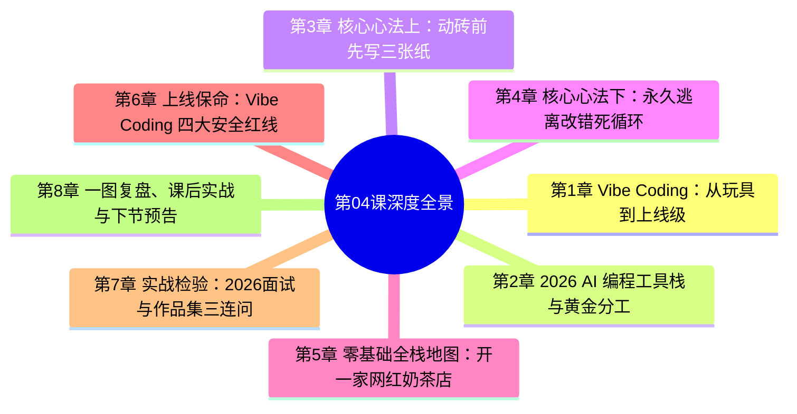

# 《从0转行AI大模型》第04课：彻底告别手敲代码！Vibe Coding实战心法：零基础如何用AI做出上线级产品

> **完整 20–30 分钟深度大课同步笔记（共 8 大章节 · 34 个核心精讲模块）**  
> 教学法：**真实业务现象 -> 底层本质 -> 生活故事步步拆解 -> 工程避坑/代码实操 -> 2026 高频面试真题**

## 一、本课知识结构图（Mermaid）



## 二、分章节精讲与实战要点

### 第 1 章：Vibe Coding：从玩具到上线级

#### 第 04 课：告别手敲代码！ Vibe Coding 上线级实战心法

欢迎来到《从零转行 AI 大模型》第 04 堂大课！前三课咱们摸透了大模型脾气和选型省钱法，今天正式拿起 2025 到 2026 年普通人转行 AI 最狠的外挂——**Vibe Coding（氛围编程）**！2025 年初 Karpathy 一条帖子引爆全网：不用死背语法手敲分号，用自然语言甚至对着麦克风说话，就能指挥 AI 写出完整软件！而到 2026 年，真正赚钱拿高薪的玩家，早就把它进化成了**生产级智能体工程开发**！今天二十多分钟，咱们把上线级实战心法一次讲透！

- 身份跃迁：告别手搬砖块的「代码泥瓦匠」，升级为 AI 时代「建筑总包工头」!
- 2026 黄金工具栈：Claude Code、Antigravity、Cursor、v0、Lovable 怎么组合打配合？
- 逃离改错死循环：动砖前先写三张纸 + 上下文保洁 + 测试安全网 + 2次Git读档铁律!
- 上线保命指南：网红奶茶店秒懂全栈 + 4条防黑客红线 + 3道 2026 面试与作品集真题!

#### 现象破案：同样指挥 AI 干活， 为啥有人周末赚钱，有人气到卸载？

先看这两年反复上演的魔幻**现象**：同样花二十美元用 Cursor 或 Claude Code，有的零基础产品经理一个周末就做出能收费的小工具；另一边，不少五年经验的老程序员上手两小时就气到卸载：「前十分钟像神仙，改到第五个功能，修好登录支付崩，彻底掉进越改越烂的死循环！」差距在哪？拿**「雇施工队盖别墅」**一秒破案：前者当的是带图纸、勤验收的**专业总包工头**，后者当的是只会甩一句「给我盖栋好看别墅」的**嘴炮甲方**！

- **翻车死法：当「甩手掌柜嘴炮甲方」**：一上来只甩一句：「帮我盖一栋大气好看的别墅!」 / 施工队凭感觉砌墙，盖完三楼你说「厨房挪到厕所旁」 / 工人拆承重墙硬改 -> 整栋楼到处漏水、越补越歪! / 这就是全网闻风丧胆的「改错死循环 (Doom Loop)」!
- **高手打法：当「专业建筑总包工头」**：动第一块砖前，先把需求合同 + 户型蓝图 + 施工规范写死! / 每次只让 AI 专心装修 1 个房间，装完立刻拿卷尺验收! / 每验收通过一个房间，立刻拍张存档照 (Git Commit)! / 哪怕 AI 手抖砸坏墙，1 秒恢复 15 分钟前完好无损的存档!

> **核心记忆点**：一语道破 2026 上线级 Vibe Coding 本质：不是随便许愿抽盲盒，而是用文档、验收与存档驾驭超强施工队！

#### 三年四代进化史： 从「Tab补全」到「2026 生产级智能体工程」

把过去三年 AI 编程的四代演进摊开，你一眼就能认清自己站在哪一层：**第一代 2023 年 Tab 补全**，像智能输入法敲半行猜后半行；**第二代 2024 年聊天框复制**，把报错粘进网页再把代码手动贴回来；**第三代 2025 年初纯 Vibe Coding**，全凭感觉一路点接受，做周末玩具巨爽，但一上真实业务极易翻车；而今天 **2026 年第四代生产级 Agentic Coding**，核心是给 AI 配齐规格文档、自动测试与版本回滚，让它稳稳交付上线级产品！

- **1. Tab 补全｜2023 辅助打字**：人写主逻辑，AI 像输入法补全后半行
- **2. 聊天复制｜2024 搬运工模式**：网页问 AI -> 手动复制代码粘回编辑器
- **3. 纯氛围编程｜2025 周末小玩具**：靠感觉一路点 Accept，爽但一改就崩
- **4. 智能体工程｜2026 上线级标准!**：文档合同 + 自动测试 + Git 存档稳交付!

> **核心记忆点**：记住定位：周末玩票靠「感觉」，拿高薪 Offer 和上线收钱靠「2026 生产级 Agentic 工程心法」！

#### 2026 AI 编程时代： 最值钱的三大「总包工头」硬核内功！

那 2026 年手背语法、手写红黑树的红利结束后，企业凭什么给咱们开高薪？全靠**总包工头的三大硬核内功**：第一，**需求拆解与边界定义力**——把模糊想法拆成清晰页面、状态和「本期不做」清单；第二，**架构边界与控场力**——懂前后端与数据流分工，管得住上下文、玩得转小步存档；第三，**铁面验收与安全把关力**——不听 AI 嘴甜，懂自动测试、看懂报错日志、死守上线安全底线！这三项内功，零基础和业务转行同学反而大有优势！

- **1. 需求拆解与写合同**：把模糊想法变成清晰功能清单；提前想清楚边界与异常情况；明确写清「本期绝对不做什么」；决定 AI 是神仙队友还是灾难源头!
- **2. 架构边界与控场力**：懂前后端、接口、数据库基本分工；绝不把整个项目垃圾全塞进窗口；把大工程拆成 15 分钟的小里程碑；随时能用 Git 秒级回滚兜底!
- **3. 铁面验收与安全观**：要求 AI 写完代码必须过自动测试；能看懂报错日志定位真正根因；死守密钥、权限、防刷爆账单红线；把 AI 产出打磨成真正可维护资产!

> **核心记忆点**：你会发现：这三项内功零基础完全能练成，而且干过产品、运营、测试或业务的同学反而天然占优！

### 第 2 章：2026 AI 编程工具栈与黄金分工

#### 2026 黄金 AI 编程工具栈： 别再吵工具大战，按四大兵种协同作战！

当好总包工头，先摸清 2026 年手下最能打的**四大 AI 工程兵种**！网上天天吵「Claude Code 干死了 Cursor」「Lovable 淘汰前端」——听句大实话：外行才搞门派站队，年薪百万的高手全靠按工种协同打配合！第一类**自治命令行施工队**（Claude Code、Antigravity、Codex），第二类**可视化精装编辑器**（Cursor、Windsurf），第三类**零代码原型闪电队**（v0、Lovable、Bolt），第四类**语音口述外挂**，各司其职威力翻倍！

- **1. 自治施工队 (Agentic)**：代表：Claude Code / Antigravity / Codex；跨几十个文件读代码、改代码、跑测试；自己看终端报错并循环修到通过!；主战场：搭骨架、写后端、大重构、修难Bug
- **2. 精装编辑器 (Visual IDE)**：代表：Cursor / Windsurf；左手看目录与代码差异，右手对话微调；Tab 丝滑补全 + 框选局部代码精准改；主战场：日常精修、页面微调、人工审查
- **3. 原型闪电队 (UI Builder)**：代表：v0 / Lovable / Bolt.new；浏览器打开就能用，一句话生成漂亮页面；10 分钟做出能点能看的交互 Demo；主战场：0到1验证想法、给老板/客户演示
- **4. 语音加速器 (Voice-to-Spec)**：代表：语音转文字输入法 / Wispr 等；对着麦克风口述需求，比打字快 3 倍!；讲业务流程和细节更自然、不断思路；主战场：写需求文档 PRD、给 AI 派大任务

> **核心记忆点**：记住核心心法：兵种工具每半年都在更新换代，但下面这套「工头协同打法」换任何工具 100% 通用！

#### 双主力深度对比： 自治智能体 vs 可视化编辑器怎么选？

重点拆解最容易搞混的两大主力！**Claude Code、Antigravity、Codex 这类自治智能体，就是扛大梁的「重型土建施工队」**——交出蓝图和验收标准，它能跨几十个文件改代码、起服务、跑测试、看终端红字自己排查修复，直到亮绿灯才汇报！而 **Cursor 和 Windsurf 则是「贴身精装设计师」**——你想微调按钮间距、逐行比对红绿差异、或人工审查关键支付逻辑时，可视化工作台无可替代！高手都是自治队扛八成重活，编辑器做两成精修！

- **自治施工队 (Claude Code / Antigravity)**：定位：能独立跑完「写代码->跑命令->看报错->修好」闭环! / 强项：跨 10~50 个文件大改动、写测试、查复杂全栈 Bug / 工作方式：你下达明确工单，它在后台自主推进并交验收报告 / 最适合：从零搭架构、新模块开发、批量重构、自动化排错!
- **精装编辑器 (Cursor / Windsurf)**：定位：人机并肩作战的高精度可视化工作台! / 强项：一眼看清每一行红绿增删 Diff、局部选中精准精修 / 工作方式：盯着代码与预览画面，随手微调交互与关键逻辑 / 最适合：前端视觉打磨、人工安全审查、局部小改动!

> **核心记忆点**：2026 高手标配组合：用自治施工队干 80% 重活与测试闭环，用精装编辑器做 20% 精细微调与代码把关！

#### 原型闪电队 & 语音外挂： 用对场景起飞，用错场景撞墙！

再看零基础最爱的**界面原型闪电队（v0、Lovable、Bolt）**和**语音外挂**！不用配任何环境，打开浏览器丢一张参考截图或一段中文，十分钟就能出高颜值可点击原型，拿去验证想法和给老板演示无敌！但记住一条清醒边界：一旦要加复杂后端鉴权、多模型编排和严格测试，别在网页框里硬磨，立刻**一键导出到 GitHub，交给本地 Claude Code 或 Cursor 接管**！再配上语音口述外挂，说话比打字快三倍，写需求细节丝滑不断片！

- **v0 / Lovable / Bolt 强项**：零环境配置，打开浏览器立刻开干；支持「丢一张截图 -> 还原高颜值 UI」；20 分钟做出可点击演示 Demo 给老板看；内置一键预览分享，验证想法最快!
- **何时必须「导出到本地」？**：需要复杂后端 API 或 Python AI 脚本；需要严格自动化测试与多分支 Git 协作；在网页框里改 3 次依然修不好联动 Bug；一键同步 GitHub -> 本地施工队接管!
- **语音口述 (Voice-to-Spec)**：普通人打字每分钟 40 字，说话 150 字!；口述更愿意把用户场景、边界讲得巨细!；把零碎语音交给 AI 整理成结构化 PRD；实测需求沟通效率直接翻倍!

> **核心记忆点**：黄金衔接术：网页原型队抢 0->1 颜值速度，导出 GitHub 后由本地 Agentic 工具扛 1->100 工程深度！

#### 周末 48 小时上线实战流： 四大兵种如何像交响乐团一样丝滑衔接？

看一遍熟练总包工头的**周末 48 小时上线实战流水线**：周六上午，对着麦克风口述十分钟，让 AI 梳理出清晰的 `PRD.md`、蓝图与工地守则；周六下午，拿两张参考截图配 v0 或 Lovable，半小时敲定干净清爽的响应式界面；周日白天，同步 GitHub 拉到本地，指挥 Claude Code 或 Antigravity 按里程碑接通数据库、大模型接口和自动化测试；周日晚上，在 Cursor 里逐行审一遍安全与手机适配细节，一键推上公网开张！

- **周六上午｜语音口述定三张纸**：口述需求 -> AI 产出 PRD + 蓝图 + 规则
- **周六下午｜原型队抢出高颜值**：参考截图 + v0/Tailwind 敲定清爽界面
- **周日白天｜自治队打通全栈闭环**：Claude Code/Antigravity 接库、API与测试
- **周日晚上｜编辑器安检并上线**：Cursor 精修 + 审查安全红线 -> 公网发布!

> **核心记忆点**：看清全局节奏了吧？全程你几乎不用手背一行语法，但每一个关键决策点都牢牢握在你的手里！

#### AI 编程选工具避坑： 千万别得「工具松鼠病」浪费生命！

顺手帮你治好新手最费钱的「工具松鼠病」！见过太多同学周一买 A 会员、周三追热搜换 B 工具，一个月交六份订阅费，电脑里却连一个能打开的上线网址都没有！记住：**九成翻车不是工具不够强，而是缺文档、缺测试、缺存档！** 最稳的极简配置就一句话：锁定**一个自治智能体（如 Claude Code 或 Antigravity）加一个主力编辑器（Cursor 或 VS Code）**，配好语音输入，把八成精力砸在通用工程内功上，先实打实上线第一个公网产品！

- **[避坑警示]**：每周追热搜换新工具，同时充 5 个会员却 1 个项目都没上线；遇到 Bug 怪工具智商低，以为换个更贵的编辑器就能自动修好；花 3 天折腾花哨的编辑器主题插件，就是不肯动手写第一份 PRD!
- **[实战推荐]**：极简顶配：锁定 1 个自治 Agent + 1 个主力编辑器，先做出 1 个公网产品!；把 80% 精力花在磨练「写规格、拆任务、做验收、玩转 Git」通用内功!；免费/低成本起步也完全够用，等作品跑通真需要重活再升级主力套餐!

### 第 3 章：核心心法上：动砖前先写三张纸

#### 上线级 Vibe Coding 第一铁律： 先写「三张纸 + 清单」，再动第一行代码！

现在进入把玩具玩家和上线级高手一刀劈开的核心心法！请把第一铁律刻进骨子里：**敲第一行代码前，先写好「三张纸」加一份清单！** 第一张 **`PRD.md`（需求合同）**，写死给谁用、核心闭环和「本期不做」；第二张 **`DESIGN.md`（建筑蓝图）**，定死技术栈、目录结构与核心数据表；第三张 **`.cursorrules` 或 `AGENTS.md`（工地守则）**，让 AI 每次开工自动默背规矩；再加 **`PLAN.md`（分步里程碑）**，把大工程切成小房间逐个击破！

- **纸 1: PRD.md｜需求外包合同**：写清目标用户、核心闭环与「本期不做」!
- **纸 2: DESIGN.md｜全栈建筑蓝图**：定死技术栈、文件夹结构与核心数据表
- **纸 3: AGENTS.md｜工地安全守则**：.cursorrules 立死规矩，防 AI 乱装库乱改!
- **清单: PLAN.md｜分步里程碑**：拆成 15 分钟一个小房间，做完测完打勾!

> **核心记忆点**：血泪数据验证：前期花 15 分钟跟 AI 写透这三张纸，能直接省掉后期整整 3 天抓狂修 Bug 的时间！

#### 真实现场对比： 朋友圈许愿 Prompt vs 工程外包合同 Prompt！

现场对比什么是「发朋友圈式许愿」，什么是「工程外包合同」！新手喊一句：「帮我把简历首页弄高级点，顺便加历史记录和导出。」AI 没范围没标准，只能瞎猜乱装一堆旧包，顺手把原布局全砸塌！而总包工头的合同写法包含四要素：**只改哪两个文件、精确加什么功能、严禁动登录与新增依赖、验收标准是手机 375 像素不错位且 `build` 零报错！** 同样一个模型，换一种下指令方式，立刻从笨实习生变身顶级大厂架构师！

- **嘴炮许愿（AI 只能瞎猜，必翻车!）**：「帮我把简历页面弄高级点，顺便加历史记录和导出」 / 问题 1：没范围 -> AI 顺手乱改了 12 个无关文件! / 问题 2：没标准 -> 瞎装一堆老旧臃肿第三方库! / 问题 3：没验收 -> AI 嘴甜说改好了，一打开白屏!
- **工程外包合同（AI 一次精准交付!）**：目标文件：只修改 ResumeCard.tsx 与 export.ts / 明确需求：加「导出 Markdown」按钮，复用现有样式 / 硬性红线：严禁新增第三方包，不改动登录与数据库代码 / 完工验收：手机宽 375px 不挤变形 + build 零报错再交差!

> **核心记忆点**：记住「四要素合同模板」：改哪几个文件 + 精确做什么 + 严禁碰什么 + 怎么算验收通过！

#### 零基础写文档外挂： 用「反向采访法」让 AI 当你的免费架构师！

零基础同学别慌：「我没写过软件，对着白纸根本写不出 `DESIGN.md` 呀！」教你硅谷高手必用的**「反向采访法（Interview Mode）」**！把原始想法丢给 AI，加上这条神级命令：**「现在严禁写一行代码！请你扮演十年经验首席全栈架构师，针对我的想法每次只问 1 到 2 个最关键的产品或边界问题，帮我补齐漏想细节；问完 6 到 8 个问题对齐后，由你帮我直接生成精简的 `PRD.md`、`DESIGN.md` 和 `PLAN.md`！」** 聊完十分钟，专业蓝图直接落盘！

- **第 1 步：只抛原始想法**：用大白话口述你想解决什么痛点；加一句死命令：「现在禁止写代码!」；让 AI 扮演十年经验架构师采访你；每次只问 2 个问题，绝不甩 30 条清单!
- **第 2 步：像聊天一样拍板**：AI 问：「要支持多人登录还是单机？」；AI 问：「分析结果要保存多久？」；不懂技术选项？直接问「小白推荐哪个？」；几轮问答下来，90% 隐形坑提前扫平!
- **第 3 步：一键落盘三张纸**：对齐后让 AI 输出 PRD + DESIGN + PLAN；人眼通读一遍，砍掉多余的花哨功能；把这三份 Markdown 存进项目根目录!；以后每个新窗口开工先让 AI 读这三张纸!

> **核心记忆点**：记住这招神仙口诀：别自己对着白纸硬编技术文档，让 AI 采访你 10 分钟，它比你更知道该问什么！

#### 生产级工地守则逐行拆解： 把这份 AGENTS.md / .cursorrules 放进根目录！

直接给你看一份真实生产项目里的 **`.cursorrules`（或 Claude Code、Antigravity 通用的 `AGENTS.md`）**！只要放进项目最外层根目录，AI 每次进工地都会自动戴上这顶安全帽！逐行看这五道死规矩：**锁定技术栈**不许乱装陌生库；**单文件不超过 300 行**且禁用弱类型 `any`；**安全死线**严禁明文写密钥；**先列 3 行计划再最小化改动**，不准顺手碰无关文件；**改完必须跑通类型检查和测试全绿**才能交差！这份模板已放进咱们的 GitHub 仓库，复制就能用！

```python
# 1. 锁定技术栈与目录：绝不允许 AI 擅自更换框架或乱装未知依赖
Stack: Next.js (App Router) + TypeScript + Tailwind + Supabase + FastAPI
# 2. 代码整洁红线：单文件 <= 300 行，禁止复制粘贴重复逻辑
Rule: Keep functions small & typed; NEVER use 'any' in TypeScript.
# 3. 安全死线：严禁在代码或前端变量中明文写 API Key / 数据库密码
Security: All secrets MUST load from server-side .env; validate all inputs.
# 4. 施工流程：动手前先列 3 行修改计划；严禁顺手改无关业务文件
Workflow: Plan first -> Edit minimal diff -> Do NOT touch unrelated files.
# 5. 铁面验收：改完必须运行 lint + typecheck + pytest/vitest 全绿才算完工!
```

> **核心记忆点**：没有规则文件的 AI 是脱缰野马；有了这 9 行 AGENTS.md，AI 瞬间变身纪律严明的大厂资深团队！

#### PLAN.md 微里程碑切分术： 一次只装修 1 个房间，10 步稳稳封顶！

三张纸齐活后，千万忍住一个致命冲动：别把整份 `PRD` 甩给 AI 喊「一口气把全站写完」！让施工队一天同时打地基、砌三楼、铺水电，必然满屏报错无从查起！高手会把 `PLAN.md` 切成**「一次只装修一个房间」的微里程碑**：第一关只做假数据漂亮样板间；第二关只打通单个大模型调用接口；第三关只接入登录和数据库存档；第四关补齐断网限流与上线！每关 15 分钟跑绿存盘，十次稳稳过关的爽感，吊打一次憋两小时崩盘！

- **M1 静态样板间｜先跑通漂亮界面**：用假数据把核心页面画好，手机电脑都顺眼!
- **M2 单点核心功能｜打通 AI 调用接口**：输入测试文本 -> 后台真调大模型流式吐字!
- **M3 登录与账本｜接入用户与数据库**：能注册登录、把生成记录存进 Supabase!
- **M4 边界与打磨｜错误提示 + 限流上线**：断网/超额有友好提示 -> 推上公网正式发布!

> **核心记忆点**：十次「15分钟一次通过」的爽感堆叠，远胜过一次「憋两小时满屏红字报错」的崩溃！

#### 写三张纸阶段的三大隐形坑： 精简聚焦，别让 AI 替你过度加戏！

顺手扫清写文档阶段的三个隐形坑！**第一坑，放任 AI 过度加戏**：你只做简历打分，它贴心地顺手给你塞进社区、积分、暗黑模式和多语言，复杂度直接炸翻，务必在 PRD 里写死「本期不做」狠砍需求！**第二坑，把文档写成二十页小说**：废话太长反而污染上下文，每份保持 **1 到 2 页干练清单**最顺手！**第三坑，写完文档就吃灰**：架构一旦改方向，让 AI 花五秒同步更新 `DESIGN.md` 和 `PLAN.md`，让图纸永远跟工地现状一模一样！

- **[避坑警示]**：放任 AI 热情加戏：还没跑通核心功能，先堆出积分、社区、暗黑模式!；把 PRD 写成 20 页废话文学 -> 反而塞爆上下文窗口稀释注意力!；第一天写完文档就再也不更新 -> 第五天图纸和真实代码完全对不上!
- **[实战推荐]**：铁血砍需求：PRD 里必写「本期不做 (Out of Scope)」，先做出最小闭环!；保持短小精悍：每份文档控制在 1~2 页，用清单和表格代替长段落!；活文档习惯：每完成一个小里程碑，让 AI 顺手把 PLAN.md 对应项打勾更新!

### 第 4 章：核心心法下：永久逃离改错死循环

#### 实测真相：同一窗口死磕越久， AI 修 Bug 一次成功率断崖式暴跌！

来到全课最救命的第四章：**如何用四记组合拳永久逃离「改错死循环（Doom Loop）」？** 先看穿死循环的底层真相！结合第一课讲的「上下文腐化」：当你在同一个窗口连聊 60 轮、粘了十几次报错、AI 叠了七层自相矛盾的补丁，此时窗口里 **80% 全是过时的失败垃圾**！它的注意力早被自己写错的旧代码带进沟里，修 Bug 一次成功率从干净窗口的 **91%** 断崖跌到 **24%**！看懂这张图就醒了：不是 AI 变蠢，是你让它在垃圾堆里蒙眼打补丁！

- **干净新窗口 + 精准 3 文件 + 报错根因 (91%)**：注意力 100% 聚焦，通常 1~2 轮丝滑修好!
- **连续聊 25 轮未清理的混合任务窗口 (58%)**：旧功能代码与新需求互相打架，开始漏改细节
- **死磕同一 Bug 第 3~5 次叠补丁窗口 (24%)**：深陷改错死循环 Doom Loop -> 修左炸右彻底崩盘!

> **核心记忆点**：看懂这张图就彻底醒了：陷入死循环不是 AI 变傻了，而是你让它在满屋垃圾里蒙着眼打补丁！

#### 逃离死循环第 1 招： 外科医生式「上下文桌面保洁术」！

逃离死循环**第一招：「上下文桌面保洁术（Context Hygiene）」**！像顶级外科医生换台手术必清桌面一样，死守三条铁律：**第一，一个独立功能等于一个全新干净窗口**——登录验收完立刻点新建对话去做支付；**第二，桌面只钉最相关的 3 个文件和 `PLAN.md`**，绝不把整座仓库一百个无关文件拖进去稀释注意力；**第三，收工写 5 行交接纸条**——关旧窗口前让 AI 更新 `PROGRESS.md`，新窗口开场一读，零废话满血接班！

- **1. 一功能 = 一新窗口**：登录做完验收通过 -> 立刻开新窗口!；别在同一对话里从建项目聊到上线；长对话越聊越贵、越聊越健忘；新窗口等于瞬间给 AI 满血重启大脑!
- **2. 桌面只留 3 个相关文件**：主动 @ 指定要改的 2~3 个核心文件；顺手带上 PLAN.md 与接口定义即可；不要把无关页面、打包产物塞进上下文；输入越干净，AI 改错率直降 70%!
- **3. 5 行交接班笔记**：旧窗口结束前：总结已做完和待办；写入项目根目录 PROGRESS.md；新窗口开场白：「读 AGENTS + PROGRESS」；0 秒丢失记忆，且零历史废话污染!

> **核心记忆点**：记住这句大实话：舍不得点「新建对话」按钮的新手，迟早会在 80 轮长对话里被上下文腐化坑哭！

#### 逃离死循环第 2 招： 不听 AI 嘴甜哄人，只认自动化绿灯！

逃离死循环**第二招：「铁面自动化验收安全网」**！千万别再信 AI 嘴甜哄你「亲爱的，我已经彻底修好啦，请刷新查看！」——它经常压根没跑代码，只是凭想象哄你开心！记住铁律：**不听嘴说，只认绿灯！** 给项目装上三层自动验房仪：第一层**强类型红线**（TypeScript 或 Python Pydantic），拼错字段当场拦死；第二层**单元测试**（`pytest`、`vitest`），让 AI 写完核心逻辑顺手写测试自己跑绿；第三层**浏览器端到端检查（Playwright）**，自动点击截图验收！

- **[避坑警示]**：轻信 AI 说「我已经完美修好了，请刷新查看」-> 一跑照样报错!；纯靠人肉点 20 次鼠标验收，改完支付忘了测注册，上线直接翻车!；用松散弱类型乱传字段 -> 拼错一个字母 user_id/userId 查半天!
- **[实战推荐]**：安全网 1：强类型护栏 (TypeScript / Pydantic)，字段写错当场秒报错!；安全网 2：让 AI 写完核心逻辑顺手写单元测试，自己跑绿再交卷!；安全网 3：关键流程配 Playwright 浏览器自动点击截图验收!

#### 逃离死循环第 3 招（打游戏存盘术）： 「连修两次不行，立刻 Git 读档重来！」

隆重请出让零基础同学幸福感飙升十倍的**第三招神技：「两次失败立刻 Git 读档铁律」**！打游戏打 Boss 前咱们都会先存个档，血崩了直接读档重来，傻子才残血硬扛！AI 十秒钟能改掉你二十个文件，所以**每 15 分钟跑绿一个小功能，立刻存一次 Git 档**！一旦同一个 Bug **AI 连修两次还没好，死死管住手，绝对别求它修第 3 次！** 一秒敲下 `git reset` 回到 15 分钟前干干净净的绿灯存档，开新窗口换更清晰的指令重新来过，五秒搞定！

- **不存档硬磕第 3、4、5 次（灾难现场）**：AI 改坏支付 -> 你求它再修 -> 它顺手改坏了登录! / 你急了继续求它修登录 -> 数据库字段全被它改乱! / 折腾 2 小时，满屏都是谁也看不懂的补丁意大利面条! / 心态彻底爆炸，怀疑人生以为自己学不会编程!
- **2-Strike Git 读档铁律（高手神操作!）**：每 15 分钟跑绿 1 个小功能 -> 立刻存盘 (git commit)! / 加新功能出错？给 AI 最多 2 次精准修复机会! / 第 2 次还不行 -> 绝不废话，1 秒读档回上个绿灯版本! / 把踩坑教训写进新窗口提示词 -> 换个干净思路一次过!

> **核心记忆点**：刻进 DNA 的保命口诀：在歪墙上打补丁只会越补越塌；有 Git 后悔药，你永远立于不败之地！

#### 零基础必会的 6 个「游戏时光机」按钮： 认得这 6 行 Git 命令，永不怕 AI 改崩代码！

别被「Git」两个字吓到！你压根不用啃厚厚的版本控制教材，做 Vibe Coding 只需要认得下面这 **6 个「游戏时光机按钮」**就 100% 够用！新建项目敲 `git init` 建存档簿；用 `git status` 查 AI 刚才偷改了哪几个文件；功能跑绿就 `git add` 加 `git commit` 拍存档照；`git log` 翻历史存档；改崩了直接 `git reset --hard HEAD` 一秒读档重来！哪怕懒得手敲，直接用中文让 AI 帮你执行，但你必须认得它们！

```python
# 1. 给新项目建一本「游戏存档簿」(每个项目开工只敲 1 次!)
git init
# 2. 检查工地现状：看看 AI 刚才到底偷改了哪几个文件
git status && git diff --stat
# 3. 测通 1 个小功能立刻存盘! (每 15 分钟存一次最爽)
git add -A && git commit -m 'v1: 简历上传与登录功能跑通'
# 4. 翻看历史存档目录：每个版本都有专属 7 位编号
git log --oneline -n 10
# 5. 连修两次不行？1 秒吃后悔药，彻底清空刚才所有乱改回到上个绿灯存档!
git reset --hard HEAD
```

> **核心记忆点**：记住：平时放心大胆试，但执行 git reset --hard 前确认当前乱改不要了——这就是你的无敌读档键！

#### 逃离死循环第 4 招： 报错不慌！总包工头「五步精准排错法」

逃离死循环**第四招：「五步精准排错法」**！程序报错时千万别只喊一句「打不开了，快修！」严格走五步：**一**，复制终端或浏览器里完整的**原始报错堆栈**；**二**，写清「期望发生什么 vs 实际发生什么」；**三**，只贴报错指向的那 1 到 2 个文件；**四，最狠的一步——命令 AI「先查明根因并用大白话向我汇报，经我确认前严禁动手改一行代码」**！看懂病因点完头再动刀；**五**，修完补一条防复发测试立刻存盘！排错精准度直接暴涨三倍！

- **1. 交体检单｜复制完整报错堆栈**：别只说「打不开」，贴原始红字 + 期望vs实际!
- **2. 锁定病灶｜只圈 1~2 个报错文件**：精准指给 AI 看，防止它满仓库乱翻乱猜
- **3. 先诊后治｜禁止直接改代码!**：强制 AI 先讲清根因与方案，你点头再动刀!
- **4. 焊死漏洞｜跑绿测试 + 立刻存盘**：补一条回归测试防复发，顺手 git commit!

> **核心记忆点**：学会「先诊断根因、确认后再动刀」这一句咒语，你的 AI 排错精准度瞬间提升三倍以上！

### 第 5 章：零基础全栈地图：开一家网红奶茶店

#### 「网红奶茶店」秒懂全栈软件： 当好总包工头，必须认清这四个房间！

很多零基础同学会问：「我不背语法没问题，可一听前端、后端、API、数据库、云部署脑子还是发懵，怎么指挥 AI 呀？」用**「开一家爆火网红奶茶店」**一秒装进你脑子里！全天下所有上线级 AI 软件，全由这**四个房间**组成：**一，前端 = 精美店面与菜单**，管颜值和点单；**二，后端与 API = 收银员与带锁后厨**，藏着秘密密钥去调大模型；**三，数据库与登录 = 记账本与会员卡**；**四，部署与域名 = 选址开张挂招牌**！

- **1. 前端 = 精美店面与菜单**：顾客眼睛看到的网页与点击按钮；负责颜值好看、点单丝滑、适配手机；2026 主流：Next.js / React / Tailwind；铁律：店面谁都能看，绝不藏机密!
- **2. 后端 & API = 收银与后厨**：收银员接点单，校验有没有付钱/超额；在带锁后厨里拿着秘密钥匙调大模型!；算好结果包装干净，递回前厅展示；2026 主流：Python FastAPI / Node API
- **3. 数据库 & 登录 = 账本与会员卡**：记住谁注册过、剩几次额度、历史记录；识别顾客 VIP 身份，防冒领别人数据；新手全包神器：Supabase (Postgres)；10 分钟搞定登录 + 数据库 + 文件存储!
- **4. 部署 & 域名 = 挂牌正式开张**：把本地电脑代码搬到 24 小时云端机房；买个好记的网址域名挂在大门正上方；一键上线神器：Vercel / Cloudflare；5 分钟让全世界手机都能打开你的产品!

> **核心记忆点**：看！不管多复杂的 AI 产品，剥掉高深黑话，全天下都是「前厅 + 后厨 + 账本 + 开张」这四个房间！

#### 1 号房间：前端店面怎么摆脱「廉价 AI 味」？ 三招画出大厂级高级颜值！

咱们逐个推门细看！先看**一号房间前端店面**。网上那些一眼假的「AI 土味紫」页面，全是新手纯靠嘴喊「帮我弄高级点」导致的！想要零美术基础也做出苹果、Linear 级高级颜值，死守三招：**第一，以图代词**，直接找两张极简好看的真实网站截图扔给 AI 当风格参考；**第二，锁定 `shadcn/ui` 加 Tailwind CSS 组件库**，天生克制高级；**第三，补齐三态验收**——不仅看有数据时的页面，必查加载动画、空状态提示和手机竖屏排版！

- **廉价 AI 土味页（外行一眼看穿）**：纯靠文字喊：「帮我画个炫酷科技感首页!」 / AI 惯性输出：满屏紫蓝渐变 + 发光边框 + 乱堆图标 / 电脑上勉强能看，一用手机打开文字全挤成麻花! / 按钮点下去没加载动画，用户以为网站卡死了!
- **硅谷高级感前端（总包工头 3 招!）**：1. 以图代词：扔 2 张喜欢的极简网页截图当风格参考! / 2. 锁定组件库：指定 shadcn/ui + Tailwind，天生克制高级! / 3. 补齐三态细节：加载中骨架屏、空数据提示、手机端适配! / 结果：零美术基础也能 30 分钟做出投资人眼亮的界面!

> **核心记忆点**：记住前端验收金标准：不仅要看「有数据时好不好看」，更要看「加载中、报错时、手机竖屏」舒不舒服！

#### 2 & 3 号房间：后端后厨 + Supabase 账本 为什么绝不能省掉后端直接调 AI？

再推开**二号后厨（后端 API）和三号账本（数据库与登录）**！记住为什么不能省掉后端让前端直接连大模型：**前端跑在用户浏览器里，相当于透明玻璃柜台**，把 API 密钥写进前端等于把银行卡密码贴在大门上，三秒就被盗刷！所以必须锁进后端后厨（Next.js API 或 Python FastAPI）！而数据库和用户登录，强烈推荐零基础首选 **Supabase**——一个平台全包 Postgres 数据库、一键登录和文件存储，免费档就能扛住前期几千名用户！

- **后端 API = 带锁后厨**：跑在你的云端服务器，顾客看不到源码；安全锁住大模型 API 密钥与商业提示词；负责检查身份、限流防刷、汇总账单；小白最顺手：Next.js API 或 Python FastAPI
- **数据库 = 永不丢失账本**：网页一刷新内存全清零，必须存进库!；存 3 张核心表：用户表、任务记录表、额度表；不用自己啃数据库运维 -> 用托管云库!；Postgres 是 2026 工业界最强默认首选
- **Supabase = 零基础全能神器**：1 个平台全包：Postgres库 + 登录 + 文件存!；自带微信/谷歌/邮箱一键登录与权限管控；免费额度足够你上线验证前几千名用户!；给 AI 说「接入 Supabase」，代码最稳最成熟!

> **核心记忆点**：记死一条铁律：浏览器里的代码全都是透明公开的；凡是涉及密钥、计费、权限和核心 Prompt，一律锁进后端后厨！

#### 慢动作全链路追踪： 用户点一下按钮 -> 3 秒内发生了什么？

慢动作走一遍**「用户在网页点击『开始诊断简历』后 3 秒内发生了什么」**！**第一步**，浏览器前厅把简历文字和登录通行证打包成 `POST` 请求发往后端接口；**第二步**，后端收银员核验 Supabase 会员身份并检查今日剩余免费额度，拦住未登录白嫖；**第三步**，后端从保密的 `.env` 取出密钥、拼上隐藏系统提示词，流式调用大模型；**第四步**，回答像打字机一样实时推回屏幕，同时后端把报告写进数据库历史表并扣减一次额度！看懂这四步，全栈大动脉彻底通透！

- **1. 前厅点单｜浏览器发 POST 请求**：携带简历文本 + 用户登录通行证发向后端
- **2. 后厨核验｜查身份 + 查剩余额度**：后端验明 Supabase 会员身份，防未登录白嫖!
- **3. 调大模型｜用 .env 密钥流式请求**：拼接隐藏提示词，向 DeepSeek/Claude 发起调用
- **4. 记账上菜｜流式推屏 + 落盘存档**：0.5 秒打字机展示给用户，报告同步存入数据库!

> **核心记忆点**：恭喜！你看懂了这 4 步，以后网站一旦报错，你立刻知道该去查「前厅请求、后厨日志、还是账本权限」！

#### 4 号房间：5 分钟挂牌公网开张！ 告别古老服务器运维，2026 一键云端发布！

最后推开**四号房间「挂牌开张上线」**！2026 年早已不需要新手去苦啃 Linux 运维和 Nginx 配置：只要把代码推上 GitHub，用 GitHub 账号登录 **Vercel 或 Cloudflare Pages** 绑定仓库，把那两行保密的 `.env` 密钥填进后台「环境变量」面板，确认 `.gitignore` 锁死本地密钥绝不上传，点一下部署——三分钟后，一条全球秒开、自带 HTTPS 绿锁的公网网址立刻诞生！有独立 Python 后端就顺手挂上 Railway，以后本地一推送代码，线上自动无缝更新！

- **1. 前端/全栈首选 Vercel**：绑定 GitHub 仓库，push 代码自动上线!；Next.js 亲儿子，全球 CDN 访问飞快；自带免费 HTTPS 绿锁与每次预览链接；个人作品与早期 SaaS 免费档完全够用!
- **2. 边缘/后端搭档推荐**：Cloudflare Workers/Pages：流量不限量极省钱；Python FastAPI 后端：Railway / Render 一键托管；不用懂 Linux 运维，后台直接看实时日志；真正做到一人就是一支完整全栈团队!
- **3. 上线必查 3 件小事**：把 .env 密钥填进云平台「环境变量」面板；确认 .gitignore 已屏蔽本地 .env 绝不上传!；上线后用手机 4G 流量亲手走通注册->核心功能!

> **核心记忆点**：别让你的好作品烂在自己电脑的 localhost 里！哪怕是个小工具，推上公网拿到真实网址，就是降维打击！

### 第 6 章：上线保命：Vibe Coding 四大安全红线

#### 上线防破产红线 1 & 2： 保住你的信用卡，绝不让黑客一晚刷爆！

上线前必须踩一脚重刹车！这两年爆出多起惨案：零基础创业者周末靠 Vibe Coding 做出爆款，发布当晚涌进两万人，结果次日醒来 **API 账单被脚本刷爆几万美元、用户隐私全被拖库**！因为 AI 默认只管跑通演示，绝不主动替你防黑客！上线必守**四大保命红线**！先记前两条：**红线 1，密钥严禁进前端 JS、严禁加 `NEXT_PUBLIC_` 前缀、严禁传上 GitHub**；**红线 2，所有调 AI 接口必查服务端登录态、必加频率限流和月预算硬上限**！

- **[避坑警示]**：红线 1 踩雷：把 OpenAI/DeepSeek 密钥写进前端 JS 或 NEXT_PUBLIC_ 变量!；把本地 .env 文件误推上公开 GitHub -> 全球爬虫 10 秒扫走疯狂盗刷!；红线 2 踩雷：后端 AI 接口裸奔不验登录、不限流 -> 恶意脚本一晚刷爆万元账单!
- **[实战推荐]**：保命 1：密钥只放云端服务端环境变量 + .gitignore 死锁 .env + 平台设月消费硬上限!；保命 2：每个调 AI 的接口必查服务端 Session 登录态，绝不信任前端传来的 user_id!；保命 3：给单用户加「每分钟最多 5 次 + 每日额度上限 + max_tokens 限制」三道保险丝!

#### 上线防数据泄露红线 3 & 4： 守住用户隐私 + 高危代码必过人工安检门！

再死守决定产品生死的**红线 3 和红线 4**！**红线 3：严验所有用户输入，必开数据库行级权限隔离（RLS）！** 新手用 Supabase 最容易图省事关闭 RLS，结果黑客改个订单编号就能偷看全站别人隐私！同时所有参数必用 Zod 或 Pydantic 限死类型和字数，查询走参数化严防 SQL 注入！**红线 4：设立「人工安检门」**——界面排版可放心交给 AI 写，但凡涉及**登录鉴权、收款支付回调、删除数据库**的高危代码，必须人眼逐行审过！

- **[避坑警示]**：红线 3 踩雷：Supabase 表关闭 RLS 权限保护 -> 用户 A 改个 ID 就能偷看用户 B 隐私!；直接把用户输入拼接进 SQL 语句，或允许用户一次粘贴 50 万字撑爆接口!；红线 4 踩雷：闭眼一路点 Accept，让 AI 顺手把支付校验和删表保护全改漏了!
- **[实战推荐]**：保命 4：Supabase 必开 RLS 策略，死锁「只允许用户读写 auth.uid() 等于自己的行」!；保命 5：所有接口参数必用 Zod/Pydantic 校验类型和最大字数，查询全用参数化 ORM!；保命 6：登录鉴权、支付 Webhook、删库迁移三类高危代码，必须逐行人工审查!

#### 上线前 5 分钟保命神器： 直接复制这段「AI 白帽黑客体检提示词」！

怕自己零基础看不出安全漏洞？教你 2026 年最实用的**「以魔攻魔：上线前 5 分钟白帽安全体检术」**！每次发布公网前，新开一个完全干净的对话窗口，把屏幕上这段**白帽安全审计提示词**直接贴进去，命令它「只读扫描全库、严禁直接改代码」，专门替你查密钥泄露、裸奔接口、无限流风险、Supabase RLS 漏洞和支付并发扣款，按致命和高危分级标出行号！花五分钟跑完体检再上线，直接吊打市面上 95% 的草台项目！

```python
请扮演资深 Web 安全白帽审计员，只读扫描当前整个项目，严禁直接改代码：
1. [密钥检查] 全库搜索硬编码的 API Key、密钥，以及暴露在 NEXT_PUBLIC_ 的敏感项；
2. [鉴权漏洞] 列出所有后端 API 路由，逐个核对是否校验服务端登录态，防越权访问；
3. [账单防刷] 检查所有调用大模型接口是否配置了限流(Rate Limit)与 max_tokens 上限；
4. [数据隔离] 检查数据库查询与 Supabase RLS 策略，确认用户 A 绝对无法读写用户 B 数据；
5. [输入校验] 检查是否对用户输入做了长度上限、格式校验(Zod/Pydantic)与防 SQL 注入；
6. [高危操作] 重点逐行审计支付回调、扣费逻辑与删除操作，排查并发重复扣款风险；
输出：按「致命(P0) / 高危(P1) / 建议(P2)」分级列出具体文件名、行号与修复方案!
```

> **核心记忆点**：让干活的 AI 写功能，再另开干净窗口请「白帽 AI」专门挑刺——这就是上线零翻车的双保险！

### 第 7 章：实战检验：2026面试与作品集三连问

#### 2026 面试真题 1（几乎必考）： 大家都用 AI 写代码，你怎么保证上线级质量？

来到每课必考的**「2026 面试与作品集灵魂三连问」**！**第 1 题**：面试官问：「现在人人都会用 Cursor 和 Claude Code，你怎么保证用 AI 写出的代码能稳稳上线、不是一堆没人敢碰的垃圾面条？」直接甩出四道铁闸：**事前**写 `PRD`、`DESIGN` 和 `AGENTS.md` 定死技术栈与边界；**事中**微里程碑拆分、一功能一新窗口控上下文；**事后**靠强类型、单元测试与端到端全绿验收，连错两次立刻 Git 回滚；**上线前**过白帽审计加高危代码人审！这一套直接拿满分！

- **青铜候选人回答（面试官直接划掉）**：「我买的最贵旗舰会员，模型很聪明写得挺好」 / 「跑起来我就肉眼点几下，没报错就上线了」 / 「遇到 Bug 就一直把报错贴给 AI 让它改到好」 / 面试官内心：这是定时炸弹，进组会把老代码全搞崩!
- **高薪总包工头满分回答（4 道铁闸!）**：1. 事前定框：先写 PRD/DESIGN/AGENTS.md 锁技术栈与目录! / 2. 事中控场：微里程碑拆分 + 单功能新窗口防上下文腐化! / 3. 事后铁验：强类型 + 单元测试 + E2E 全绿，连错 2 次 Git 回滚! / 4. 上线安检：白帽安全清单扫描 + 鉴权支付删库代码人眼必审!

> **核心记忆点**：2026 面试真相：企业不排斥你用 AI 提效 10 倍，企业最怕的是你「只会点 Accept 却兜不住底」！

#### 2026 面试真题 2： 接手一团乱的 AI 遗留代码库，怎么稳稳救活？

再看**第 2 题**：面试官抛出真实场景：「你刚接手一个别人用 AI 赶工写出来的陌生代码库，线上频频崩溃、文档全无，你怎么下手调试稳住局势？」切忌张口就说「全删了让 AI 重写」！亮出资深工程师四步法：**一，先画地图不动刀**，让 AI 通读入口反向梳理架构图与数据流；**二，靠日志锁病灶**，从原始报错堆栈定位最高频崩溃点并先诊根因；**三，先补安全网再动手术**，给主流程补上自动化测试防修左炸右；**四，小步原子 Git 提交**，一次只修一个根因！

- **1. 先画地图｜让 AI 反向生成架构图**：理清入口、核心数据流与数据库表，绝不盲目重写!
- **2. 抓头号病灶｜看日志锁高频崩溃点**：用真实堆栈日志锁定 P0 报错，先诊断根因!
- **3. 先装安全网｜补主流程自动化测试**：动手术前先给老功能加测试护栏，防修左炸右!
- **4. 原子化修复｜小步修改 + 清晰存档**：1 个 Commit 只修 1 个根因，随时可回滚可审计!

> **核心记忆点**：答出「反向建架构图 + 先补测试护栏再重构」，哪怕你是零基础转行，面试官也会把你当成资深工程老手！

#### 2026 简历杀手锏（真题 3）： 把 Vibe Coding 作品包装成「免试级」GitHub！

最后看**第 3 题，直接决定你简历过不过初筛**：「怎么把 Vibe Coding 做出来的 SaaS 包装成让技术总监眼前一亮的 GitHub 作品集？」千万别只扔个干巴巴的代码链接！给每个项目配齐**四件套**：顶部挂**可直接点开的公网在线体验链接加 60 秒动图**；README 里画清**前厅后厨账本架构图**；把你的 **`PRD.md`、`DESIGN.md` 和 `AGENTS.md` 留在仓库**证明工程素养；再晒出**单次调用成本、首字延迟和测试通过率等量化指标**——直接降维打击！

- **1. 30 秒一眼惊艳**：顶部放可点击的公网在线体验 URL!；附 1 张 60 秒高清动图/录屏演示；别让面试官自己配环境运行你的代码!；能直接点开用，好感度瞬间暴涨 80%!
- **2. 亮出总包工头内功**：README 画清「前厅-后厨-账本」架构图；保留 PRD.md / DESIGN.md / AGENTS.md；写清你做过的关键技术取舍与安全防线；证明产品不是瞎猫碰死耗子撞出来的!
- **3. 晒出硬核工程指标**：单次 AI 调用成本从多少压到多少；流式首字延迟 (TTFT) 优化到几秒；核心用例自动化测试通过率 100%；有真实量化数字，大厂总监根本无法拒绝!

> **核心记忆点**：记住作品集黄金法则：代码只是冰山一角，架构图 + 工程文档 + 真实公网链接 + 量化指标，才是高薪敲门砖！

### 第 8 章：一图复盘、课后实战与下节预告

#### 第 04 课 · 终生难忘的 8 句上线级 Vibe Coding 记忆卡 & 实战作业！

恭喜你啃完这堂高密度上线级 Vibe Coding 完整大课！把精华收进这 **8 句终生记忆卡**，再花 **15 分钟完成今天的实战作业**：第一，打开置顶评论里的开源仓库 `github.com/JJacksonchen/30-days-ai-expert` 一键 Star，领走全套 **`PRD.md`、`AGENTS.md` 规则模板和上线白帽体检提示词**；第二，挑一个你想做的小工具，用「反向采访法」让 AI 问你 6 个问题落盘三张纸，建好第一个 Git 存档，并在评论区打卡写下你的产品点子！

- **心法与逃离死循环**：1. 当总包工头不当嘴炮甲方：先写三张纸再写第一行代码!；2. 四兵种协同：原型队抢颜值 + 自治队干重活 + 编辑器精修!；3. 防死循环：1功能1新窗口 + 只认测试绿灯 + 连错2次Git读档!；4. 排错铁律：贴完整堆栈，强迫 AI 先讲清根因再动手改代码!
- **全栈上线 + 15 分钟行动**：5. 奶茶店全栈：前厅(前端)+后厨(API)+账本(Supabase)+开张(Vercel)!；6. 四大红线：密钥锁后端 + 鉴权限流 + RLS隔离 + 高危代码人审!；7. 去 GitHub 仓库领 AGENTS.md 模板与白帽安全体检清单!；8. 15分钟作业：用反向采访法生成你的第1份 PRD，评论区打卡!

> **核心记忆点**：全套模板/结构图/代码开源直达：github.com/JJacksonchen/30-days-ai-expert（置顶评论一键 Star！）

#### 下节压轴：第 05 课 年薪百万新岗 FDE 深度全揭秘！

下一期**第 05 课**，咱们迎来第一阶段终极压轴大戏——**全面揭秘 2025 到 2026 年被 OpenAI 和 Anthropic 开出 35 万到 100 万美元天价疯抢的超级新岗：FDE 前置部署工程师！** 为什么 90% 企业 AI Demo 惊艳却死在上线前？FDE 这群特种兵怎么靠 **Agent Harness 护栏 + MCP 协议 + Eval 评测飞轮**帮企业赚到真金白银？别忘了**点赞、投币、收藏加关注 UP 主**，顺手去置顶评论 Star 咱们的 `github.com/JJacksonchen/30-days-ai-expert`，咱们下课见！

- 灵魂真相：为什么 90% 企业级 AI Demo 展示惊艳，一进真实业务全翻车？
- 天价新岗起底：从 Palantir 到 OpenAI/Anthropic，百万年薪 FDE 每天到底干啥？
- 2026 企业级 AI 三大核心底座：Agent Harness 护栏 + MCP 协议 + Eval 评测飞轮!
- 普通人转行路线：零基础/传统开发/产品怎么 30 天拼齐 FDE 能力拿高薪 Offer？
