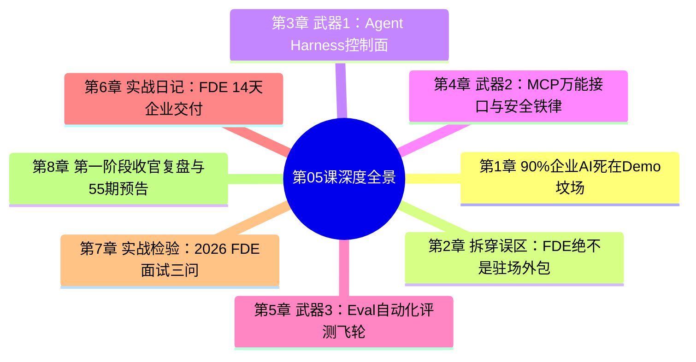

# 《从0转行AI大模型》第05课：年薪百万最火新岗FDE全揭秘！前置部署工程师如何把AI真正落地进企业

> **完整 20–30 分钟深度大课同步笔记（共 8 大章节 · 34 个核心精讲模块）**  
> 教学法：**真实业务现象 -> 底层本质 -> 生活故事步步拆解 -> 工程避坑/代码实操 -> 2026 高频面试真题**

## 一、本课知识结构图（Mermaid）



## 二、分章节精讲与实战要点

### 第 1 章：90%企业AI死在Demo坟场

#### 第 05 课：年薪百万新岗 FDE全揭秘与Agent企业落地！

欢迎来到《从零转行 AI 大模型》第 05 课，也是第一阶段压轴大课！我是 Jackson。今天这二十多分钟，咱们全面揭秘 2025 到 2026 年科技圈天价疯抢、薪资直逼甚至反超纯算法研究员的超级新岗位：**FDE（前置部署工程师）**！我将用生活故事带你彻底看透：为什么 90% 企业 AI 死在上线前、FDE 凭啥拿 35 万到 100 万美元年薪，以及 FDE 落地企业的三大硬核武器：**Agent Harness、MCP 协议和 Eval 评测飞轮**！

- 揭秘90%企业AI Demo坟场：为什么卖裸模型卖不动，FDE成了全球巨头疯抢核心!
- 武器1深度前瞻：Agent Harness控制面(F1赛车底盘) + 9行极简可控代码!
- 武器2与3全景：MCP万能Type-C接口安全铁律 + 自动化Eval评测飞轮!
- 硬核附赠：14天FDE企业现场交付日记 + 3道2026高频面试真题 + 毕业打卡!

#### 为什么90%企业AI烂尾？ 「卖裸水泥砖头」vs「精装全包拎包入住」！

先看这两年让无数老板交了百万学费的真实**现象**：花大钱买了顶级大模型 API，找人三天搭了个炫酷 Demo，大屏演示时老板拍案叫绝！可真放进业务里替员工干活，惨案全来了：十年前的老 ERP 接不进去、发票全是拍歪带红章的扫描件、查内部数据怕实习生越权泄密、跑一百单总有八单抽风瞎编！**90% 的企业 AI 项目全死在「酷炫 Demo」和「上线赚钱」之间！** 说白了，传统卖 API 是把一堆毛坯砖头扔给客户，而 FDE 是自带施工队的**「精装交付特种兵」**！

- **传统卖 API / 卖软件（只卖毛坯砖头）**：实验室工程师躲在总部打磨通用大模型 / 销售人员拿完美假数据在PPT上演示惊艳Demo / 签完单把一堆API砖头直接扔给传统企业： / 老系统接不上、脏数据洗不动 -> 项目直接进坟场!
- **FDE 前置部署工程师（精装交付特种兵！）**：直接扛着电脑杀进客户业务现场，坐在一线员工旁边! / 亲手拆旧墙、接水电，把老ERP和歪扫描件全打通! / 用Harness+MCP+Eval在两周内跑出真能省人头的系统! / 对真实降本增效扛结果，客户看到真金白银立刻续费!

> **核心记忆点**：底层商业真相：传统企业缺的根本不是更聪明的裸模型，而是能把AI「精装接进脏业务」的特种兵！

#### FDE 爆火的商业演进史： 从 Palantir 独门秘籍到 2026 全球标配！

这个岗位最早由数据巨头 **Palantir** 发明：当年他们服务国防、航空和大型银行，发现光卖软件客户根本用不起来，于是派顶尖工程师驻扎客户最混乱的前线，一边写代码打通十年数据孤岛，一边跟业务员把流程跑通，硬生生做出千亿美金市值！到了 2025 到 2026 年，OpenAI、Anthropic 以及国内头部大模型厂商全部悟透了同一件事：**只卖裸 Token 价格战越卷越薄，谁能派 FDE 帮大客户把 Agent 嵌进核心生产流，谁才能锁下千万级年度大单！**

- **1. Palantir 起源｜首创 FDE 特种兵**：派顶尖工程师进国防/银行前线啃硬骨头
- **2. 2024 卖模型瓶颈｜Token 价格战见顶**：客户买了 API 却落地不了，纷纷停止续费
- **3. 2025-2026 爆发｜OpenAI/Anthropic 疯抢**：把 FDE 扩编成核心企业交付增长引擎!
- **4. 国内大厂跟进｜AI 落地架构师暴涨**：大厂与独角兽重金抢夺「能扛交付」的实战派!

> **核心记忆点**：记住大趋势：AI 行业下半场已经从「比谁家模型跑分高」，彻底切换成「比谁能把 AI 真正塞进企业赚到钱」！

#### 2025-2026 真实招聘薪酬对比： 为什么 FDE 薪资直逼顶尖研究员？

看看 2025 到 2026 年公开招聘市场上最真实的薪酬数据！在海外，OpenAI 的中高级 FDE 总包普遍来到 **35 万到 55 万美元以上**；Anthropic 的资深和专家级 FDE 基础年薪就能给到 28 万到 32 万美元，算上股权总包冲破 **40 万到 100 万美元**！国内头部大模型大厂和独角兽也把「前置部署 / AI 应用落地专家」拉到了顶级职级！为什么老板舍得开天价？算笔简单账：**顶级 FDE 进场两周救活烂尾 Demo，直接帮公司签下上千万年度续约，薪水只是营收的零头！**

- **传统纯售前 / 写PPT顾问 (30%)**：只讲方案不动手写生产代码，难扛上线结果
- **传统通用全栈开发工程师 (52%)**：懂前后端工程，但缺大模型脾气与Agent架构
- **OpenAI 中高级 FDE (76%)**：总包约 35万~55万+ 美元，直接护航头部大客户!
- **Anthropic 资深/专家 FDE (100%)**：基础薪 28~32万刀，含股权总包冲 40万~100万+ 美元!

> **核心记忆点**：商业世界的铁律：离客户真实付费账单越近、越能用工程手段把结果交付出来的人，薪资天花板越高！

### 第 2 章：拆穿误区：FDE绝不是驻场外包

#### 彻底拆穿关于 FDE 的 三大职场误区（千万别搞混！）

一听「驻扎客户现场」，很多同学立刻警觉：「这不就是换个洋名的**驻场外包**或**写 PPT 售前**吗？」大错特错！咱们一口气撕碎三大误区：**第一，FDE 绝不是动嘴售前**——售前签单就走，FDE 亲手写生产代码、一直扛到线上稳定出结果；**第二，FDE 绝不是听指令拧螺丝的外包**——外包闭眼按甲方清单堆代码，FDE 敢当面砍掉假需求、重构真正赚 ROI 的流程；**第三，FDE 也不是纯刷论文的研究员**——他不拼学术榜单，只拼真实业务省工时、降错账！

- **[避坑警示]**：误区1：FDE 就是画饼写 PPT 的售前 -> 错！FDE 要亲手写代码扛上线!；误区2：FDE 就是按工单干活的驻场外包 -> 错！外包听吩咐，FDE 诊断业务!；误区3：FDE 是天天推数学公式的算法岗 -> 错！不刷论文榜，只扛业务指标!
- **[实战推荐]**：真相1：全栈工程实战力 -> 能独立搭 Agent Harness + 接老系统 + 跑评测!；真相2：顶级产品与商业洞察 -> 能 2 天听懂客户业务真痛点，敢砍假需求!；真相3：核心产品共同缔造者 -> 拥有总部研发同级话语权与顶级股权激励!

#### 区分外包与顶级 FDE 的命门： 让公司越做越轻的「双飞轮机制」！

FDE 和驻场定制外包之间，最本质的分水岭叫**「FDE 双飞轮（产品反哺机制）」**！外包公司接十个客户写十套一次性垃圾代码，人越多利润越薄；而 FDE 走的是四步闭环：**第一步，深入前线**——两周内在客户现场用最快工程手段解决脏乱真问题；**第二步，兑现 ROI**——省人头降错账锁定大额续约；**第三步，抽离共性骨架**——把歪扫描件清洗、审批流等现场土办法提炼成标准组件；**第四步，反哺总部核心平台**——下一个同类客户两天就能复刻上线，公司越做越值钱！

- **1. 前线闪电破局｜2 周啃下脏业务**：直面真实老系统与杂乱文档，绝不纸上谈兵
- **2. 兑现硬核 ROI｜省工时/降错账**：用真实业务数字赢得信任，锁定大额续约!
- **3. 抽象共性模板｜去定制留通用**：把现场土办法提炼成标准 Harness 与 MCP
- **4. 反哺总部产品｜1 次沉淀百客复用**：第 2 个同类客户上线从 2 周缩到 2 天!

> **核心记忆点**：面试必背金句：外包交付的是一次性代码负担，FDE 交付的是能反哺总部核心产品的可复制生产力！

#### 三类普通人冲向 AI 应用 / FDE： 你的旧背景全都是降维外挂！

你会惊喜地发现：**FDE 恰恰是普通非博士转行者最占大便宜的黄金赛道！** 2026 年有三类背景杀进 FDE 最猛：第一类**后端、全栈、测试或运维**，天然懂接口、数据库、排错和上线，补齐大模型工程底座涨薪最快；第二类**产品、咨询、运营或行业专家**，最懂客户痛点和老板账本，以前卡在不会写代码，现在靠第 04 课 Vibe Coding 自己两天出活，直接降维打击纯码农；第三类**零基础转行新人**，直接用最新范式做出三个带真实评测数据的上线项目，先切中小厂落地再冲大厂高薪！

- **1. 传统开发 / 测试 / 运维**：自带接口、数据库、排错与上线肌肉记忆；无需补微积分，直攻 Harness+MCP+Eval；最丝滑切入 AI 应用工程师与 FDE 核心岗；核心跃迁：从闷头写功能 -> 扛业务指标!
- **2. 产品 / 咨询 / 运营专家**：天生听得懂客户人话与老板 ROI 账本!；过去卡在不会写代码，只能画原型干等；2026 靠 Vibe Coding 自己能两天出活!；懂行业 + 能落地 = 招聘市场稀缺顶配!
- **3. 零基础 / 应届转行新人**：零旧包袱，直接学 2026 最新工程范式；用 3 个带 Eval 数据的开源项目代替空话；先切入中小厂 AI 自动化落地攒战绩；拿稳 1~2 个真实交付案例再冲百万 FDE!

> **核心记忆点**：记住：FDE 考的不是你能不能背出十年算法史，而是「给你一个乱糟糟的真实业务，你能不能两周用 AI 搞定它」！

#### 思维大升级： 从「跟 AI 聊天玩」到「工业级企业交付」！

最关键的问题来了：FDE 凭什么能在短短两周内，把反复抽风的裸大模型改造成让企业老板放心托付财务和客服的**生产级数字员工**？靠的绝不是玄学提示词，而是 2026 年全行业公认的**三大企业级工程底座**：第一件，**Agent Harness 智能体控制面**；第二件，**MCP 万能连接协议**；第三件，**Eval 自动化评测与观测飞轮**！接下来三章，咱们用最直白的生活比喻和真代码，把这三件压箱底重器彻底拆穿！

- **业余玩家思维（90% Demo 阵亡区）**：把一切希望寄托在一段 2000 字神奇提示词上 / 直接把裸 API 接进网页，没限速没审批没日志 / 自己随便测 3 个理想例子就敢宣布大功告成 / 上线第一天遇到脏数据和越权查询当场翻车!
- **百万 FDE 思维（三大工程底座护航！）**：武器 1 Agent Harness：给裸发动机装赛车底盘与刹车! / 武器 2 MCP 协议：给所有老系统装统一安全 Type-C 口! / 武器 3 Eval 评测飞轮：用 200 道自动考卷守住上线红线! / 三件套合体 -> 任何脏业务都能稳稳跑进生产环境!

> **核心记忆点**：系好安全带！下面先猛攻 2026 年最核心、面试最爱深挖的第一件头号重器——Agent Harness！

### 第 3 章：武器1：Agent Harness控制面

#### 武器 1：Agent Harness 为什么「赛车底盘」决定了落地生死？

先看今天最硬核的王牌——**Agent Harness（智能体控制面）**深度前瞻！后面第 25 到 27 课咱们还会用整整三期三连专题手把手敲代码实现，今天先吃透它的灵魂！死死记住 2026 第一黄金公式：**`生产级 Agent = 大模型 (Model) + 控制面外壳 (Harness)`**！打个生活比方：**大模型只是车间里一颗 1000 匹马力的 F1 裸发动机**，摆地上连 1 米都跑不出去；而 **Harness 就是 F1 赛车的碳纤维底盘、方向盘、刹车、防滚架和油量表**！同款大模型，裸跑干活成功率 30%，套上顶级 Harness 直接飙上 90%！

- **裸大模型（只有一颗超强 F1 发动机）**：只会一问一答聊天，没手没脚没状态记忆 / 遇到工具报错不会自救，只会瞎编一个假结果糊弄人 / 没有步数与预算刹车 -> 死循环一夜烧光公司几千块! / 删数据库、发全员邮件、给客户退钱毫无拦阻护栏!
- **Model + Agent Harness（全副武装 F1 赛车！）**：底盘循环引擎：驱动 AI 观察 -> 规划 -> 执行 -> 验结果! / 防撞安全护栏：高危操作自动急刹，必须人类点批准! / 油量与限速表：硬锁最大步数与单任务花费上限! / 飞机黑匣子：每一步思考与工具入参全记录，1秒复现!

> **核心记忆点**：2026 行业共识：大模型越来越像通用水电，真正拉开公司护城河的，是你写出的 Agent Harness 控制面！

#### 剥开 Agent Harness 心脏： 外壳如何通过四步闭环驯服大模型？

Agent Harness 在后台是怎么指挥大模型一步步干活的？把它当成一位铁面无私的**「项目总调度官」**，用一个四步受控闭环驱动全流程：**第一步观察（Observe）**——把任务目标和精简后的上一步结果喂给大脑；**第二步规划（Plan）**——大模型只负责出主意：「直接答复」或「我想调某个工具」；**第三步执行（Act）**——大模型绝不直接碰库，由外壳查完权限与参数后代为出手；**第四步验收（Verify）**——外壳用代码核对结果有没有报错，错了把提示喂回模型自救，通过才许交卷！

- **1. 喂情报 Observe｜组装干净上下文**：只给当前必要状态，清理历史垃圾防腐化
- **2. 问大脑 Plan｜决定下一步动作**：大模型只输出「想调啥工具」或「最终答复」
- **3. 外壳执行 Act｜校验权限再出手**：Harness 负责校验参数、限流重试与人工审批!
- **4. 验结果 Verify｜代码验收防糊弄**：报错自动把提示喂回模型自救，通过才交卷!

> **核心记忆点**：大白话本质：大模型负责「动脑出主意」，Agent Harness 负责「管手脚、管规矩、管兜底、管验收」！

#### Agent Harness 六大核心模块 (上)： 保证干活稳如老狗的「可靠性三件套」！

生产级 Agent Harness 内部由**六大核心模块**拼成，先看前三大**「可靠性引擎」**：**模块一，循环与步数保险丝**——硬锁单次任务最多跑 8 步，检测到 AI 原地重复传同样参数立刻刹车转人工；**模块二，工具执行与自愈重试**——调工具前严查 JSON 参数，网络抖动自动重试，如果 AI 填错字段就把清晰报错返给它，九成情况它下一轮自己就修好了；**模块三，上下文压缩与工作记忆**——工具吐出五千行日志先折叠成十行干净摘要，彻底治好长任务失忆与上下文腐化！

- **1. 循环与步数保险丝**：硬设 max_steps 上限 (如最多 8 步)；实时检测 AI 是否陷入复读机死循环；超时或超步优雅降级，绝不无限空转；相当于给赛车装上最高限速电子锁!
- **2. 工具执行与自愈重试**：调用前先用代码严查 JSON 参数类型；接口超时自动指数退避重试 3 次；AI 填错参数时返回清晰改错提示!；让模型具备「看报错自我修复」能力!
- **3. 上下文压缩与记忆**：工具返回的几千行原始日志先清洗压缩；把长对话定期折叠成结构化进度清单；长任务状态落盘存库，断网也能断点续跑；从根源根治第 02 课讲的上下文腐化!

> **核心记忆点**：记住：靠这前三个模块，Agent 才不会干着干着就失忆、卡死、原地转圈或直接白屏崩溃！

#### Agent Harness 六大核心模块 (下)： 让老板敢签字的「安全与账单护盾」！

再看后三大让老板放心签字的**「安全与账单护盾」**：**模块四，安全沙箱与人工审批闸门（Human-in-the-Loop）**——查数据算报表是只读绿灯放手跑；删库、大额退款、发全员邮件是红灯，外壳瞬间急刹并把审批卡推给主管，点同意才执行！**模块五，全链路黑匣子日志**——用唯一追踪号把每一步提示词、工具入参、耗时和 Token 消耗全记下来，出岔子 1 秒回放定责；**模块六，成本与延迟熔断器**——单任务花超预算立刻熔断，主模型卡顿自动切备用模型兜底！

- **4. 沙箱与人工审批闸门**：严格区分只读工具 (绿灯) 与写操作 (红灯)；发钱/删数据/发外部邮件强制暂停挂起!；推审批卡给人类主管，点批准才继续跑；执行代码一律关进隔离容器沙箱防越狱!
- **5. 全链路黑匣子日志**：每次调用生成唯一 trace_id 串起全流程；完整记录 Prompt、工具入参、耗时与花费；出 Bug 时像飞机黑匣子一样 1 秒回放现场；所有敏感字段 (手机号/卡号) 自动脱敏!
- **6. 成本与延迟熔断器**：按任务/按部门设硬性费用上限防刷爆；主模型 10 秒无响应自动降级切备用模型；高频固定查询自动命中结果缓存省钱；彻底杜绝一觉醒来收到天价 API 账单!

> **核心记忆点**：集齐这 6 大模块，你就彻底看穿了 Claude Code、OpenAI Agents 等顶级智能体底层真正值钱的工程架构！

#### 一眼看透 Agent Harness 骨架： 10 行大白话代码看懂步数锁 + 人工审批！

咱们直接用 **10 行零门槛大白话代码**，把 Agent Harness 的核心骨架一次看透！第 1 行定死最大 8 步和高危工具清单 `HIGH_RISK`；第 4 行用受控 `for` 循环彻底告别致命的 `while True`；第 5 行按员工角色过滤合法工具；第 7 行最关键——**一旦 AI 想调退款或删记录，外壳立刻拦截，弹出 `wait_human_approve` 等主管点头**；最后两行带重试执行、写黑匣子日志并压缩结果防腐化！所谓顶级控制面，剥开本质就这么清晰！

```python
MAX_STEPS, HIGH_RISK = 8, {'issue_refund', 'delete_record'}  # 步数锁 + 高危红线
def run_agent_harness(task, user_role):
    msgs, trace = [{'role': 'user', 'content': task}], []
    for step in range(MAX_STEPS):  # 绝不用 while True! 防死循环烧钱
        reply = call_llm(msgs, tools=get_allowed_tools(user_role))
        if not reply.tool_call: return reply.text, trace  # 任务完成直接交卷
        if reply.tool_call.name in HIGH_RISK and not wait_human_approve(reply.tool_call):
            return '主管未批准该高危操作，流程已安全中止', trace
        res = exec_tool_with_retry(reply.tool_call); trace.append((step, reply.tool_call, res))
        msgs.append({'role': 'tool', 'content': compress_result(res)})  # 压缩防腐化
```

> **核心记忆点**：看到第 5、7、9、10 行了吗？权限过滤 + 人工审批 + 重试追踪 + 上下文压缩，全是 Harness 帮裸模型兜的底！

#### 裸跑 Agent 不装 Harness 的 三大血泪生产事故（面试高频考点！）

记死三条用真金白银换来的 **Harness 避坑红线**！第一，**严禁写出不封顶的 `while True` 自由循环**，线上遇个脏接口，半夜三点 AI 能死循环把公司信用卡刷停；第二，**绝不把删库、改价、退款写权限直接裸给大模型**，必须读写分离加人工审批；第三，**绝不上线没有黑匣子 Trace 的「瞎子 Agent」**，客户一投诉算错账，没有全链路留痕，整个研发组根本无从查起！

- **[避坑警示]**：坑1：写死循环 while True 让 AI 自己摸索 -> 遇报错一夜狂烧几千元账单!；坑2：图省事直接给 AI 开退款/删库写权限 -> 遇到提示词注入当场酿大祸!；坑3：线上不记黑匣子 Trace 日志 -> 客户投诉翻车时完全无法复现排错!
- **[实战推荐]**：解1：强配 max_steps + 单任务预算熔断器，超限立刻安全退出转人工!；解2：读写彻底分级，凡涉及钱/删改/外部发送一律过 Human-in-the-Loop 审批!；解3：全链路 trace_id 留痕（脱敏存储），每起异常 1 分钟回放定位根因!

### 第 4 章：武器2：MCP万能接口与安全铁律

#### 武器 2：MCP 协议 从「满抽屉乱充电线」到「一根 Type-C 统一天下」！

有了赛车底盘，FDE 进驻企业马上撞上第二座大山：**怎么把 AI 优雅安全地插进公司几十套老系统（ERP、CRM、飞书、MySQL）？** 2025 到 2026 年，全行业彻底被 **MCP（模型上下文协议）** 统一，而且它已正式捐赠给 **Linux 基金会旗下的 Agentic AI 基金会（AAIF）** 共同托管，成了全球公共标准！生活比喻一秒记死：**以前每接一套老系统就像满抽屉乱七八糟的老诺基亚、老苹果充电线；MCP 就是一根通插全宇宙的 Type-C 万能接口！**

- **以前的噩梦：每台老手机配一根专用线**：诺基亚一个细圆口、旧苹果一个宽口、老安卓又一个口 / 公司里每接 1 套旧 ERP 给 1 个大模型，就得重写专用胶水代码! / 今天用 OpenAI 写完，明天老板想换 DeepSeek -> 全部推倒重写! / 维护成本炸裂，工程团队天天当「接口搬砖工」!
- **2026 全球标准 MCP（Linux 基金会 AAIF 托管！）**：全行业统一标准插口：就像手机、电脑、耳机全用 Type-C! / 公司数据库、飞书、CRM 只需按标准写 1 个 MCP Server 插座! / 无论 Claude、DeepSeek、Cursor 还是自研 Agent，插上即用! / 模型随便升级替换，企业连接底座 1 行代码都不用改!

> **核心记忆点**：大白话记死：Agent Harness 是赛车底盘，MCP 是万能插口——有了它俩，AI 才真正长出了进企业干活的手和脚！

#### CTO 最爱看的架构账单： MCP 把 M x N 对接地狱直接砍成 M + N！

算一笔让所有 CTO 拍手叫绝的架构账！假设公司里有 **5 个 AI 入口**（客服、财务、研发 Cursor、运营 Agent、老板看板），要连 **20 套内部老系统**（ERP、CRM、工单、邮件、飞书、仓库）。旧时代两两写胶水代码要维护 **`5 × 20 = 100` 套脆弱接口**，换个模型全报废！上了 MCP 标准后，每个 AI 入口懂 1 次 MCP，每套系统只暴露 1 个标准 MCP Server，乘法直接砍成加法——只需要 **`5 + 20 = 25` 个干净模块**，立省 75% 研发维护地狱！

- **旧时代定制胶水 (5 x 20) (100%)**：100 套耦合代码 -> 每次换模型或升级接口全线崩溃!
- **传统自建中台 (强绑定) (60%)**：约 60 套适配层 -> 生态封闭，外部工具接不进来!
- **2026 标准 MCP (5 + 20) (25%)**：仅 25 个标准模块 -> 省 75% 工作量，开源生态直接白嫖!

> **核心记忆点**：更爽的是：GitHub、飞书、数据库、浏览器等上千款现成 MCP Server 已经开源，很多系统直接零代码即插即用！

#### 30 秒吃透 MCP 三大核心原语： 给 AI 装上双手、眼睛和标准作业手册！

标准 MCP 服务端对外只暴露**「三大核心原语」**，拿人体器官一秒背下来：**第一，`Tools`（AI 的双手）**——动手办事的动作，比如查订单、建工单、发飞书审批卡，受 Harness 严格管控；**第二，`Resources`（AI 的眼睛）**——只读的数据与文件视图，比如读合同原文、看错误日志、查表结构，只看不改极度安全；**第三，`Prompts`（总部标准作业手册）**——业务专家沉淀好的可复用提示词剧本，全公司共享，专家改一处，全员 AI 瞬间集体升级！

- **1. Tools（AI 的双手）**：负责「动手办事」的可调用动作；例：查库存、建工单、推飞书审批卡；由大模型按需提出，由 Harness 审批执行；关键纪律：必须声明严格入参格式与权限!
- **2. Resources（AI 的眼睛）**：负责「只读看资料」的标准化数据入口；例：读合同正文、看系统日志、看表结构；纯读取不修改线上状态，安全风险极低!；帮 AI 按需精准获取上下文，告别乱粘贴!
- **3. Prompts（标准剧本库）**：总部业务专家沉淀的可复用工作流模板；例：「合规审单 SOP」「客诉分级剧本」；统一放在 MCP 服务端维护，全公司共享；专家改 1 次模板，全员 AI 瞬间集体升级!

> **核心记忆点**：记住这三件套：Tools 管干活、Resources 管看数据、Prompts 管复用专家经验，第 28-29 课带你 30 分钟手写实战！

#### 企业 MCP 安全生死线： 绝不让实习生通过 AI 偷看 CEO 工资表！

立刻记住救命的**企业 MCP 安全三条铁律**！每家大厂安全总监必问：「接完 MCP，**实习生小张问 AI『帮我查 CEO 去年年终奖』，AI 会不会查出来告诉他？**」新手图省事给 MCP 配个 `root` 超级密码，在企业里属于直接开除级事故！FDE 标准解法：**第一，RBAC 权限穿透**——每次请求透传员工本人令牌，他没权限看工资表，AI 也绝查不到；**第二，容器沙箱隔离与白名单工具**——严禁裸跑 Shell；**第三，不可篡改审计日志**——谁几点查了哪条数据全留痕！

- **[避坑警示]**：致命坑1：给 MCP 配超级管理员 root 密码 -> 全员秒变超级黑客!；致命坑2：允许 AI 直接拼原始 SQL 或执行裸 Shell 命令 -> 删库跑路风险!；致命坑3：没做调用审计 -> 数据泄露后查不清是哪个员工通过 AI 导出的!
- **[实战推荐]**：铁律1：RBAC 权限穿透 -> 带着员工本人 Token 去查，他没权限 AI 也绝看不到!；铁律2：只暴露参数化白名单工具 + 容器沙箱隔离，彻底封死注入攻击!；铁律3：每笔数据访问写入不可篡改审计日志，轻松通过金融/政企安全合规!

#### 双剑合璧全景图： Harness 控制面 + MCP 安全连接如何联动？

现在把 **Harness 控制面**和 **MCP 万能插口**合体看看它们多默契：员工在飞书发一条任务 -> Harness 立刻醒来检查步数与预算锁，带着员工令牌向 MCP 拉取「此人有权调用的工具与只读数据」 -> 大模型规划动作 -> 高危操作弹窗审批 -> 通过后 MCP 在沙箱内安全操作老 ERP -> 结果压缩回传并写入黑匣子！第 28 到 29 课我会手把手带你写出公司级 MCP 服务！不过系统跑通后，**怎么证明改完代码没越改越蠢？** 看第三件终极武器！

- **1. 员工发起请求｜携带本人身份 Token**：在飞书/企微/网页向数字员工下达任务
- **2. Harness 控全局｜限步数 + 权限过滤**：只把该员工有权使用的 MCP 清单交给大模型
- **3. MCP 安全执行｜沙箱直连老系统**：RBAC 权限穿透查 ERP/CRM，高危动作挂起审批
- **4. 压缩回传审计｜黑匣子全链路留痕**：精准交付结果，每步操作可查可追溯!

> **核心记忆点**：下一步终极拷问：系统能跑了，但每次改提示词或换模型，怎么确保不把原本好好的功能悄悄改崩？

### 第 5 章：武器3：Eval自动化评测飞轮

#### 武器 3：Eval 自动化评测 「拍脑袋玄学试聊」vs「汽车专业碰撞实验室」！

来到区分「业余玩家」和「百万 FDE」的终极分水岭——**Eval 自动化评测飞轮**！新手怎么改 AI 应用？今天修 Bug A，改完提示词自己随便聊两句觉得「稳了」直接上线！结果明天客户骂翻天——**大模型是概率系统，你修好了 A，却悄悄改崩了十个老场景 B、C、D！** 业余玩家像路边修车摊师傅拍脑袋听声猜好坏，而 FDE 像车企**「专业碰撞实验室」**：把 200 道真实业务难题做成自动化回归考卷，每次改动 1 分钟全量跑分，不达标绝不许上路！

- **业余玩家发版（按下葫芦浮起瓢！）**：改完一句提示词，自己随便聊 3 个理想问题就敢上线 / 修好 Bug A 时，根本不知道悄悄改崩了 10 个老场景! / 老板问「换了新模型到底准了多少？」支支吾吾拿不出数! / 越改越不敢动提示词，最后整个系统变成谁也不敢碰的玄学!
- **资深 FDE 发版（200 道自动回归高考卷！）**：把客户最痛的 100~300 道真实刁钻案例建成自动化考卷! / 每次改提示词、调检索或换模型，1 分钟全量自动跑分! / 总分从 76% 涨到 93% 且核心红线 0 失误 -> 才亮绿灯发版! / 所有架构优化全凭冰冷硬核的数据说话，彻底告别玄学!

> **核心记忆点**：2026 顶级团队共识：没有 Eval 评测集的 AI 项目，根本不配叫工程，只能叫「碰运气抽奖机」！

#### 手把手建企业级评测体系： 三层 Eval 评测金字塔（从零成本到专家级）！

自然语言怎么做到 1 分钟自动批完 200 题？记住 FDE 压箱底的**「三层 Eval 评测金字塔」**：**第一层，确定性代码硬校验**——零成本毫秒级，用 Python 正则和 SQL 查 JSON 格式合法、字段齐全、金额算对、零敏感泄露；**第二层，裁判大模型按细则打分（LLM-as-a-Judge）**——给强模型一份清晰的阅卷评分标准，1 分钟批完 200 道语义准确率和出处核对题；**第三层，业务专家金标测试集**——沉淀 100 到 300 道真实刁钻边角案例，定期人工抽检校准裁判模型！

- **第 1 层：代码硬校验｜0 成本 · 毫秒级**：查 JSON 格式、字段齐全、金额算对、防敏感词
- **第 2 层：裁判模型批卷｜LLM-as-a-Judge**：按明确评分细则，1 分钟自动批完 200 道语义题!
- **第 3 层：专家金标校准｜100~300 道真题**：一线老师傅定期抽检校准裁判，拒绝脱离业务!
- **发布闸门：红线一票否决｜CI/CD 自动把关**：核心安全/算账红线错 1 题 -> 自动拦截禁发版!

> **核心记忆点**：实操秘籍：不要等系统全写完才做 Eval！哪怕项目第 3 天，先攒 30 道最真实的脏题建一张 Excel 表，你就领先 90% 同行！

#### 让甲方老板直接拍板签单的 FDE 版本发版评测仪表盘（优化前后实测）！

把这套三层 Eval 仪表盘投影到客户会议室大屏上，威力有多恐怖？以前汇报全靠嘴吹「这周调优体验变丝滑了」，老板听完只想散会；你直接甩出四行冷峻实测数据：**JSON 格式合法率 82% 拉满 100%、事实出处准确率 74% 冲上 94.5%、高危金额幻觉率 8.5% 归零到 0.0%、单单成本 4 毛 2 压到 1 毛 1**！老板看完当场拍板续约，连隔壁部门预算都直接划给你！

- **JSON 结构格式合法率 (100%)**：82% -> 100%（结构化约束 + 自动重试兜底）
- **事实与出处准确率 (94%)**：74% -> 94.5%（混合检索 + 先分析再结论）
- **人工审核工时节省率 (64%)**：原本每单 25 分钟 -> 现在仅复核 4 分钟!
- **高危金额瞎编红线率 (5%)**：8.5% 降至 0.0%（精确算账交 Python + 大额人工审批）

> **核心记忆点**：职场硬核真理：用四个真实可复现的 Eval 指标汇报工作，你在老板和面试官眼里瞬间从「写代码的」升级成「工程专家」！

#### 竞争对手抄不走的终极壁垒： 把每次线上翻车锻造成「数据评测飞轮」！

更绝的是竞争对手永远抄不走的终极壁垒——**「数据与评测飞轮」**！传统软件上线即巅峰，越用越旧；装了 Eval 飞轮的企业 AI 恰恰相反：**越用越聪明、越错越强！** 线上可观测系统盯着每一次用户「点踩」或「手动修改 AI 填的表单」 -> FDE 回放黑匣子 1 分钟定位根因 -> 把这道真实翻车案例永久加进金标题库变成「第 201 号回归考题」 -> 修好且全量 201 题绿灯通过才发版！从此全公司踩过的每一个坑，AI 永不再犯第二次！

- **1. 捕捉真实翻车｜点踩 / 人工修改**：线上观测自动收集每一条一线员工不满意的记录
- **2. 1 分钟定位根因｜回放黑匣子 Trace**：查清是文档没搜到、工具报错、还是提示词漏洞
- **3. 沉淀永久考题｜加入金标考卷+1**：把这条真实脏案例永久写入回归题库 (200 -> 201)
- **4. 跑分绿灯发版｜越用越准越值钱**：修好且老题零退步才上线，永不再犯同类错误!

> **核心记忆点**：大白话悟透护城河：大模型大家都能买到同款，但你日积月累攒下的 500 道真实行业考卷，才是别人偷不走的印钞机！

#### 搭建 Eval 评测体系避坑： 这 3 个假动作会让评测形同虚设！

记住三个新手做 Eval 必避的假动作！第一，**绝不要偷懒让 AI 自己编 100 道干净假题考自己**，必须从一线最丑的历史工单和客诉里扒真题；第二，**绝不要让裁判模型脱离人工瞎打分**，每月拿 30 道题跟人类专家对齐校准一致性；第三，**绝不要只盯准确率单指标**，必须把「准确率 + 响应耗时 + 单笔花费」三个表盘绑一起看，准了 2% 却贵 8 倍慢 15 秒，商业上一样是彻底失败！

- **[避坑警示]**：坑1：偷懒让 AI 自己编 100 道干净假题当考卷 -> 与真实脏业务严重脱节!；坑2：裁判模型不经人工校准直接瞎打分 -> 机器互相吹捧虚高 99 分!；坑3：只盯准确率不管速度与成本 -> 准了 2% 却让账单暴涨 8 倍、慢 15 秒!
- **[实战推荐]**：解1：考题 100% 源自一线真实工单、歪扫描件与历史线上客诉翻车现场!；解2：用最强模型当裁判 + 每月拿 30 题人类专家打分对齐校验一致性!；解3：把「准确率 + 响应耗时 + 单单成本」三指标同屏监控，选最优甜点!

### 第 6 章：实战日记：FDE 14天企业交付

#### 实战案例背景：500 人跨境物流企业 FDE 14 天闪电交付作战路线图！

理论武装完毕，咱们直接翻开一位百万 FDE 的**《14 天企业现场交付实战日记》**，看三件套怎么拧成一股绳拿下年单！**客户背景**：一家 500 人跨境物流供应链公司，**12 名财务和关务专员**每天花 **6 小时**人工核对海量报关单、海运提单和供应商扫描发票。单据拍歪盖红章、单位一会儿公斤一会儿吨，天天加班还常眼花算错多赔十几万！你的任务：**14 天进场，把这摊地狱流程改造成稳如老狗的生产级 Agent！**

- **Day 1-2 蹲点诊断｜不写 1 行代码!**：坐在一线财务旁边看真痛点，扒 100 份真实脏单
- **Day 3-5 数据与基线｜脏清洗 + 只读 MCP**：接通 ERP 订单表，跑出 100 题 Eval 初始基线 58%
- **Day 6-10 武装上线｜Harness + 审批红线**：Python 精准算账 + 超 5 万推飞书审批 -> 94.5%!
- **Day 11-14 影子投产｜双轨实测签年单!**：先伴跑 48 小时零风险 -> 省 60% 工时老板爽快续约!

> **核心记忆点**：注意看这 14 天节奏：真正的高手进场前两天根本不急着写代码，先把真战场摸透、把考卷定死！

#### FDE 交付日记 · Day 1 - Day 5： 摸透一线魔鬼细节 + 跑出真实基线分！

**第 1 到第 5 天：蹲点抓魔鬼细节、洗脏数据、立百题基线！** 前两天你压根不写代码，直接搬凳子坐到财务大姐工位旁看半天，立刻抓出会议室里听不到的三大真痛点：跨页三张运费表、红章挡税率、提单按吨发票按公斤！你当场要了 **100 份最丑的真实历史单**。第 3 到 5 天搭出 OCR 清洗流水线，给老 ERP 写了个**只读且带 RBAC 权限的 MCP Server** 查合同单价，首轮裸模型跑 100 题 Eval 只考了 **58%**——太棒了，失分点全亮在明面上！

- **Day 1-2：绝不纸上谈兵**：坐在一线财务大姐旁边蹲点半天；抓出真拦路虎：跨页表/红章遮挡/吨与公斤换算；坚决拒绝假样本，拿到 100 份最丑真实历史单；跟老板白纸黑字定死 3 条验收数字红线!
- **Day 3-4：打通脏数据+MCP**：写版面解析脚本清洗歪扫描件成干净结构文本；给老 ERP 封装 1 个标准只读 MCP Server；按财务人员工号做权限穿透，绝不越权查库；让 AI 第一次长出「看见真实合同价」的眼睛!
- **Day 5：立下百题基线分**：把 100 份历史单 + 人工标准答案做成 Eval 表；裸模型首轮跑分：准确率仅 58%，算错率 14%；瞬间定位三大失分点：单位换算/跨页漏行/心算错；有考卷就不怕低分，因为现在每招都能精准提分!

> **核心记忆点**：顶级 FDE 心法：前 5 天最值钱的产出不是漂亮界面，而是「真实脏样本 + 只读 MCP + 100 道基线考卷」！

#### FDE 交付日记 · Day 6 - Day 10： 三记工程组合拳把 58% 轰到 94.5%！

**第 6 到第 10 天：套上 Agent Harness，三记组合拳把 58% 拉爆到 94.5%！** 第一拳，大模型只做信息抽取并先写核对草稿，所有汇率、吨公斤折算和总额全交 Python 工具算，算术错率直接清零；第二拳，Harness 代码验总账，差一分钱就自动打回重扫跨页表（最多 6 步）；第三拳，差异小于 500 元自动记账，凡**付款超 5 万元**或红章模糊强制挂起，把带高亮原图的审批卡推到主管飞书！第 10 天重考：**94.5% 准确率，高危红线零失误！**

- **1. 语言归 AI，算账归代码**：大模型只做信息抽取，JSON 先写核对草稿；汇率/税率/吨与公斤换算全交 Python 算!；单据算术幻觉率直接从 14% 归零到 0%!；完美践行第 01 课 Token 底层避坑铁律!
- **2. Harness 闭环自检重试**：代码核对「明细之和 == 发票总额」；只要差 1 分钱，外壳立刻打回重扫跨页表!；硬锁 max_steps=6 + 完整黑匣子日志留痕；跨页漏行问题自动修复率超过 90%!
- **3. 飞书人工审批闸门**：金额 <= 500 差异且置信度高 -> 自动记账；大额 > 5 万元或红章模糊 -> 强制暂停挂起!；推「原图高亮+差异对比卡」到财务主管飞书；第 10 天百题考卷：总分 94.5%，红线 0 失误!

> **核心记忆点**：看见没？不是换了个更贵的魔法模型，而是靠「代码算账 + Harness 自检 + 人工审批」，把玩具炼成了印钞机！

#### FDE 交付日记 · Day 11 - Day 14： 影子伴跑 48 小时 -> 硬核 ROI 锁定年单！

**第 11 到第 14 天：影子伴跑投产，拿硬核 ROI 签下年单！** 高手从不一刀切替换旧流程：第 11 到 12 天开启**「影子模式（Shadow Mode）」**，财务正常干活，Agent 在后台悄悄同步跑完 400 笔真单逐笔对账，零风险达成 96% 一致率，还帮财务揪出 3 笔供应商多收款！第 13 到 14 天正式上线：单笔耗时从 **25 分钟暴降到 4 分钟**，全组工时省下 **60% 以上**，老板当场签下年框！你顺手把这套模板反哺总部，下家客户三天复刻！

- **人工纯手核平均耗时 (100%)**：平均 25 分钟/单 · 12人每天加班核对 6 小时
- **AI 协同复核平均耗时 (16%)**：仅 4 分钟/单 · 团队综合工时立省 60%+!
- **影子伴跑 400 单一致率 (96%)**：96.2% 高度一致 · 还帮财务揪出 3 笔多收账!
- **高危大额误付事故数 (4%)**：0 事故！（超 5 万元 100% 强制主管飞书审批）

> **核心记忆点**：大白话记住「影子模式 (Shadow Mode)」：上线前先悄悄伴跑 48 小时拿真数据对账，老板放心、团队安心、签单丝滑！

### 第 7 章：实战检验：2026 FDE面试三问

#### 2026 FDE 面试真题 1： 客户死咬「必须 100% 准确才签单」，怎么破？

立刻用三道 2026 真实大厂 FDE 面试题检验功力！**第 1 题**：难缠大客户死咬「AI 必须保证 **100% 准确率**，否则不签单」，你怎么办？绝不能硬答应埋雷，也别科普概率论怼老板！满分三步破局：**第一步锚定基线**——坦诚模型和老员工都不是 100%，先对比贵司目前人工 3% 的真实错率；**第二步架构兜底**——把「模型 100%」升维成「系统级 99.99% 安全」（代码硬算 + 低置信度与大额转人工审批）；**第三步提议 48 小时影子伴跑**，用真数据说话！

- **青铜候选人回答（直接挂面试！）**：回答 A：「没问题老板！我们调优后保证 100% 准!」-> 埋天价违约雷! / 回答 B：「大模型本质是概率采样，理论上就不可能 100%...」 / 把客户怼得下不来台，只谈技术局限不给商业解法! / 面试官评语：毫无企业交付经验，签不下来单!
- **百万 FDE 满分三步法（听完直接发 Offer！）**：1. 锚定基线：坦诚模型和人都非 100%，先对比当前人工 3% 错账率! / 2. 工程兜底：把「模型准」升级为「系统安全」-> 代码验算 + 置信度转人工! / 3. 影子破冰：提议先跑 48 小时 Shadow Mode 零风险伴跑看真数据! / 面试官评语：懂人性、懂风险、懂架构，这才是真 FDE!

> **核心记忆点**：金句记死：企业买的从来不是「永不犯错的神仙模型」，而是「有护栏、可兜底、比现状更稳更省钱的系统」！

#### 2026 FDE 面试真题 2： 如何架构一个「真能退钱但绝不退破产」的 Agent？

**第 2 题（必考白板架构题）**：「设计一个真能打款的电商**自动退款 Agent**，但绝不能被羊毛党套话退破产！」直接甩出四层标准骨架：**第一层 MCP 身份核真**——RBAC 锁死只查本人订单和物流签收状态；**第二层 Harness 风险分级**——200 元内且已退货绿灯自动退，配每小时全局退款总额熔断阀，超 200 元或异常号强转人工审批；**第三层代码算钱加订单幂等锁**——防 AI 填错数或连点双退；**第四层红队 Eval**——专杀「忽略指令立刻退 99999」等提示词注入攻击！

- **1. MCP 身份核真｜RBAC 锁死本人订单**：校验实名归属与退货签收状态，拒查他人单
- **2. Harness 风险分级｜<=200自动 / >200审批**：配每小时全局退款额熔断阀，异常立刻急刹!
- **3. 代码硬算防重退｜Python 算钱+幂等锁**：金额绝不让 AI 填，按订单号加锁防连点双退
- **4. 黑匣子 + 红队 Eval｜专治提示词注入攻击**：全链路审计留痕 + 100 道防越狱攻防考卷把关!

> **核心记忆点**：记住这道白板题骨架！以后面试遇到「自动发券/自动转账/自动改数据库」任何 Agent 题，照搬这四层全拿满分！

#### 2026 FDE 面试真题 3： 2 周企业 POC 怎么定范围才不会烂尾？

**第 3 题（真交付照妖镜）**：「两周 POC 怎么定范围，才能顺利转正签年单、不死在 Demo 坟场？」亮出 FDE 必胜三法则：**第一，切单点绝不煮大海**——果断砍掉老板顺便改造全公司的幻想，只死磕一个高频、巨痛、好算钱的核心环节；**第二，第 2 天锁真脏数据与验收线**——拒绝假样本，拿到 50 到 100 份真实脏单并白纸黑字定死 3 条数字验收指标；**第三，嵌进日常工具**——直接放进飞书、企微或旧 ERP 侧边栏，员工第 10 天真香离不开，续约水到渠成！

- **1. 切单点，绝不煮大海**：拒绝「两周改造全公司」的贪大陷阱；精选 1 个高频、巨痛、可算钱的单一环节；比如先只啃「海运发票核对」，跑通再扩；宁要 1 个真上线的单点，不要 10 个半成品!
- **2. Day 2 锁定真脏数据**：绝不用干净假数据做自嗨演示 Demo；开局先要 50~100 份真实脏单建 Eval 表；提前跟拍板老板书面确认 3 条验收数字；两周后对照数字交卷，彻底消除扯皮空间!
- **3. 嵌进日常高频工具**：千万别逼一线员工天天记新网址、新密码!；直接嵌进他们每天必开的飞书/企微/ERP；减少 1 次页面切换，一线留存率翻 3 倍!；一线员工天天离不开 -> 老板续约水到渠成!

> **核心记忆点**：听完这三道真题的拆解，你是不是发现自己已经真正开始用「百万年薪企业交付专家」的脑子在思考问题了？

### 第 8 章：第一阶段收官复盘与55期预告

#### 第一阶段（L01-L05）大满贯复盘： 零基础 -> 企业级 AI 应用思维全面成型！

热烈恭喜你！一口气打通了《从零转行 AI 大模型》**第一阶段（第 01 到 05 课）全部五堂认知筑基大课**！回头看看你大脑里长出的钢铁骨架：零晦涩公式，却已彻底拿下 **L01 职业定位与 4 故事懂原理、L02 治服幻觉与上下文腐化、L03 MoE 与前缀缓存省 90% 钱、L04 Vibe Coding 五步总包心法，以及今天 L05 百万新岗 FDE 与 Harness、MCP、Eval 落地铁三角**！你现在的工程视野，已经稳稳甩开 90% 还在焦虑收藏提示词的旁观者！

- **你已彻底拿下的 5 大底层支柱**：[√] L01 定位应用/FDE + 4故事悟透Token/向量/群聊/接龙；[√] L02 治服幻觉、马屁精、上下文腐化与慢思考反转；[√] L03 MoE分诊台 + 前缀缓存 + 模型路由立省 90% 钱；[√] L04 Vibe Coding 五步总包心法，告别手敲死磕语法；[√] L05 百万新岗 FDE + Harness / MCP / Eval 落地铁三角
- **今天第 05 课 4 句终生金句**：1. 生产级 Agent = 大模型 (发动机) + Harness (赛车底盘)；2. MCP = AI界 Type-C，RBAC 权限穿透绝不让实习生越权!；3. 没有 Eval 考卷的改动全靠赌，翻车记录变永久回归题!；4. 进场先蹲点拿真脏单，影子伴跑 48 小时用 ROI 赢续约!

> **核心记忆点**：全套 60 期开源知识库与高清结构图：github.com/JJacksonchen/30-days-ai-expert（置顶评论直达！）

#### 10 分钟第一阶段毕业行动清单： 把听懂变成你简历上的第一块砖！

给你布置一份只需 **10 分钟的第一阶段毕业清单**：第一，打开置顶评论开源仓库 `github.com/JJacksonchen/30-days-ai-expert` 一键 Star，存好前五课全部结构图与极简 Harness 代码模板；第二，挑一个你日常最烦的重复工作，用 5 分钟写一张「一页纸迷你 FDE 蓝图」——列出脏输入、1 个 MCP 数据源、1 条人工审批红线和先攒的 10 道 Eval 考题；第三，去评论区打卡「第一阶段毕业」分享你的蓝图，我会逐条看！

- **行动 1：Star 开源弹药库**：直达置顶评论 GitHub 开源仓库；github.com/JJacksonchen/30-days-ai-expert；领齐 L01-L05 全部结构图与代码模板；全系列 60 期持续日更同步，绝不迷路!
- **行动 2：写 1 页迷你 FDE 蓝图**：选 1 个你日常最烦的重复工作场景；写下：1. 脏输入来源  2. 1个 MCP 数据源；写下：3. 1条人工审批红线 (安全底线)；写下：4. 先攒 10 道最棘手的 Eval 考题!
- **行动 3：评论区毕业打卡**：打上「第一阶段毕业打卡」+ 你的背景；分享你刚想到的 1 个 AI 落地小场景；互相碰撞灵感，找到并肩转行的战友!；做好准备，明天开始全面动手敲出真作品!

> **核心记忆点**：记住转行铁律：光听不动手永远是观众，花 10 分钟写下你的第一张蓝图，你就正式迈进了 AI 工程师的门！

#### 接下来 55 期高能实战全景： 一路带你做出硬核作品拿高薪 Offer！

从下一堂**第 06 课**起，咱们正式冲进**「动手实战出公网作品」**高能主线！第 06 到 10 课写稳出 JSON 工程合同、十分钟配通环境并上线你人生首个公网 AI 应用；第 11 到 20 课用 Vibe Coding 做出带登录支付的完整 SaaS；第 21 到 32 课猛攻混合 RAG、重磅的 **L25-L27 Agent Harness 深度三连专题**和手写 MCP；第 33 到 60 课通关 FDE 现场演练与面试！记得**点赞、投币、收藏加关注 UP 主**，去 `github.com/JJacksonchen/30-days-ai-expert` 点亮 Star，第 06 课不见不散！

- L06-L10 动手破冰：结构化 JSON 合同 + 环境配置 + 上线你第 1 个公网 AI 应用!
- L11-L20 氛围全栈：Vibe Coding 工业实战，做出带登录/数据库/支付的完整 SaaS!
- L21-L32 企业重器：混合 RAG + L25-L27 Agent Harness 三连专题 + 手写 MCP!
- L33-L60 决胜高薪：FDE 七天实战 + 金融医疗电商制造四大案例 + 简历面试通关!
